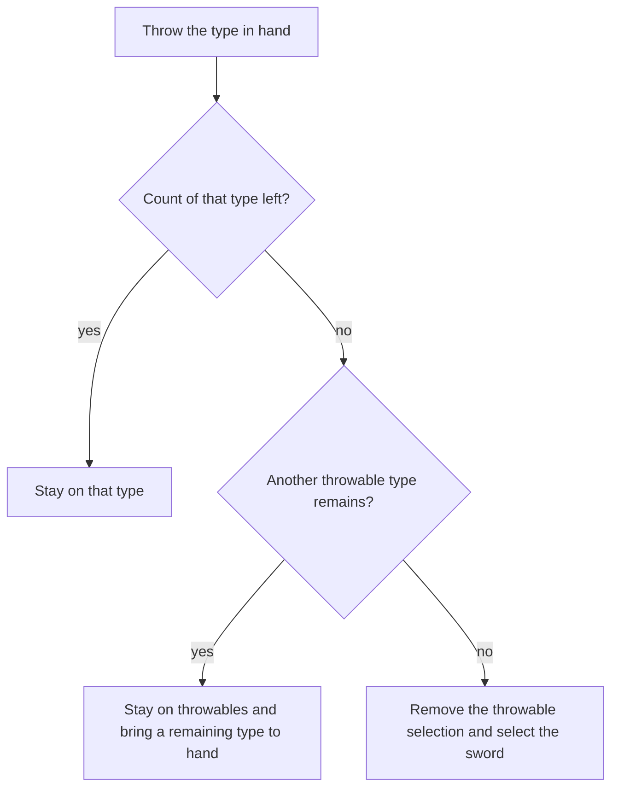
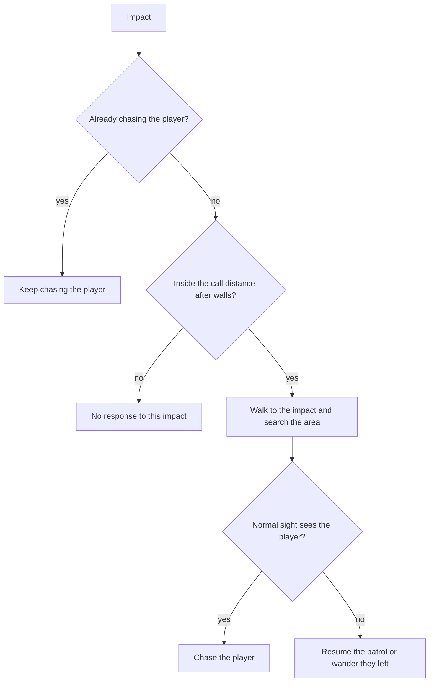
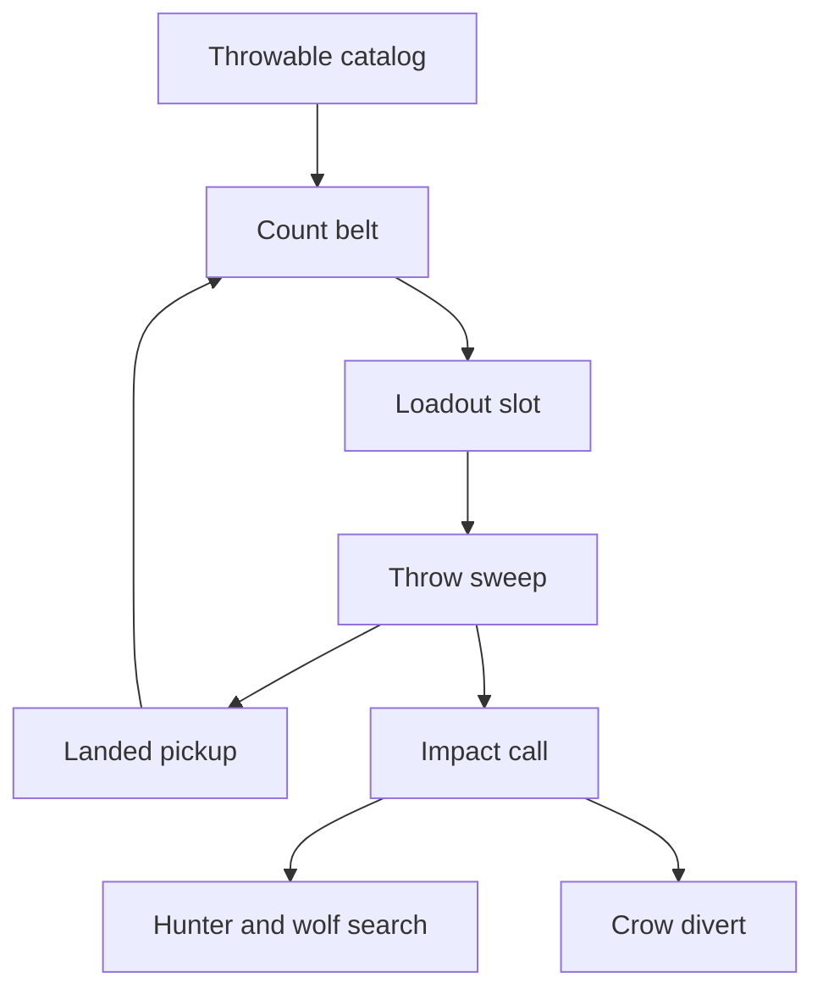
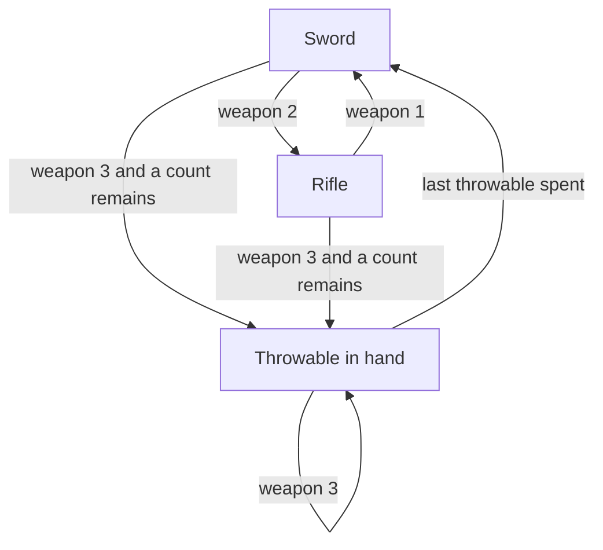
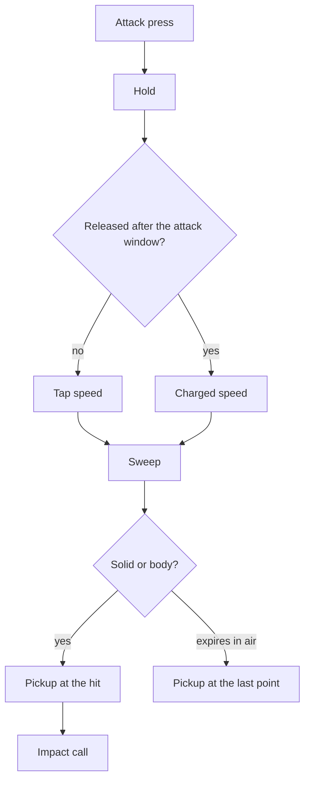
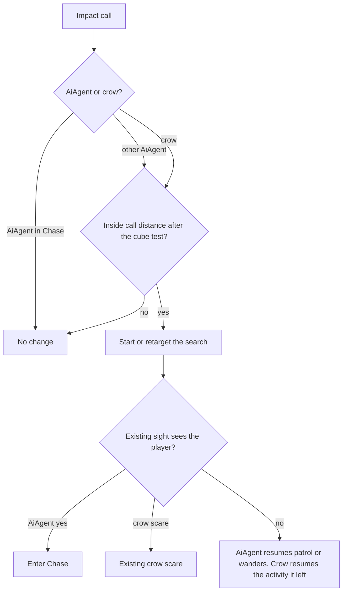
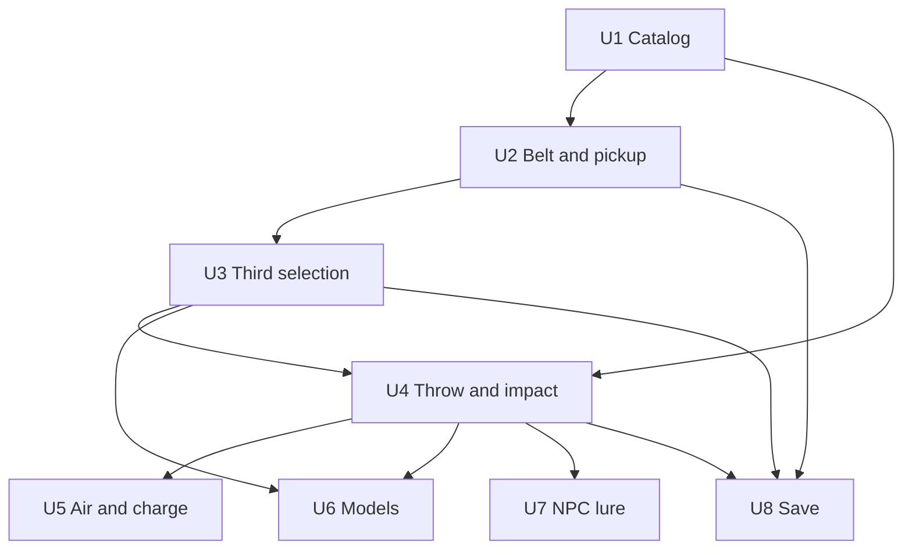

# Throwables - Plan

## Goal Capsule

- **Objective:** The player can place a noise away from themselves by throwing an object, and NPCs who are not already chasing the player go look there. An AiAgent then resumes its patrol, or wanders if it has none, and a crow resumes the flock, perch, or forage it left.
- **Means:** A third loadout selection throws a counted object, and the impact places a lure that is separate from footstep hearing (KTD1, KTD4, KTD8).
- **Product authority:** Player-facing behavior was confirmed on 2026-10-23. The tap strength, the search time and area, retargeting, which walls count, save behavior, and leaving the two play modes separate were confirmed on 2026-10-24. Planning may not change who is called, what a throw spends, or what an impact does.
- **Open blockers:** None.
- **Execution:** code
- **Stop:** Stop if sword or rifle air attacks start throwing, or if footstep hearing starts a search.

---

## Product Contract

### Summary

Throwables become a third loadout selection with a counted belt. A swept throw lands as a pickup and places a lure that nearby NPCs walk to. Sword and rifle attacks stay as they are, in both play modes.

### Problem Frame

The player can already avoid notice by crouching, using cover, and staying quiet. Hearing the player starts a chase. There is no way to make a sound in a chosen place so a nearby NPC leaves a patrol, looks there, and then gives up. Without that, stealth is only about not being noticed.

### Key Decisions

- **Third weapon** (session-settled: user-directed — chosen over the pack or a grab straight into the hand: selection sits with the sword and the rifle). Governs R3, R6, R8.
- **Counted throws that return** (session-settled: user-directed — chosen over infinite throws or one type replacing another: a throw spends one and the landing can be picked up). Governs R4, R5.
- **Three selections, throwable cycles** (session-settled: user-directed — chosen over a key per type or replacing the rifle: sword and rifle stay in place). Governs R3, R5.
- **Pickup keeps the current weapon** (session-settled: user-directed — chosen over switching to the throwable or requiring it already in hand: the sword stays out). Governs R2.
- **Empty throwables return to the sword** (session-settled: user-directed — chosen over empty hands or a slot with nothing to throw: a remaining type stays on the throwable selection). Governs R5, R16.
- **Air throw** (session-settled: user-directed — chosen over a jump attack, or a tap throw with a held leap: sword and rifle keep the air jump attack). Governs R6, R8.
- **Charge in the air** (session-settled: user-approved — chosen over a grounded charge only: air and ground share the tap and the charged throw). Governs R6, R17, R19.
- **Charged reach, weight changes the drop** (session-settled: user-directed — chosen over weight always landing short, or weight leaving the flight unchanged: a heavier item needs a higher aim). Governs R7, R19.
- **Per-item sound and call distance** (session-settled: user-directed — chosen over one shared range or loudness only for the player: a bottle can call from farther than a rock). Governs R9, R10.
- **Distraction, not a hit** (session-settled: user-directed — chosen over damage or using the object up: the landing stays a pickup). Governs R4.
- **Search the area, then resume** (session-settled: user-directed — chosen over turning in place or looking from where they stand: they walk the spot and then go back). Governs R13.
- **Normal sight during the search** (session-settled: user-directed — chosen over finishing the search blind, or chasing on any glimpse: crouch and cover still hide the player). Governs R18.
- **Chase stays on the player** (session-settled: user-directed — chosen over breaking off or switching to a closer impact: the throw is a lure for everyone else). Governs R15.
- **Footsteps still chase** (session-settled: user-approved — chosen over turning all hearing into a search: only an impact starts the search). Governs R14.
- **Walls shorten the call** (session-settled: user-directed — chosen over a hard block or distance with no regard for walls). Governs R11.
- **A body is an impact point** (session-settled: user-directed — chosen over scenery only, or ignoring a hit on the player: a hit on you can call others to you). Governs R12.
- **Every NPC who is not chasing** (session-settled: user-approved — chosen over hunters and wolves only: the confirmed scope includes any other NPC who is not chasing). Governs R10, R13.

### Actors

- A1. The player. Sees throwables, picks them up, selects them, and throws them.
- A2. NPCs. Hunters, wolves, and any other NPC. They answer a call or stay on a chase.
- A3. The content author. Sets each throwable's weight, throw distance, impact sound, call distance, and model.

### Requirements

**Carrying**

- R1. While a throwable is the weapon in hand, the player sees its authored model there, and that same model is the object on the ground and in flight.
- R2. Picking a throwable up adds one to that type's count and leaves the weapon in hand unchanged.
- R3. The player selects among sword, rifle, and throwable, and pressing the throwable selection again cycles the types whose count is above zero.
- R4. A throw spends one of the type in hand, and the object that lands is a pickup of that same type.
- R5. Spending the last of a type brings a remaining type to hand on the throwable selection.
- R16. Spending the last throwable selects the sword and removes the throwable selection until a pickup adds a count.



**Throwing**

- R6. With a throwable in hand, attack throws it on the ground and in the air.
- R17. A charged release throws farther than a tap.
- R19. A charged throw can reach the item's throw distance.
- R7. A heavier throwable drops faster, so reaching its throw distance takes a higher aim than a lighter item with the same distance.
- R8. With the sword or the rifle in hand, an attack in the air is a jump attack.

**Authoring**

- R9. Each throwable's weight, throw distance, impact sound, call distance, and render model are read from a JSON file.

**NPC reaction**

- R10. An impact calls every NPC who is not already chasing the player, out to that item's call distance, centered on the impact.
- R11. A wall between the NPC and the impact shortens that call distance.
- R12. The impact point includes a hit on the player or on another creature.
- R13. A called NPC walks to the impact, searches a small area around it, then resumes the patrol or wander they left.
- R18. Normal sight of the player during that search starts a chase.
- R14. Hearing the player, including footsteps, still starts a chase.
- R15. An NPC already chasing the player keeps chasing through an impact.



### Key Flows

- F1. Pick up
  - **Trigger:** The player picks up a throwable while any weapon is in hand.
  - **Actors:** A1
  - **Steps:** The count for that type increases by one. The weapon in hand stays. The world object is gone until one is thrown.
  - **Outcome:** That type can be selected later.
  - **Covers:** R1, R2
- F2. Select and throw
  - **Trigger:** The player selects a throwable and attacks.
  - **Actors:** A1
  - **Steps:** The authored model is in the hand. A tap throws shorter than a charged release. The charged release can reach the item's throw distance. One count is spent. The object lands as a pickup.
  - **Outcome:** The landing can be picked up to restore the count.
  - **Covers:** R1, R3, R4, R6, R7, R17, R19
- F3. Run out
  - **Trigger:** A throw spends the last of a type.
  - **Actors:** A1
  - **Steps:** A remaining type comes to hand per R5. If no throwable count remains, the sword comes to hand per R16.
  - **Outcome:** The player is not left on an empty throwable selection.
  - **Covers:** R5, R16
- F4. Impact
  - **Trigger:** A thrown object hits something.
  - **Actors:** A1, A2
  - **Steps:** The impact plays that item's sound at the hit. NPCs inside the call distance after walls, and not already chasing, search the area per R13. Normal sight during that search starts a chase per R18. An NPC already chasing stays on the player per R15.
  - **Outcome:** The impact is a lure for NPCs who were not already chasing.
  - **Covers:** R10, R11, R12, R13, R14, R15, R18

### Acceptance Examples

- AE1. A chase ignores the impact
  - **Covers:** R15
  - **Given:** A hunter is chasing the player.
  - **When:** A rock hits the ground off to the side, inside that hunter's call distance.
  - **Then:** The hunter keeps chasing the player.
- AE2. Sight during the search starts a chase
  - **Covers:** R18
  - **Given:** A wolf is wandering and is not chasing the player.
  - **When:** A bottle lands inside the call distance and the player then steps into normal sight.
  - **Then:** The wolf chases the player.
- AE3. A hidden player is left behind
  - **Covers:** R13
  - **Given:** A hunter is on patrol and the player stays out of normal sight.
  - **When:** A rock lands inside the call distance.
  - **Then:** The hunter searches around the landing and then returns to that patrol.
- AE4. The last rock leaves the bottle
  - **Covers:** R5
  - **Given:** The throwable selection is active, with one rock and at least one bottle.
  - **When:** The player throws the rock.
  - **Then:** The throwable selection stays and a bottle is in hand.
- AE5. The last throwable returns the sword
  - **Covers:** R16
  - **Given:** The player has one rock and no other throwable.
  - **When:** The player throws the rock.
  - **Then:** The sword is in hand, and the throwable selection is gone until a pickup adds a count.
- AE6. Pickup leaves the sword out
  - **Covers:** R2
  - **Given:** The sword is in hand and a rock is on the ground.
  - **When:** The player picks the rock up.
  - **Then:** The rock count increases by one and the sword stays in hand.
- AE7. A charged throw in the air
  - **Covers:** R6, R17, R19
  - **Given:** A throwable is in hand and the player is in the air.
  - **When:** The player releases a charged attack.
  - **Then:** The throwable is thrown farther than a tap.
- AE8. The rifle still jump-attacks
  - **Covers:** R8
  - **Given:** The rifle is in hand and the player is in the air.
  - **When:** The player attacks.
  - **Then:** The player jump-attacks and does not throw.
- AE9. A wall can hide a quiet impact
  - **Covers:** R11
  - **Given:** A wolf is beyond a wall, inside a rock's open call distance and outside the shortened distance.
  - **When:** The rock hits on the other side of the wall.
  - **Then:** The wolf does not come.
- AE10. A louder item can still call through a wall
  - **Covers:** R9, R11
  - **Given:** The same wolf and wall as AE9, and a bottle whose shortened call distance still reaches the wolf.
  - **When:** The bottle hits on the other side of the wall.
  - **Then:** The wolf comes to search.
- AE11. A hit on the player calls others there
  - **Covers:** R12
  - **Given:** A hunter is not chasing, and the call distance reaches from the player to that hunter.
  - **When:** A thrown rock hits the player.
  - **Then:** The hunter comes to the player.
- AE12. Footsteps still start a chase
  - **Covers:** R14
  - **Given:** A wolf is not chasing, and the player sprints inside footstep hearing.
  - **When:** The player does not throw.
  - **Then:** The wolf chases.
- AE13. Weight changes the aim
  - **Covers:** R7
  - **Given:** Two throwables share a throw distance and differ in weight.
  - **When:** The player uses a full charge on each with the same aim.
  - **Then:** The heavier one drops sooner, and a higher aim can still land it at the authored distance.
- AE14. The throwable selection cycles types
  - **Covers:** R3
  - **Given:** The player carries rocks and bottles, and a rock is in hand.
  - **When:** The player presses the throwable selection again.
  - **Then:** A bottle is in hand and the rock count is unchanged.

### Success Criteria

A play session can see a throwable, pick it up, select it, throw it, and watch an NPC who was not chasing search the landing and then resume.

### Scope Boundaries

- An impact deals no damage.
- The object does not break, shatter, or disappear on impact. It remains a pickup until someone picks it up.
- The call is the impact sound. The object does not keep making noise after it lands.
- NPCs do not pick up or throw throwables.
- Player movement noise is unchanged per R14.

#### Deferred to Follow-Up Work

- Merging the sandbox and editor combat ticks into one function.
- Adding footstep hearing to editor play. Editor play does not emit stride noise today.
- Treating hills or round cover as walls. The call uses the cube test that guard hearing already uses.
- Reloading the throwable catalog during play.

### Dependencies / Assumptions

- Normal sight is the sight test hunters and wolves already use, including crouch, cover, and the sight cone. Planning does not add a second sight rule for this search.
- Already chasing means the AiAgent Chase leaf. Patrol, wander, search, suspicion, memory, assist, and flee are not that exclusion, so those NPCs answer a call per R10. Crows do not chase.
- Resume for an AiAgent means the patrol or wander they left when the call started. An AiAgent with no patrol wanders. A crow resumes the flock, perch, or forage it left.
- The JSON file is read when content loads. This plan does not require changing it during play.
- The same pickup, selection, throw, and NPC reaction apply in sandbox play and in editor play.
- Today an airborne attack jump-attacks before the weapon fires, and attack charge is disabled in the air. R6, R8, R17, and R19 are the change for a throwable in hand.
- Today wolves do not investigate a placed noise, and hearing the player forces a chase for wolves and for hunters that are not awareness guards. R10 and R14 keep those as separate outcomes.
- Hunter brain leaves today are wander, chase, memory, assist, and flee. There is no investigate leaf. R13 is the behavior, whatever planning uses to get there.
- Spawners are not NPCs. The NPC kinds in play are hunters, wolves, and crows.

### Sources / Research

- `Gameplay/Item.h` and `Gameplay/Item.cpp` define the item catalog in code. Kinds today are sword, rifle, medkit, helmet, chest plate, and flashlight. Definitions have no weight, throw distance, call distance, sound, or model field. No throwable or bottle item exists.
- `Weapons/WeaponLoadout.h` is a two-slot loadout. `activeKind()` treats every non-zero slot as the rifle. `selectSlot` clamps to 0 or 1.
- `Save/PersistCombat.cpp` writes the loadout slot and rejects a slot outside 0..1 before cooldowns are applied. `WeaponLoadoutComponent::kSaveVersion` is 1.
- `Sandbox/SandboxApp.cpp` and `Editor/EditorPlay.cpp` each start a jump attack on an airborne attack press before the loadout fires, and each disables attack charge while airborne. Hard crowd control and a busy jump attack return before fire. Sandbox swimming still fires the loadout. Editor play does not swim.
- `content/entities/player.entity.input.json` binds `weapon_1` to Digit1 and `weapon_2` to Digit2. Digit3 is the editor place key for a particle, and place mode does not run during play.
- `Combat/HoldCharge.h` treats a release before the hold window as a tap and a release after it as the charged action. The attack window default is 0.40 seconds. Clearing `canChargeAttack` resets the hold with no fire. A weapon swap does not clear the hold by itself.
- `AI/AiSystem.cpp` turns player hearing into a chase for wolves and for hunters that are not awareness guards. Placed noises feed the guard meter only, up to 32 events, and wolves do not read those noises. `sightBlocked` tests cubes. `wallScale` defaults to 0.5.
- `AI/Brain.h` and `content/ai/hunter.hsm.json` leaves are wander, chase, memory, assist, and flee. Flee returns before a See transition.
- `AI/Awareness.h` sends an awareness guard who is investigating to the notice point and then looks around. That look is not a search of the area. Awareness defaults off, so ordinary hunters are not guards.
- `Play/Crow.h` keeps crows on flock, perch, forage, and flee. They are not AiAgent leaves. `simulateCrows` runs from both play hosts.
- `Character/ItemView.cpp` renders current pickups as `models/unit_cube.gltf`. Sandbox pickup calls `giveItem` into the bag. Editor play has no give path. The pickup action is marked sandbox-only.
- `Weapons/ProjectileWeapon.cpp` simulates rifle shots inside the weapon. An impact plays audio and does not leave a pickup. `weaponSweepClosest` hits target bounds and terrain, and it does not see the cubes and spheres that stop the player.
- `Character/SwordView.cpp` attaches the equipped sword to `R_Hand` from sandbox play only. Editor play does not sync that visual. The sword mesh is built from cubes.
- `Character/SkillCatalog.cpp` is the fail-closed JSON pattern: parse with the non-throwing form, and a bad file leaves the previous catalog in place.
- `Render/CrosshairHud.cpp` draws two weapon cells.
- New engine and test sources are picked up by the recursive globs in `cmake/DarkEngineTargets.cmake` and `UnitTests/CMakeLists.txt`.

---

## Planning Contract

### Key Technical Decisions

- KTD1. The third selection is loadout slot 2. `WeaponKind` gains a throwable kind. `selectSlot` accepts 0, 1, and 2, and `activeKind()` returns that kind instead of treating every non-zero slot as the rifle. The selection is available only while some throwable count is above zero. Pressing it again cycles catalog order to the next type with a count above zero. Both play hosts bind `weapon_3` to Digit3 and leave the editor place binding in place for edit mode. The HUD draws the third cell only while the selection exists. (session-settled: user-directed — chosen over the pack or a grab straight into the hand: selection sits with the sword and the rifle). Cites R3, R5, R16.
- KTD2. Counts live on a belt beside the loadout, keyed by catalog id. A throwable pickup adds one, destroys that world object, and does not call `giveItem`. The weapon in hand stays. A full bag still accepts the pickup. Editor play uses the same pickup action for throwables and does not grow a bag. Sandbox play and editor play each stock one rock and one bottle near the player start when the scene does not already have them. Cites R2.
- KTD3. The catalog is `content/items/throwables.json`, loaded once at content start by both hosts. Parse follows `SkillCatalog`: the non-throwing JSON parse, a temporary object, and commit only on full success. A missing file keeps the built-in rock and bottle. A bad file keeps the previous catalog. Each entry has id, weight, throw distance, impact sound, call distance, and model. The sample bottle uses `models/unit_glass.gltf` and a longer call than the rock. The sample rock uses a single stone mesh already under `content/models/` and is heavier than the bottle. The two impact clips are different files already under `content/audio/`. Cites R9.
- KTD4. Flight is a sweep owned by the throwable, not `Weapon::fire` and not a dynamic physics body. Launch origin is the camera fire origin so the crosshair matches the arc. Weight multiplies throw gravity. Charged launch speed is solved per item so some aim reaches that item's throw distance on flat ground. Tap launch speed is 0.55 of the charged speed. (session-settled: user-approved — chosen over a tap that can reach the authored distance: the tap stays clearly short of a full charge). Cites R7, R17, R19.
- KTD5. The sweep hits terrain, character bodies, and the cubes and spheres that stop the player. The thrower is ignored on the opening segment so the throw can leave the body. A later hit on the thrower or on any other body counts, and the search point is the world position at that hit. The point does not follow a moving body. Impact spawns a pickup of the same type, plays that item's impact clip, and does not damage, stagger, or alert through the weapon hit path. The object is not a pickup while it is in flight. If the flight expires in open air, the pickup still appears at the last point. Another throw may be in flight when count remains. Cites R4, R12.
- KTD6. Both play hosts keep their own combat ticks and call one shared predicate. When a throwable is selected, an airborne attack throws and charge stays armed in the air. Sword and rifle keep the jump attack, and their charge still clears in the air. (session-settled: user-approved — chosen over a grounded charge only: air and ground share the tap and the charged throw). Cites R6, R8, R17, R19.
- KTD7. Hard crowd control and a busy jump attack drop the attack hold and do not throw. Release before the 0.40 second attack window is the tap. Release after it is the charged throw. The window ending while the button is held does not fire. Jump, air time, and landing do not clear a hold that belongs to a throwable. A weapon swap leaves the hold armed, and the release uses whatever is in hand then. Swapping to the sword or the rifle while airborne clears the hold with no fire, because those weapons cannot charge in the air. Sword swing-lock and the melee cooldown do not block a throw. Where sandbox swimming already fires the loadout, a throwable throws on release. Cites R6, R17.
- KTD8. An impact posts its own call. It does not use `addNoise` and it does not move the guard meter. The call queries every AiAgent whose leaf is not Chase, and every crow. Distance is the item call distance, multiplied by `wallScale` when the existing cube sight test hits a cube. Hills and round cover leave the distance unchanged. An agent already in Chase ignores the call. Footstep hearing keeps its current chase path. (session-settled: user-approved — chosen over treating hills or round cover as walls: only the blocks that already muffle a guard shorten the call). Cites R10, R11, R14, R15.
- KTD9. A called AiAgent gets a search overlay for 9 seconds inside a 4 meter radius. The overlay walks to the impact, then through points inside that radius, and it owns movement so the brain mover does not overwrite it. Existing sight, including sight forced by footsteps, clears the overlay and enters Chase. Flee does not gain a new transition. When the timer ends, an agent with a patrol resumes it, and otherwise wanders. A new impact that reaches someone who is searching retargets that search and restarts the timer. A crow flies to the impact and then resumes the flock, perch, or forage it left, unless its existing scare replaces the search. (session-settled: user-approved — chosen over finishing the first search: a newer landing that reaches them replaces it). Cites R13, R18.
- KTD10. The hand, the ground pickup, and the in-flight object use the catalog model. The hand model is placed on `R_Hand` in both play hosts and is hidden when a throwable is not selected. A missing model logs and skips the mesh. The throw still spends and still lands. Cites R1.
- KTD11. The existing loadout record accepts slot 0, 1, and 2. Throwable counts, the active type, and in-flight throws are optional fields on that record. A missing field loads as zero counts and no flight. A throwable slot with zero counts selects the sword on load. An old record still applies. Keep save version 1 unless a version bump is the only way those old records survive. An in-flight throw resumes on load and still becomes a pickup on impact. (session-settled: user-approved — chosen over leaving the third selection unsaved: the selection and counts travel with the weapon slot). Cites R3, R4, R16.

### High-Level Technical Design

The catalog feeds the belt. The belt decides whether slot 2 exists and which type is in hand. The sweep reads that type, and the impact writes a pickup plus a lure. Hunters and wolves consume the lure as an overlay. Crows consume it as a short divert. Save reads and writes the slot, the counts, and any flight still in the air.



Slot 2 exists only while a count is above zero. A press on that slot advances the type. Spending the last count of every type returns to the sword and removes the slot until a later pickup.



A press charges through the existing hold. Release chooses tap or charged speed, spends one, and starts the sweep. The sweep ends on a solid, a body, or expiry, and every ending leaves a pickup.



The lure ignores Chase. Everyone else is tested after the wall shorten. A hit starts or retargets the search. Sight during that search enters Chase for an AiAgent.



### Assumptions

- Already chasing is the Chase leaf. An awareness Alert that has not entered Chase still answers a call.
- Editor play does not swim and does not emit stride noise. This plan does not add either.
- The 0.55 tap fraction, the 9 second search, and the 4 meter radius are the confirmed tuning for R13, R17, and R19.

### Sequencing

U1 lands the catalog. U2 and U3 add the belt and the third selection. U4 throws. U5, U6, and U7 branch from the throw. U8 waits until the slot, the counts, and in-flight throws exist.



### Risks

- A missed `activeKind()` call site will fire a throwable as a rifle shot. U3 and U4 have to update every branch that assumes two kinds, including shoot skill and the swing lock.
- Widening the saved slot without optional fields will reject old loadout records. U8 fails the unit if a slot 0 record with no throwable fields does not load.
- The search overlay will lose to the next brain tick if the mover still runs. U7 keeps the overlay in front of wander, flee, and guard movement for that agent.
- Reusing `weaponSweepClosest` alone lets a throw pass through player-blocking cubes. U4 includes those solids.
- Digit3 stays bound to editor placement. The weapon press runs only in play, matching Digit1 today.

### Alternatives Considered

- A dynamic physics body was the existing pickup toss. It does not report a reliable impact, and it does not leave a deterministic test of throw distance. The sweep does both.
- The guard investigate meter already walks to a noise and looks around. Wolves never read it, awareness defaults off, and the look stays in place. A separate overlay is the search R13 describes.
- A selection stored outside the loadout would avoid `selectSlot`. Save, the HUD, and both fire branches already key off that slot. Extending the slot keeps one selection path.

### System-Wide Impact

- Save records for the weapon loadout grow optional fields. Old records stay valid.
- Sandbox play and editor play both change attack, weapon keys, pickup, and the hand mesh. Their combat ticks stay separate and share the air-throw predicate.
- Hunter ticking and crow simulation both gain a lure. Footstep hearing and `addNoise` stay on their current paths.
- The player input map gains `weapon_3`. Editor placement keys stay bound for edit mode.

---

## Implementation Units

### U1. Throwable catalog

- **Goal:** Authors can define a rock and a bottle, and a bad file cannot wipe a good catalog.
- **Requirements:** R9
- **Dependencies:** None
- **Files:** `Gameplay/ThrowableCatalog.h`, `Gameplay/ThrowableCatalog.cpp`, `content/items/throwables.json`, `Sandbox/SandboxApp.cpp`, `Editor/EditorAppInit.cpp`, `UnitTests/Gameplay/ThrowableCatalogTests.cpp`
- **Approach:**
  - Add a catalog with the fields in KTD3 and built-in rock and bottle defaults.
  - Load it from both hosts at content start, once.
  - Commit a parsed file only when every entry is complete. Reject a file that omits a required field.
  - Use the non-throwing JSON parse. Do not throw.
- **Patterns to follow:** `Character/SkillCatalog.cpp` temp-then-commit load. `content/skills/skills.json` for a versioned object file.
- **Test scenarios:**
  - A file with a rock and a bottle loads weight, throw distance, impact sound, call distance, and model for each.
  - A missing file keeps the built-in rock and bottle.
  - A broken file keeps the catalog that was already loaded.
  - An entry missing throw distance does not replace the catalog.
  - The bottle's call distance in the sample file is longer than the rock's, and the bottle's weight is lower.
- **Verification:** The catalog tests pass, and both hosts call the same load.

### U2. Belt and pickup

- **Goal:** Picking up a throwable adds a count and leaves the weapon in hand alone.
- **Requirements:** R2, F1, AE6
- **Dependencies:** U1
- **Files:** `Gameplay/ThrowableBelt.h`, `Gameplay/ThrowableBelt.cpp`, `Sandbox/SandboxApp.cpp`, `Editor/EditorPlay.cpp`, `content/entities/player.entity.input.json`, `UnitTests/Gameplay/ThrowableBeltTests.cpp`
- **Approach:**
  - Store counts on the belt from KTD2, not in `InventoryComponent`.
  - In sandbox pickup, a catalog id adds one and destroys the entity. Any other pickup still calls `giveItem`.
  - Bind the pickup action so editor play can take a throwable. Do not add editor bag items.
  - Stock one rock pickup and one bottle pickup near the player start in sandbox play and in editor play when the scene has none.
- **Patterns to follow:** `Sandbox/SandboxApp.cpp` `pickUpNearestItem` for the aim test. `Character/ItemView.cpp` `destroyPickup` for cleanup.
- **Test scenarios:**
  - Covers AE6. Pickup of a rock while the sword is selected adds one, the sword stays selected, the entity is gone, and the bag count is unchanged.
  - Pickup of the type already in hand adds one and stays on that type.
  - A full bag still accepts a throwable.
  - An unknown item id still uses the bag path.
  - Editor play pickup of a throwable adds the belt count and does not create a bag stack.
- **Verification:** Belt tests pass, and a sandbox pickup of a non-throwable still stacks in the bag.

### U3. Third selection

- **Goal:** The player can select the throwable slot and cycle the types they carry.
- **Requirements:** R3, R5, R16, F3, AE4, AE5, AE14, KTD1
- **Dependencies:** U2
- **Files:** `Weapons/Weapon.h`, `Weapons/WeaponLoadout.h`, `Weapons/WeaponLoadout.cpp`, `Weapons/WeaponLoadoutComponent.h`, `Play/CharacterAttach.cpp`, `Sandbox/SandboxApp.cpp`, `Editor/EditorPlay.cpp`, `content/entities/player.entity.input.json`, `Render/CrosshairHud.cpp`, `UnitTests/Weapons/WeaponTests.cpp`, `UnitTests/Weapons/WeaponLoadoutComponentTests.cpp`, `UnitTests/Scene/EntityInputTests.cpp`
- **Approach:**
  - Extend the loadout per KTD1. Update every `activeKind()` branch so slot 2 is not the rifle.
  - Show the slot only when a count is above zero. A press cycles catalog order.
  - Spending the last of one type selects the next remaining type. Spending the last of all types selects the sword.
  - Bind `weapon_3` to Digit3 without removing the editor place action.
  - Draw the third HUD cell only while the selection exists.
- **Execution note:** Add a failing test that slot 2 is a distinct kind before changing `selectSlot`, because the current tests expect a clamp to the rifle.
- **Patterns to follow:** `Weapons/WeaponLoadout.cpp` `selectSlot`. `UnitTests/Scene/EntityInputTests.cpp` for Digit1 shared by a place action and a weapon action.
- **Test scenarios:**
  - Covers AE14. With rocks and bottles carried and a rock in hand, the throwable press puts a bottle in hand and leaves both counts unchanged.
  - Covers AE4. Throwing the last rock while a bottle remains stays on the throwable selection and puts the bottle in hand.
  - Covers AE5. Throwing the last throwable selects the sword, and the throwable press does nothing until a pickup adds a count.
  - `selectSlot(2)` with every count at zero does not leave the slot on throwable.
  - Slot 0 stays melee and slot 1 stays projectile.
  - `weapon_3` is Digit3, and the editor place action on Digit3 remains.
- **Verification:** Loadout tests pass with three kinds, and a rifle press still selects the projectile kind.

### U4. Throw and impact

- **Goal:** A tap and a charged release throw the object, and the landing is a pickup of that type.
- **Requirements:** R4, R6, R7, R12, R17, R19, F2, AE13, KTD4, KTD5
- **Dependencies:** U1, U3
- **Files:** `Weapons/ThrowableFlight.h`, `Weapons/ThrowableFlight.cpp`, `Sandbox/SandboxApp.cpp`, `Editor/EditorPlay.cpp`, `UnitTests/Weapons/ThrowableFlightTests.cpp`
- **Approach:**
  - Simulate the sweep from KTD4 and KTD5. Do not call `Weapon::fire`.
  - Solve charged speed so a higher aim can reach the authored distance under that item's gravity. Use 0.55 of that speed for a tap.
  - Spend the count when the throw starts. Spawn the pickup only when the sweep ends.
  - Play the impact clip at the hit the way a rifle plays its hit clip.
  - Include player-blocking cubes and spheres in the sweep.
- **Patterns to follow:** `Weapons/ProjectileWeapon.cpp` gravity step and sweep. `Play/WeaponFire.h` camera origin.
- **Test scenarios:**
  - On flat ground, the solved charged pitch lands at the authored throw distance within a small tolerance.
  - Covers AE13. Two items share a throw distance. At the same aim, the heavier one lands closer. A higher aim on the heavier one still reaches the distance.
  - A tap at 0.55 charged speed lands closer than the charged throw.
  - An impact spawns a pickup of the same id at the hit and plays that item's clip.
  - A hit on a body stores that world position and does not parent the pickup to the body.
  - The opening segment ignores the thrower. A later intersection with the thrower counts as a hit.
  - Expiry in open air still spawns the pickup at the last point.
  - A cube that blocks the player stops the throw.
  - The impact applies no damage and does not emit a weapon hit.
  - Two throws can be in flight when the count allows it.
- **Verification:** Flight tests pass without a physics world, and a rifle shot still does not leave a pickup.

### U5. Air throw and charge

- **Goal:** A throwable throws on the ground and in the air, and the sword and rifle still jump-attack.
- **Requirements:** R6, R8, R17, AE7, AE8, KTD6, KTD7
- **Dependencies:** U3, U4
- **Files:** `Play/WeaponFire.h`, `Sandbox/SandboxApp.cpp`, `Editor/EditorPlay.cpp`, `UnitTests/Play/ThrowableAirTests.cpp`
- **Approach:**
  - Add the shared predicate from KTD6 and call it from both combat ticks. Do not merge the ticks.
  - Keep charge armed in the air only while a throwable is selected.
  - Apply the hold rules in KTD7. Sword and rifle airborne behavior stays on the current path.
- **Execution note:** Characterize the rifle airborne jump attack before changing the early return, and keep that test after the throwable branch exists.
- **Patterns to follow:** `Sandbox/SandboxApp.cpp` and `Editor/EditorPlay.cpp` airborne blocks. `Combat/HoldCharge.cpp` for tap versus charged release.
- **Test scenarios:**
  - An airborne throwable press does not start a jump attack and arms the hold. The throw starts on release as a tap or a charged throw under KTD7.
  - Covers AE7. An airborne charged release throws farther than an airborne tap.
  - Covers AE8. An airborne rifle press jump-attacks and does not throw.
  - Hard crowd control during a throwable hold resets the hold and does not throw.
  - A busy jump attack blocks the throw.
  - The sandbox swim path throws a selected throwable on release.
  - Landing does not cancel a throwable hold.
  - A hold started on a throwable, then swapped to the rifle before release, fires the rifle.
  - The editor predicate matches the sandbox predicate for airborne throwable, airborne rifle, and airborne sword.
- **Verification:** Air tests pass, and the existing jump-attack tests still pass.

### U6. Hand, ground, and flight models

- **Goal:** The player sees the authored model in the hand, on the ground, and in flight.
- **Requirements:** R1, F1, F2, KTD10
- **Dependencies:** U1, U3, U4
- **Files:** `Character/ThrowableView.h`, `Character/ThrowableView.cpp`, `Character/ItemView.cpp`, `Sandbox/SandboxApp.cpp`, `Editor/EditorPlay.cpp`, `UnitTests/Character/ThrowableViewTests.cpp`
- **Approach:**
  - Place the catalog model on `R_Hand` while a throwable is selected, in both play hosts.
  - Use that model for the landed pickup and for the in-flight draw. Do not use `models/unit_cube.gltf` for a throwable.
  - Hide the hand model when the sword or rifle is selected.
  - A missing model logs and skips the mesh. The count and the flight still work.
- **Patterns to follow:** `Character/SwordView.cpp` joint lookup and pose multiply. `Character/ItemView.cpp` spawn and destroy.
- **Test scenarios:**
  - With a throwable selected, the hand entity uses the catalog model and the `R_Hand` joint.
  - The landed pickup and the in-flight draw use that same model.
  - Selecting the sword hides the throwable hand model.
  - A missing model leaves the entity absent, logs, and does not fail the throw.
  - Editor play runs the same hand sync.
- **Verification:** View tests pass, and the sword visual still attaches for a melee selection in sandbox.

### U7. NPC lure and search

- **Goal:** An impact calls NPCs who are not chasing, they search the spot, and then they resume.
- **Requirements:** R10, R11, R13, R14, R15, R18, F4, AE1, AE2, AE3, AE9, AE10, AE11, AE12, KTD8, KTD9
- **Dependencies:** U4
- **Files:** `AI/AiSystem.h`, `AI/AiSystem.cpp`, `Play/Crow.h`, `Play/Crow.cpp`, `Sandbox/SandboxApp.cpp`, `Editor/EditorPlay.cpp`, `UnitTests/AI/ThrowableLureTests.cpp`, `UnitTests/Play/CrowTests.cpp`
- **Approach:**
  - Post the impact call from KTD8. Leave `addNoise` and the footstep path alone.
  - Run the overlay from KTD9 for AiAgents. Skip that agent's leaf mover while the overlay is active.
  - On sight, enter Chase and clear the overlay. Do not add a Flee-to-Chase edge in `content/ai/hunter.hsm.json`.
  - On timeout, resume patrol when the agent has one, otherwise wander.
  - Retarget when a later call reaches an agent who is already searching.
  - Divert a crow to the impact, then restore its previous crow state unless its existing scare fires.
  - Feed the same call from sandbox hunter tick and editor hunter tick.
- **Patterns to follow:** `AI/AiSystem.cpp` `sightBlocked` and `wallScale` multiply. `UnitTests/AI/WolfApproachTests.cpp` for a cube that shortens a noise. `Play/Crow.cpp` state changes.
- **Test scenarios:**
  - Covers AE1. An agent in Chase does not change target when an impact lands inside its call distance.
  - Covers AE3. A patrol agent outside sight walks to the impact, visits a point inside 4 meters, and after 9 seconds is back on that patrol.
  - Covers AE2. Sight during the search enters Chase.
  - Covers AE9. An agent beyond one cube, inside the open call distance and outside that distance times `wallScale`, does not search.
  - Covers AE10. A longer call distance still reaches that agent after the same shorten.
  - Covers AE12. Sprint hearing still enters Chase and does not start a search.
  - A second impact inside the shortened distance retargets the search and restarts the 9 seconds.
  - An agent in Flee answers the call, and sight during the search enters Chase without a new HSM edge.
  - Covers AE11. A non-chasing hunter within call distance comes to the stored position of a hit on the player.
  - A crow in Perch diverts to the impact and then returns to Perch when the timer ends.
  - The impact does not append an `addNoise` event.
  - Editor hunter tick honors the same call.
- **Verification:** Lure tests and crow tests pass, and the existing guard-noise wall test still passes.

### U8. Save the selection and counts

- **Goal:** Old saves still load, and a throwable selection comes back with its counts.
- **Requirements:** R3, R4, R16, KTD11
- **Dependencies:** U2, U3, U4
- **Files:** `Save/PersistCombat.cpp`, `Weapons/WeaponLoadoutComponent.h`, `UnitTests/Save/ThrowableSaveTests.cpp`
- **Approach:**
  - Accept slot 0, 1, and 2 on the existing loadout record.
  - Write counts, the active type, and in-flight throws as optional fields. A missing field is zero, not a failed record.
  - On load, a throwable slot with zero counts selects the sword.
  - Restore an in-flight throw so it can still land as a pickup.
  - Keep save version 1 if old records still apply. Bump it only when that is required for old records to survive, and migrate slot 0 and 1 with zero counts.
- **Execution note:** Characterize a slot 0 record with no throwable fields before widening the accepted range.
- **Patterns to follow:** `Save/PersistCombat.cpp` `captureLoadout` and `applyLoadout`.
- **Test scenarios:**
  - Slot 2, a rock count, a bottle count, and the active type round-trip.
  - An old record with slot 0 and no throwable fields loads as the sword and zero counts.
  - Slot 1 still loads as the rifle.
  - Slot 2 with zero counts loads as the sword.
  - A slot outside 0..2 fails the record.
  - An in-flight rock round-trips and becomes a rock pickup when the restored sweep hits.
- **Verification:** Save tests pass, and a current loadout record without throwable fields still restores melee and projectile cooldowns.

---

## Verification Contract

Build and run the test target, then build both play hosts:

```bash
cmake --build build --config Debug --target UnitTests
build\bin\Debug\UnitTests.exe
cmake --build build --config Debug --target Sandbox
cmake --build build --config Debug --target Editor
```

The throw, belt, air, lure, view, and save tests added by U1 through U8 pass. Existing weapon, jump-attack, hold-charge, awareness, wolf-noise, crow, and entity-input tests still pass.

A Debug sandbox session can pick up the stocked rock and bottle, select them, throw a tap and a charged throw, and watch a non-chasing NPC search the landing and then resume. Editor play can do the same when those pickups are present.

---

## Definition of Done

- R1 through R19 hold, including the air throw, the charged reach, the wall shorten, and the search that resumes.
- U1 through U8 test scenarios pass under the Verification Contract commands.
- Sandbox and Editor Debug builds link.
- An old weapon-loadout save loads, and a saved throwable selection restores its counts.
- Sword and rifle air attacks still jump-attack.
- Footstep hearing still starts a chase.
- No `try`, `catch`, or `throw` is added under engine or Sandbox paths.
- Abandoned attempt code is removed before the work is called done.
