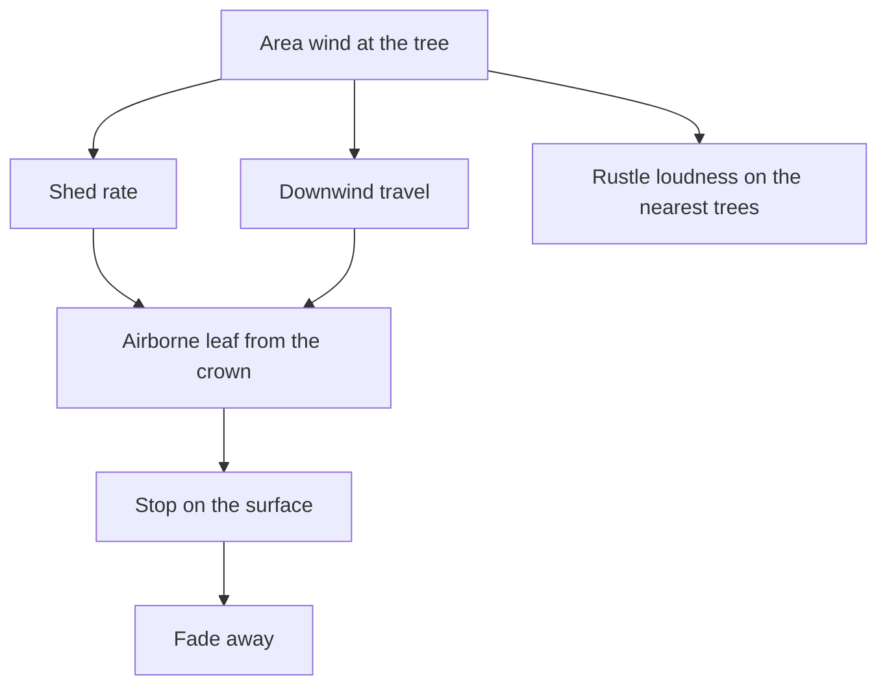
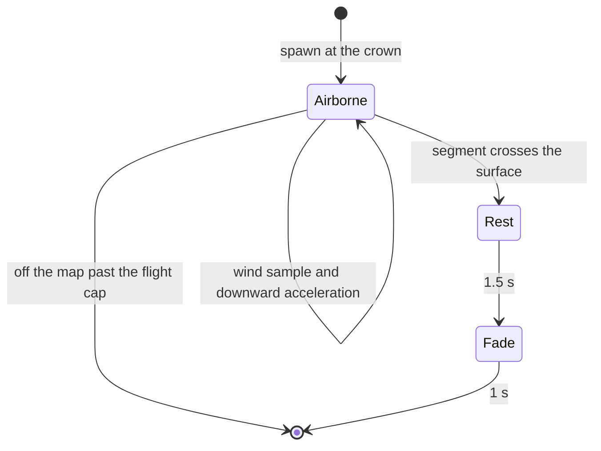
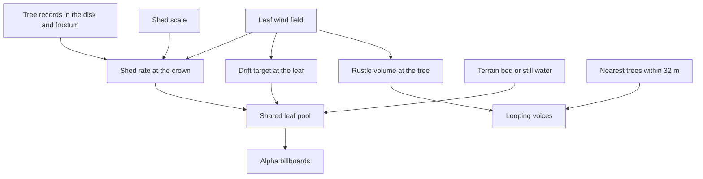
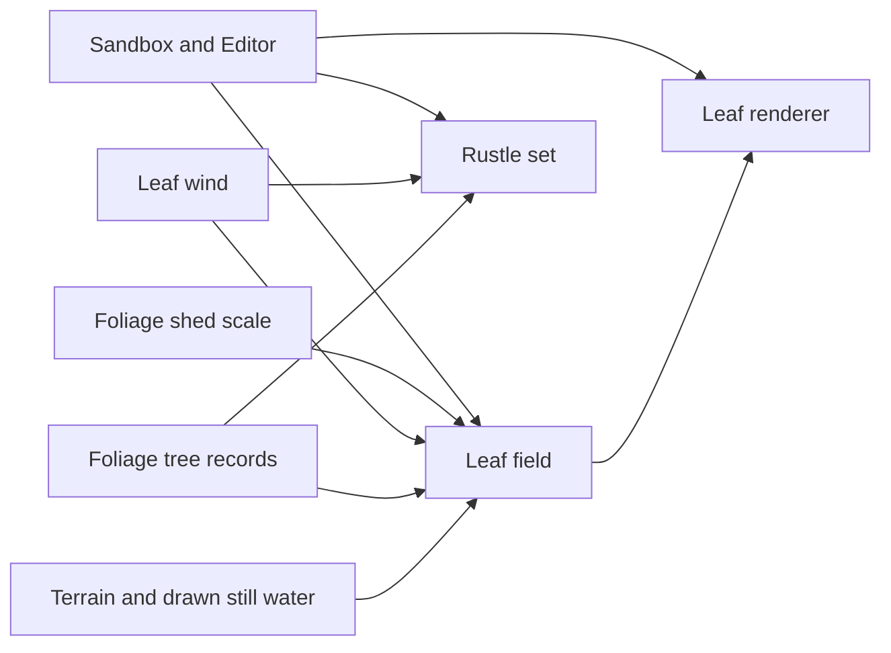
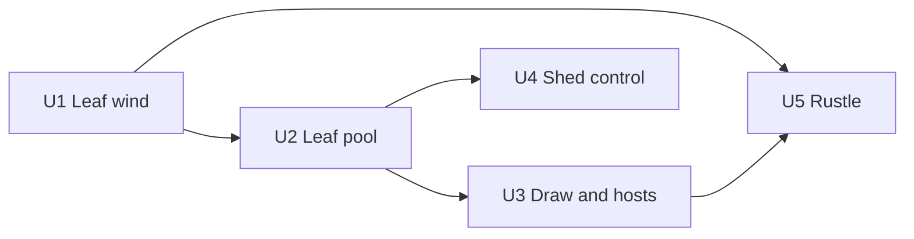

# Falling Leaves - Plan

## Goal Capsule

- **Objective:** A player can see a few leaves leave each visible tree, ride the local wind farther downwind, rest, and fade, and can hear which nearby tree is rustling louder as that wind rises.
- **Means:** One shared leaf pool spawned at the crowns of trees in view (KTD1).
- **Product authority:** Player-facing behavior in the Product Contract wins. A key technical decision wins on mechanism inside the requirements it cites. A unit overrides neither.
- **Execution profile:** Code in the engine, Sandbox, and Editor. Prove the wind sample and the leaf simulation with tests before the draw and the voices.
- **Stop conditions:** Stop if the work would drive grass or clouds, change the existing particle update, add canopy motion, lasting litter, a landing sound, stealth from the rustle, or a tree query wider than the foliage gather. Stop if maximum shed can no longer keep the grove sparse.
- **Tail ownership:** Return the completed branch for review. Opening a pull request stays with the session that owns the shipping tail.
- **Open blockers:** None.

---

## Product Contract

Product Contract preservation: restructured, no scope change — Summary adds the implementation posture; requirement meaning is unchanged.

### Summary

Trees the player can see shed a few leaves from their crowns into one shared budget. An area wind can sit calm and then rise, carrying leaves farther downwind until they rest and fade, and the nearest few trees rustle louder as the wind at that tree rises. One control sets how readily they shed.

Leaves are a new small pool with their own draw. The shed control is saved in the scene and can be edited live. A landed leaf lies flat, and a missing rustle clip stays silent.

### Problem Frame

Trees do not move, shed, or rustle. Grass lean uses a wind that never goes calm. Cloud motion uses a separate wind with one strength for the whole forest. Those winds do not reach the trees, so a gust elsewhere in the scene leaves the forest looking like placed props.

### Key Decisions

- **Rest, then fade.** (session-settled: user-directed — chosen over vanishing on contact or staying as litter: the stop is visible and windy trees do not build a carpet.) Governs R7.
- **Separate area wind.** (session-settled: user-directed — chosen over the grass wind or the sky wind: grass never goes calm, and the sky wind is one value for the whole forest.) Governs R5, R6.
- **Rustle on the nearest few trees.** (session-settled: user-directed — chosen over one bed around the player or silence until a high wind: the player can tell which tree is louder.) Governs R8, R9, R10.
- **Every tree in view sheds.** (session-settled: user-directed — chosen over only the rustling trees or only a short radius: a hillside of trees still moves.) Governs R1.
- **One shared crown budget.** (session-settled: user-directed — chosen over a spout on each tree or peeling canopy cards: the same flight, with a flat cost when the grove is full.) Governs R2.
- **Ship the full bar together.** (session-settled: user-directed — chosen over cutting drift, the rest, or the rustle: that set is the minimum.) Governs R3, R4, R7, R8.

<!-- ce-section: work-relationships -->
### How This Work Fits Together

This plan owns falling leaves and tree rustle. Canopy motion is the current understanding of a later area, not a committed roadmap.

- Canopy motion
  - Can proceed independently of this plan
  - Shares the goal that trees answer the wind
  - Still to decide whether it uses the area wind in R5

### Actors

- A1. Player. Sees the leaves and hears the rustle.
- A2. Tree. A foliage tree in view. Sheds from its crown. The nearest few also rustle.
- A3. Area wind. Strength and direction at a place. It can sit near calm, rise over time, and differ between nearby places. It drives shed rate, downwind travel, and rustle loudness.

### Requirements

**Leaves**

- R1. Every foliage tree the player can see sheds leaves from its crown. A tree at the edge of the view still sheds, and nearer crowns do not take the whole supply.
- R2. Those leaves draw from one shared budget for the view. At the highest shed setting the player can still follow individual leaves.
- R3. In calm wind a tree sheds only a few leaves, and they fall near that tree.
- R4. As the wind at a tree rises, that tree sheds more leaves and they travel farther downwind before landing.

**Wind**

- R5. Wind has a strength and a direction in each area. Strength can sit near calm and rise over time, and two nearby areas can differ at the same moment.
- R6. This wind does not change grass lean or cloud motion.

**Landing**

- R7. A leaf stops on the surface under it, remains visible for a short time, and then fades away.

**Rustle**

- R8. The nearest few trees each play a continuous rustle at that tree, and the player can tell the louder tree when their winds differ.
- R9. The rustle stays quiet in calm wind and grows louder as that tree's wind rises, including through moderate wind.
- R10. Trees beyond those few stay silent, including when the player is in the open with no tree nearby.

**Control**

- R11. One control scales how many leaves trees shed at a given wind, and it cannot raise the view past the sparse budget in R2.

### Key Flows



- F1. Calm shed
  - **Trigger:** A tree in view stands in calm wind.
  - **Actors:** A1, A2, A3
  - **Steps:** The crown sheds a few leaves. They fall near the tree. Each leaf then follows F3.
  - **Outcome:** The tree looks lightly active.
  - **Covered by:** R3
- F2. Wind rises
  - **Trigger:** The wind at a tree rises.
  - **Actors:** A2, A3
  - **Steps:** That crown sheds more leaves. They travel farther downwind, then follow F3. If the tree is among the nearest few, its rustle follows F4.
  - **Outcome:** The gust reads on that tree.
  - **Covered by:** R4, R9
- F3. Land and fade
  - **Trigger:** A leaf reaches the surface under it.
  - **Actors:** A1
  - **Steps:** The leaf stops. It stays visible for a short time. It fades away.
  - **Outcome:** The stop is visible and nothing is left on the ground.
  - **Covered by:** R7
- F4. Nearest rustle
  - **Trigger:** One or more trees are near the player.
  - **Actors:** A1, A2, A3
  - **Steps:** The nearest few play a continuous rustle at the tree. Volume follows the wind at that tree. Farther trees stay silent.
  - **Outcome:** The player can tell which nearby tree is louder.
  - **Covered by:** R8, R9, R10

### Acceptance Examples

- AE1. Calm crown
  - **Covers R3, R9.**
  - **Given:** A tree in view stands in calm wind and is among the nearest few.
  - **When:** The player watches it.
  - **Then:** A few leaves fall near the tree, and its rustle is quiet.
- AE2. Wind rises
  - **Covers R4, R9.**
  - **Given:** The tree from AE1.
  - **When:** The wind there rises.
  - **Then:** It sheds more leaves, they land farther downwind, and its rustle grows louder.
- AE3. Two winds
  - **Covers R4, R5, R8, R9.**
  - **Given:** Two nearby trees stand in different wind, and both are among the nearest few.
  - **When:** The player listens and watches both.
  - **Then:** The windier tree sheds farther leaves and rustles louder than the calmer tree.
- AE4. Full grove at maximum shed
  - **Covers R1, R2, R11.**
  - **Given:** Many trees are in view and the shed control is at its maximum.
  - **When:** The player looks across the grove.
  - **Then:** A tree at the edge still sheds, and the leaves still read as individuals.
- AE5. Rest, then gone
  - **Covers R7.**
  - **Given:** A leaf is in flight.
  - **When:** It reaches the surface.
  - **Then:** It stops, stays briefly, and is gone, and later leaves have not left a carpet.
- AE6. Open ground
  - **Covers R10.**
  - **Given:** The player stands away from trees.
  - **When:** The wind there is strong.
  - **Then:** No rustle plays.
- AE7. Grass and clouds stay put
  - **Covers R6.**
  - **Given:** Grass is leaning and clouds are moving.
  - **When:** The tree wind rises.
  - **Then:** Grass lean and cloud motion stay on their own winds.

### Scope Boundaries

**Deferred for later**

- Canopy motion. The tree mesh stays still in this plan.

**Outside this work**

- Lasting leaf litter, and a sound when a leaf lands.
- Stealth, hearing, or any other gameplay driven by the rustle.
- Driving grass or clouds from this wind (R6).
- A placed emitter on every saved tree, and peeling cards off the canopy. The shared-budget decision governs R2.

### Dependencies / Assumptions

- A rustling-leaves clip does not exist yet. `content/audio` has footsteps, voice, UI, `ambient_loop.wav`, and `whoosh.wav` only. This work needs one supplied rustle clip.
- The rustle shares the existing pool of 24 voices in `Audio/AudioSystem.h`. The few trees in R8 must leave room for the rest of the game.
- A leaf stops on the surface under it, including still water, then follows R7. It does not float, swim, or collect.
- The player walking through or brushing a tree does not shed extra leaves.
- A tree is in view when the foliage draw already includes it. `Render/FoliagePipeline.cpp` gathers those instances at about 96 m. This plan does not add a wider tree query.

### Sources / Research

- `Particles/ParticleEmitter.cpp` integrates gravity only and retires a particle when its life ends. There is no wind term and no ground rest.
- `Particles/ParticleTypes.h` defaults a placed emitter to 512 particles and 40 per second. `content/scenes/level.json` has one such emitter. Foliage does not spawn emitters.
- `Particles/ParticleRenderer.h` draws through one upload ring shared by scene particles and blood. The default particle blend is additive. Leaves need their own alpha draw.
- `content/shaders/FoliageGBuffer.hlsl` and `content/shaders/FoliageDepth.hlsl` transform tree vertices with no wind offset.
- `Terrain/DESIGN-foliage-density.md` records foliage wind and vertex animation as a non-goal of the density work. This plan does not add vertex wind. Grass wind is specified in `Terrain/DESIGN-procedural-grass.md`.
- `Terrain/GrassWind.cpp` keeps grass strength between 0.45 and 1 on each 8 m tile, and its clock keeps advancing while the world is paused. `Sky/CloudLayer.h` `windSpeedMps` is a separate whole-forest cloud speed.
- `Audio/AudioSystem.h` caps voices at 24. Looping voices are not stolen. `play3D` does not loop. `loadOrBlip` substitutes a tone when a clip is missing. `loadWav` logs and returns empty. A source id of 0 does not count for Hear. Doppler defaults on.
- `Play/GuardVoice.cpp` starts a looping spatial voice and updates its position. `Play/Crow.cpp` walks tree records inside a radius. The crow perch lift is a bird offset, not the crown.
- The foliage gather stores matrices, can lag the camera by about 16 m, and is not a public list. A fresh query of tree records is the shed set.
- `Terrain/TerrainGrid.h` `tryHeightAtWorld` fails outside the world. `HeightMap` height clamps to the border. `Water/Water.h` `heightAtWorld` adds swell and still returns a height on dry ground. `Water/WaterBody.h` `containsXZ` is the whole rectangle. `Water/WaterStream.h` is a ribbon, not a landing height. Sandbox draws the lake. Ponds count only where the host is already drawing them.
- The particle depth test is reverse-Z and does not write depth. A depth bias has the wrong sign under reverse-Z.
- The default tree is `models/BirchTree/scene.gltf`. A missing model falls back to the trunk-and-cone prototype in `Render/FoliagePrototypes.cpp`. Crown height is the model bounds above the ground seat, times scale.
- Engine and test sources are globbed. New files under `Terrain/`, `Particles/`, and `UnitTests/` do not need a hand-written source list.

---

## Planning Contract

### Key Technical Decisions

- KTD1. Dedicated leaf pool. The view uses one fixed pool of 256 slots and a free list. Spawn points are crowns of tree records inside the 96 m gather disk that also pass the camera frustum. A fresh query may differ from the drawn set by up to 16 m. Shadow-only trees outside the frustum do not shed. The pool steps its own slots. While a leaf is airborne it integrates a downward acceleration and damps its horizontal velocity toward the leaf-wind target at its current place. On the surface, velocity becomes zero, the slot rests 1.5 s, fades for 1 s, and returns to the free list. Wind is not sampled during rest or fade. Candidate crowns are visited round-robin. Each crown's cap is two to three times the budget divided by the active crown count, and at least 1. When crowns outnumber the budget, which crowns are active rotates so a crown in the far part of the view still emits over a few seconds. Each crown's spawn carry clamps to one leaf. A failed spawn does not consume carry. One step spawns at most 8 leaves, so a hitch cannot fill the pool. An over-cap crown evicts its oldest resting leaf. An airborne leaf is not dropped to make room. Shed scale multiplies the rate. Scale 0 spawns nothing. The pool is the storm cap. (session-settled: user-directed — chosen over a spout on each tree or peeling canopy cards: one shared budget stays sparse when the grove is full.) Governs R1, R2, R3, R4, R7, R11.
  - **Conflict:** The update in `Particles/ParticleEmitter.cpp` adds one gravity and retires a particle while it is still moving. That update cannot rest one leaf or take the wind where the leaf is. The pool keeps the shared budget and does not call that update.
- KTD2. Leaf wind field. A separate scrolling Perlin field has its own seed, a low spatial frequency, and a slow time scroll. Strength maps from 0 to 1. Direction comes from the same sample. Shed rate and rustle read the sample at the crown. Drift reads the sample at the leaf on each airborne step. The horizontal target is direction times strength times a leaf speed in metres per second. There is no second unbounded acceleration. The sample uses simulation time, so a paused world stops the field. It does not call the grass sample, write grass parameters, or write cloud speed. (session-settled: user-directed — chosen over the grass wind or the sky wind: grass never goes calm, and the sky wind is one value for the whole forest.) Governs R4, R5, R6, R9.
- KTD3. Card pose. An airborne card faces the camera. A resting or fading card lies on the surface normal, lifted a few centimetres along that normal. The card is a leaf, about 10 to 20 cm, drawn with alpha blending. Alpha stays opaque in flight and falls only during the fade. (session-settled: user-approved — chosen over a camera-facing card after landing: a facing card sits half in the ground.) Governs R7.
- KTD4. Landing surface. The bed comes from terrain height where the query hits. Rest height is the highest still surface among that bed and any drawn lake or pond whose rectangle contains the point and whose bed is below that body's still level. Wave height still returns a value on dry ground, a stream ribbon is not a height, and a border clamp would pin a leaf to the map edge, so none of those are the rest surface. A crown spawn does not snap on the first step. The slot snaps only when its motion segment crosses the surface after the horizontal move. A horizontal step longer than one terrain cell is substepped. Off the height map, the leaf keeps flying until an 8 s flight cap, then dies. On snap, the position freezes for the rest. Governs R7.
- KTD5. Rustle voices. At most 4 trees, each within 32 m, are selected by distance. A tree behind the player inside that radius can rustle. None in range means silence. Each voice loops, is spatial, has doppler off, and uses an unattributed source. Volume follows that tree's wind, including moderate wind, and position follows the foliage instance root. A tree that leaves the set is stopped after a short volume ramp. It is not left running at volume zero. A swap margin of about 1 m keeps two equidistant trees from restarting the loop every frame. A missing clip is loaded as a wave, logged, and left silent. (session-settled: user-approved — chosen over a stand-in tone: a missing recording stays silent.) Governs R8, R9, R10.
- KTD6. Shed control. One float, `shedScale`, lives on the foliage scene description. Range is 0 to 1. Default and missing-key value is 1. Sandbox dev tools edit it live. The editor saves the authored value with the scene, the same way it saves grass wind. (session-settled: user-approved — chosen over a live-only slider: the setting survives in the scene and can still be edited live.) Governs R11.

### High-Level Technical Design

A leaf is spawned, carried, stopped, and released. Wind is read at three places. Sandbox and Editor share the field, the draw, and the voices.







Grass wind, cloud motion, and the existing particle update have no edge in that graph.

Directional guidance for one airborne step:

```text
sample leaf wind at the leaf
damp horizontal velocity toward direction times strength times leaf speed
add downward acceleration
move
if the segment crosses the surface, snap, zero velocity, and enter rest
```

### Implementation Constraints

- New engine and Sandbox code returns a bool or logs and returns. Programmer errors use `DE_ASSERT`. No `try`, `catch`, `throw`, or exception types.
- The existing particle update and `Particles/ParticleRenderer.h` draw stay as they are. The leaf draw is a sibling with its own upload, sized to the pool, through the alpha particle pipeline.
- The leaf renderer reuses the particle shader. It does not fork it.
- The voice cap stays 24. Rustle does not take a slot it is not playing.
- Tree lookup stays inside the existing gather radius. Copy the radius-limited walk used for crow perches.
- Particle depth stays reverse-Z and does not write depth. Ground cards use the normal lift in KTD3. They do not use a depth bias.

### Sequencing

U1 stands alone. U2 needs U1. U3 and U4 need U2 and can proceed together. U5 needs U1, and it lands after U3 because both edit the Sandbox and Editor frame.



### System-Wide Impact

- Sandbox and Editor both tick the field with simulation time and both draw it. The Editor tick sits with the grass tick. The Sandbox tick sits with the other CPU particle work.
- The scene file gains `shedScale` on foliage. Old scenes load the default.
- The rustle expects `content/audio/leaves_rustle.wav`. A missing file stays silent.
- Grass parameters, cloud speed, and the existing particle update stay on their current paths.
- Looping rustle slots cannot be stolen. A leaked slot starves footsteps and other one-shots.
- The leaf upload is separate so a full grove cannot skip blood or scene particles, and those emitters cannot skip the leaves.
- A paused world stops leaf motion because the field uses simulation time. The grass wind clock is a different clock.

### Risks

- The landing query must match the surface the player sees. Using swell height, a stream ribbon, or the map-border clamp would stop leaves in the air or pin them to the edge.
- Four looping voices are safe only if every release calls stop. Volume zero still holds an unstealable slot.
- The private foliage draw list is the wrong spawn source. It mixes kinds, can lag by 16 m, and can drop instances past the draw cap.
- Resting cards on reverse-Z depth can flicker if they are camera-facing or biased the wrong way. KTD3 is the mitigation.
- The supplied clip may be absent on the first run. Silence is the intended result, and it will look like a bug if the log is missed.

---

## Implementation Units

### U1. Leaf wind sample

- **Goal:** A place and a simulation time produce a strength from 0 to 1 and a direction, and sampling it leaves grass wind unchanged.
- **Requirements:** R5, R6. Supports F2 and AE3, AE7.
- **Dependencies:** None.
- **Files:** `Terrain/LeafWind.h`, `Terrain/LeafWind.cpp`, `UnitTests/Terrain/LeafWindTests.cpp`
- **Approach:** Copy the Perlin sample shape from `Terrain/GrassWind.cpp`. Own the seed, the spatial frequency, and the time scroll. Map strength across 0 to 1. KTD2 owns the field. The function takes a place and a time. It does not take grass parameters.
- **Execution note:** Write the sample tests first.
- **Patterns to follow:** `Terrain/GrassWind.h` for the sample shape. `UnitTests/Terrain/GrassWindTests.cpp` for the test style.
- **Test scenarios:**
  - Covers R5. Sample one place at two times several seconds apart. Both strengths are inside 0 to 1, and they differ.
  - Covers R5, AE3. Sample two places tens of metres apart at the same time. Strength or direction differs.
  - Covers R5. Map a calm noise extreme through the strength function. The result is 0. Map the strong extreme. The result is 1. No sample is raised to a 0.45 floor.
  - Covers R6, AE7. Record grass samples on a grid. Sample leaf wind across that grid. The grass samples match the recording.
  - The leaf sample runs with only a place and a time. It needs no grass object and no cloud object.
- **Verification:** The tests pass. The diff does not call the grass sample and does not write grass or cloud fields.

### U2. Leaf pool simulation

- **Goal:** Crowns in view share one pool. Leaves fall near the tree in calm wind, travel farther as that wind rises, then rest and disappear. An edge crown still receives leaves.
- **Requirements:** R1, R2, R3, R4, R7, R11. F1, F2, F3. AE1, AE2, AE3, AE4, AE5.
- **Dependencies:** U1
- **Files:** `Terrain/LeafField.h`, `Terrain/LeafField.cpp`, `UnitTests/Terrain/LeafFieldTests.cpp`
- **Approach:** One array and a free list, per KTD1. Tests inject crown height, a wind sample, and a height function so they do not load a glTF or a GPU. The field runs the KTD4 query from the terrain and the still water the host passes in. Crown height in the host is model bounds times scale above the ground seat. Player position is not a spawn input.
- **Execution note:** Write the simulation tests first. Keep this unit free of the graphics device.
- **Patterns to follow:** The radius-limited tree walk in `Play/Crow.cpp`. `Terrain/TerrainGrid.h` `tryHeightAtWorld`. `UnitTests/Terrain/GrassFieldTests.cpp` for a field test without a device.
- **Test scenarios:**
  - Covers F1, AE1, R3. One crown in calm wind and scale 1, stepped for several seconds. Only a few leaves spawn, and they land near the crown.
  - Covers F2, AE2, R4. The same crown with strength near 1. More leaves spawn in the same time, and their landing offset along the wind is greater than the calm run.
  - Covers AE3, R4, R5. Two crowns whose injected wind differs. The windier crown's leaves land farther down its wind than the calmer crown's.
  - Covers AE4, R1. Several hundred crowns, one near the camera and one near 90 m inside the frustum, scale 1. Over a few seconds the far crown spawns at least once.
  - Covers R11. Scale 0 for several seconds spawns nothing.
  - Covers R2, R11. Scale 1 with enough crowns to saturate the pool. Living leaves never exceed 256.
  - A leaf spawned at crown height, with the surface far below, is still airborne after one small step.
  - Covers F3, R7. A segment that crosses the injected terrain height ends at that height with zero velocity.
  - Covers R7. The bed is below a still water level and the point is inside a drawn lake or pond. The leaf rests at the still level. It does not rest on the bed and does not rest on a swell.
  - A point outside the height query keeps its in-air position through the first seconds and is gone after the 8 s flight cap. It is not moved to a border height.
  - Covers AE5, R7. After the snap, position holds through the 1.5 s rest. The slot is free after the 1 s fade. A later leaf does not keep the earlier slot alive.
  - One step with a 1 s dt spawns at most 8 leaves.
  - Fill the pool, fail a spawn, free one slot, and step again. That crown can spawn without rebuilding a full carry period.
  - An over-cap crown with a resting leaf and an airborne leaf loses the resting leaf.
  - Moving the listener does not change the spawn count for the same wind and crowns.
- **Verification:** The tests pass without a graphics device. The diff does not call the particle update.

### U3. Billboard draw and host hookup

- **Goal:** Sandbox and Editor show airborne leaves as camera-facing cards and resting leaves as cards lying on the ground.
- **Requirements:** R1, R7. F3. AE5.
- **Dependencies:** U2
- **Files:** `Particles/LeafRenderer.h`, `Particles/LeafRenderer.cpp`, `Sandbox/SandboxApp.cpp`, `Editor/EditorUi.cpp`, `Editor/EditorRender3D.cpp`, `UnitTests/Particles/LeafCardTests.cpp`
- **Approach:** A pure helper builds one card from the leaf phase, position, surface normal, and camera, per KTD3. The renderer uploads those cards through its own alpha pipeline, sized to 256. Init failure logs and skips the draw. Both hosts tick the field with simulation dt, pass the terrain and the still water they draw into the KTD4 query, and draw the cards. They do not route leaves through the shared particle upload.
- **Patterns to follow:** `Particles/ParticleRenderer.h` for the alpha pipeline and the two-frame upload. Keep the leaf upload on its own resource.
- **Test scenarios:**
  - Covers R7, KTD3. An airborne leaf's card faces the camera. A resting leaf's corners lie on the supplied normal, a few centimetres along it.
  - During flight the card alpha stays opaque. During fade the alpha is lower. A free slot produces no card.
  - Zero living leaves produce zero quads.
  - A full pool of 256 cards fits the leaf upload capacity.
  - The card helper runs without a graphics device.
- **Verification:** The card tests pass. Sandbox and Editor both tick the field and call the leaf draw. The shared particle renderer is unchanged. A failed renderer init does not throw.

### U4. Shed control

- **Goal:** One saved float scales shed rate in the scene, in Sandbox dev tools, and in the editor.
- **Requirements:** R11, R2. AE4.
- **Dependencies:** U2
- **Files:** `Scene/SceneTypes.h`, `Scene/SceneFile.cpp`, `Sandbox/DevToolsPanel.cpp`, `Editor/EditorTerrain.cpp`, `UnitTests/Scene/SceneFileTests.cpp`
- **Approach:** Add `shedScale` to the foliage scene description, per KTD6. Clamp on load. The Sandbox slider writes the live field. The editor stores the authored value on save, beside authored grass. The field reads that float as its scale.
- **Patterns to follow:** The foliage floats in `Scene/SceneFile.cpp`. The grass sliders in `Sandbox/DevToolsPanel.cpp` and the authored grass save in `Editor/EditorTerrain.cpp`.
- **Test scenarios:**
  - Covers R11. Save `shedScale` 0.25 and load it. The value is 0.25.
  - A foliage block with no `shedScale` loads 1.
  - A value below 0 loads as 0. A value above 1 loads as 1.
  - Covers R2, R11. The loaded scale is the value the leaf field uses. Scale 1 still cannot exceed the pool, which U2 already proves.
- **Verification:** The scene round-trip tests pass. Existing scene files still load. Sandbox can change the live scale, and the editor writes the authored scale back into the scene.

### U5. Rustle voices

- **Goal:** Up to four nearby trees loop a rustle that follows the wind at that tree, and a missing clip stays silent.
- **Requirements:** R8, R9, R10. F4. AE1, AE2, AE3, AE6.
- **Dependencies:** U1, U3
- **Files:** `Terrain/LeafRustle.h`, `Terrain/LeafRustle.cpp`, `Sandbox/SandboxApp.cpp`, `Editor/EditorUi.cpp`, `UnitTests/Terrain/LeafRustleTests.cpp`
- **Approach:** A pure selector implements KTD5. The host starts a voice with the looping spatial play, then updates volume and position. It stops a voice that leaves the set. The clip path is `content/audio/leaves_rustle.wav`, loaded with the wave loader. An empty clip logs and starts no voice. The source stays unattributed so Hear ignores it.
- **Patterns to follow:** `Play/GuardVoice.cpp` for a looping spatial voice owned without a sound-emitter component. `UnitTests/Audio/SoundClipAssetTests.cpp` for clip loading. Do not copy `loadOrBlip`.
- **Test scenarios:**
  - Covers R8, R10. Trees at 5 m, 12 m, 18 m, 25 m, 31 m, and 40 m. The selector returns the four nearest inside 32 m. The tree at 31 m and the tree at 40 m stay out.
  - Covers R9, AE1, AE2. The same tree at strength 0.2 gets a lower volume than at strength 0.8, and 0.2 is not silence.
  - Covers AE3, R8. Two selected trees with different strengths. The windier tree's volume is higher.
  - Covers AE6, R10. No tree inside 32 m, with strength 1. The set is empty.
  - A tree behind the listener at 10 m is eligible. Frustum is not a filter.
  - Two trees stay within the 1 m swap margin. The set keeps the tree it already holds.
  - A tree that drops out of the set is marked stop. It is not marked as a zero-volume hold.
  - An empty clip result starts no voice and requests no tone.
- **Verification:** The selector tests pass without an audio device. After stop, the host clears the voice id. A one-shot can still allocate when a device is present. Where the device is absent, skip that check the way existing audio tests skip, and confirm the call site uses the looping play path.

---

## Verification Contract

| Gate | Check | Units |
| --- | --- | --- |
| Debug build | `cmake --build build --config Debug` | All |
| Unit tests | `cmake --build build --config Debug --target UnitTests`, then `build\bin\Debug\UnitTests.exe` | U1, U2, U3, U4, U5 |
| Focused tests | The same binary with a gtest filter for the new leaf, rustle, and scene cases while iterating | The unit being edited |
| Exception scan | The diff under engine and Sandbox paths has no `try`, `catch`, `throw`, `std::exception`, or `std::runtime_error` | All |
| Untouched systems | The diff does not change the particle update, the shared particle draw, grass wind parameters, or cloud speed | All |
| Host parity | Sandbox and Editor both tick the field and draw the leaves. Both start and stop rustle | U3, U5 |
| Scene compatibility | `content/scenes/level.json` loads with shed scale defaulting to 1 when the key is absent | U4 |
| Playthrough | Calm crown, rising wind, two nearby winds, a full grove at scale 1, rest then fade, open ground, and grass and clouds on their own winds | AE1 through AE7 |

A missing `content/audio/leaves_rustle.wav` is a passing silence case, not a failed test. Hearing the rustle in the playthrough needs that file supplied.

---

## Definition of Done

- The Goal Capsule objective holds in Sandbox and in the Editor: visible trees shed into one sparse pool, wind changes distance and loudness, and a landed leaf rests and fades.
- U1 through U5 meet their verification lines, including the test scenarios marked on those units.
- `shedScale` round-trips through the scene file, edits live in Sandbox, and saves from the Editor.
- At most four rustle voices play, each within 32 m, and each is stopped when its tree leaves the set.
- A missing rustle clip logs and stays silent.
- Grass lean and cloud motion are unchanged when leaf wind changes.
- New code follows the no-exception rule.
- Abandoned experiments and unused helpers are removed before the branch is called done.
- The tree mesh does not sway, leaves do not remain as litter, and a landing does not play a sound.
