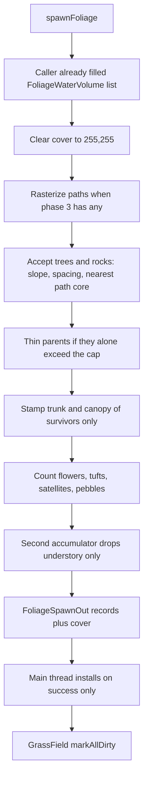

# DarkEngine6 Foliage Upgrade — Implementation Plan

| | |
|---|---|
| Author | DarkEngine |
| Date | 2026-11-13 |
| Status | Draft, revised after review |
| Source | `docs/plans/DarkEngine6-foliage-plan.md` (written against git `35cf523`) |
| Tree | Live `D:\DarkDev\DarkEngine6`. Line numbers below were re-read. Do not use the source plan's line numbers. |

This is an implementation plan. It does not change code. Phases stay in the source order: 1, then 2, then 3, then 4, then 5. Phase 3 is two independently mergeable PRs (authored raster, then auto trails). Nothing here is a Phase 6.

---

## Overview

Baked foliage is a 1 m Bernoulli lattice in `Terrain::spawnFoliage` (`Terrain/FoliageSpawn.cpp`). It does not reject on slope, does not space trees, and does not tell either grass system where a trunk or a path is. Procedural grass (`GrassField::acceptCandidate`) and baked tufts (`FoliageKind::Grass`, `grassPerM2`) both run on `content/scenes/level.json` and neither one sees the other. One prototype is drawn per kind.

The upgrade is five CPU-first phases on that spawner. Phase 5 also edits the cull shader, the gbuffer shader, and the CPU/GPU draw split in `FoliagePipeline`. It is not a shader-only change:

1. Per-kind `minNormalY`, a tree lean cap, and a rock pitch clamp. No new file.
2. A ground-cover sidecar both grass systems sample, plus minimum tree spacing.
3. Walking paths and game trails rasterized into that same mask. Trails are scene JSON, not entities.
4. `hash21` patch masks, understory satellites, and downhill pebbles. `strength == 0` reproduces phase 2.
5. Species lists, a variant byte, and an RGB565 tint packed into the existing per-instance kind uint. `kFoliageVersion` becomes 2. v1 bins still load.

Editor and Sandbox stay shells. Spawn, cover, trail raster, and the least-cost search live in `Terrain/`. Each app fills a host struct and calls in.

---

## Background and motivation

### What the live tree actually does

`spawnFoliage` (`Terrain/FoliageSpawn.cpp`) builds a lattice of `floor(widthM)` by `floor(depthM)` cells (`cols` / `rows`, lines 112–113). Cell centres are `origin + index + 0.5` (lines 275–279). Sea level rejects the **cell centre** (line 282). Jitter, water, and the Bernoulli test use the **jittered** point inside `consider` (lines 136–189).

Salts and jitter (lines 15–30):

| Constant | Value |
|---|---|
| `kFlowerSlots` | 2, offsets `±0.25` m |
| `kSaltTreeAccept` / Flower / Rock / Grass | `0x1000`, `0x2000`, `0x3000`, `0x3500` |
| Jitter salts | `0x4000`–`0x5500` |
| `kSaltYaw` / `kSaltScale` | `0x6000` / `0x7000` |
| `kTreeRockJitter` | `±0.45` m |
| `kFlowerJitter` | `±0.12` m |

`consider` never reads `normalAtWorld`. Rocks write pitch only (lines 245–252): if `n.y <= 0.999`, `pitch = acos(clamp(n.y))`, `tiltYaw = atan2(n.x, n.z)`. Trees, flowers, and tufts stay at pitch 0. Scale ranges are trees `0.85–1.15`, flowers `0.80–1.20`, rocks `0.60–1.80`, tufts `0.80–1.25` (lines 220–236).

Water is `coveredByWater` (lines 41–50). The call at line 151 rejects **trees, tufts, and flowers** when `bedY < surfaceY` and the XZ is inside the volume (`entireMap` or the rectangle). Rocks are not rejected. The comment on `FoliageWaterVolume` (`Terrain/FoliageSpawn.h` lines 12–13) says flowers and rocks are planted. Rocks still match that sentence. The flower half does not. Phase 1 rewrites the comment to: trees, grass, and flowers whose bed is below `surfaceY` are not planted; rocks are. The predicate at line 151 stays.

`HeightMap::normalAtWorld` (`Terrain/HeightMap.cpp` lines 359–373) is a central difference over one cell: `n = normalize(hL - hR, 2 * cellSize, hD - hU)`. A 1:1 ramp (`setHeight(x, z, float(x))`, cell 1 m) is `n.y = 1/sqrt(2) ≈ 0.707` (45°). A rise of 0.25 m per metre is `n = normalize(-0.5, 2, 0)`, `n.y ≈ 0.970` (about 14°).

The two-pass scan counts, then keeps (`scan`, lines 266–308; count at 316, keep at 327). Cap is `kMaxFoliageInstances` (`12582912`). Over-cap uses the even accumulator at lines 199–207 and logs `FoliageSpawn: cap thinned` (line 339). Cancel (`onProgress` returns false) calls `failSpawn`, which clears the output. `EditorApp::pollFoliageSpawn` (`Editor/EditorTerrain.cpp` lines 1506–1524) swaps `m_foliage` only when `m_foliageOk`. Cancel logs `previous set kept` and does not swap. Keep that.

### File format today

`Terrain/FoliageFile.h`:

```text
kMaxFoliageInstances    = 12582912
kMaxFoliagePerFile      = 1048575     // (32 MiB - 32) / 32
kMaxFoliageDraw         = 65536
kFoliageMagic           = 0x4C464544  // 'D','E','F','L'
kFoliageVersion         = 1
kMaxFoliageSidecarBytes = 32 MiB
```

`FoliageRecord` is 32 bytes (`static_assert` at line 55): `x, y, z, yaw, scale, pitch, tiltYaw, kind, pad[3]`. `saveFoliageTile` writes the record and then **zeroes `pad[0..2]`** (`Terrain/FoliageFile.cpp` lines 80–83). `loadFoliageTile` rejects any version other than `kFoliageVersion` (lines 160–164). Header flags are ignored (lines 150–153).

Tile names (`Terrain/TerrainTileFile.h`): `t_%02d_%02d.height.bin`, `.splat.png`, `.foliage.bin`. No cover file. `kTileCells = 512`, `kMaxWorldTiles = 8`.

### Scene JSON today

`SceneFileData::version` defaults to 2 (`Scene/SceneTypes.h` line 545). That default is the struct, not the product file. `content/scenes/level.json` line 610 is `"version": 3`. `EditorApp::saveScene` assigns `data.version = 3` (`Editor/EditorSceneFile.cpp` line 93). The loader stores the integer (`Scene/SceneFile.cpp` line 956) and does not reject unknown keys. The saver writes `scene.version` (line 577). Do not change the root version. Do not add a scene version 4. Editor saves stay 3. The struct default stays 2. `TerrainFoliage_RoundTrip` stays on that default and still asserts `"version": 2`, foliage `"version": 1`, and no `"version": 3` substring **in that fixture** (`SceneFileTests.cpp` lines 1000–1002). New foliage and trail keys are optional on both root versions 2 and 3.

`terrain.foliage` is a separate object whose own `"version"` is hardcoded to **1** on save (`Scene/SceneFile.cpp` line 648). That integer is not `kFoliageVersion` and it is not the scene root. Do not bump it. New foliage and trail fields are optional keys with defaults.

`FoliageSceneDesc` (lines 370–386) mirrors `FoliageDensity` (rates, seed, four model strings) plus `present`, `stale`, and `shedScale`. It is not an embedded `FoliageDensity`. Every new density field has to be added in both structs and copied at every field-by-field site:

- `EditorApp::fillTerrainSceneDesc` World Engine branch, `Editor/EditorTerrain.cpp` lines 831–844, and grid branch, lines 885–898.
- `EditorApp::loadTerrainFromScene` World Engine branch, lines 1092–1102, and grid / height-file branch, lines 1200–1210.
- `SandboxApp` boot, `Sandbox/SandboxBoot.cpp` lines 429–439.

Missing a copy site means the Editor slider and the Sandbox boot disagree.

`level.json` (`content/scenes/level.json` lines 524–549) sets `grassPerM2` to **0.25** (struct default is 0) and `grass.enabled` to **true**. Both grass systems are on. Model keys are the four single paths below. There is no `trails` object.

### Grass, leaves, and who updates them

`GrassField::acceptCandidate` (`Terrain/GrassField.cpp` lines 686–752) already rejects `weights[1] < 0.35`, rock `> 0.55`, snow `> 0.45`, `normal.y < kNormalYMin`, and `surfaceY < waterLevel`. `kNormalYMin` is **0.80** (line 43, anonymous namespace, not a public constant). Root lift is `kRootLiftMetres = 0.015` along the normal (lines 744–746). `heightMul` is `Lerp(0.70, 1.30, …)` (line 747). Tiles are 8 m (`kGrassTileMetres` in `Terrain/GrassTypes.h` line 146), 64×64 candidates, cell 0.125 m. Keep bases are `{32, 16, 8, 5}` (line 25). LOD distances in `content/terrain/lod.json` are 16 / 40 / 80 / 256 m. `setParams` dirties tiles only when `densityScale` or `seed` changes (lines 278–288). `tryRebuild` resamples with `resampleAll = true` (line 920). `tryPromote` does not (line 897). Rebuild budget is 4 tiles, or 8 inside 48 m (`kGenerateBudget`, `kGenerateWarm`, lines 47–50).

There is no `markAllDirty`. A new cover will not move existing blades until something sets `Tile::dirty`.

Call sites, which must stay different:

| App | Function | Anchor |
|---|---|---|
| Editor | `EditorApp::updateEditorGrass` (`Editor/EditorTerrain.cpp` lines 728–746) | Edit mode: camera XZ. Play with a valid `m_playPlayer`: `fillGrassPlayerSample`. Then `m_grassField.update(m_terrain, x, z, …, m_water.params().waterLevel, sample)`. |
| Sandbox | `SandboxApp::onUpdate` (`Sandbox/SandboxApp.cpp` lines 2018–2024) | Only when `possessedBody()` is valid. Same `GrassField::update`. No camera fallback. |

`acceptCandidate` already takes `const TerrainGrid&`. A cover hanging off the grid needs no new grass argument.

Falling leaves are a different water list. Do not merge them.

| | Foliage plant / trail block | Falling leaves |
|---|---|---|
| Test | `coveredByWater` / `FoliageWaterVolume` | `LeafField::Pond` plus the lake sheet |
| Editor | `startFoliageSpawn` (`Editor/EditorTerrain.cpp` lines 1423–1449): lake sheet (`entireMap`, `m_water.params().waterLevel`) plus every `SceneObjectType::Water` via `placedWaterFootprint` | `tickLeaves` (lines 749–782): up to 32 ponds from `m_placedWater`, plus the lake |
| Sandbox | Boot (`Sandbox/SandboxBoot.cpp` lines 684–687): **lake sheet only**. Placed water objects are not pushed | `SandboxApp::tickLeaves` (lines 1924–1940): lake only, `pondCount` left 0 |

`stepFallingLeaves` (`Play/EnvironmentTick.cpp`) reads `tick.ponds`. Tree crown height uses `treeModel->bounds().Max.y` (lines 31–33). That bounds call is the right place to read a canopy radius later. It is not a pond test.

Sandbox World Engine boot is the only Sandbox spawn (`BootSlice::WaitFoliage`, lines 664–734). Grid scenes do not spawn. They draw `residentFoliage` because `SandboxFrame.cpp` passes `&m_foliage` only when the vector is non-empty (`drawGBuffer` call, line 841). Editor always passes `&m_foliage` (`Editor/EditorRender3D.cpp` line 825).

### Draw, physics, pathfinding

GPU cull is 4 kinds × 8 parts, 65536 instances (`FoliagePipeline::kCullKindCount = 4`, `kCullPartsPerKind = 8`, `kCullConstantBytes = 432`, `FoliagePipeline.h` lines 73–75; `FoliageCull.hlsl` lines 9–12). Gather radius is 96 m, rebuild after 16 m (`FoliagePipeline.cpp` lines 43–44). World matrix is `Scale * RotY(yaw) * RotX(pitch) * RotY(tiltYaw) * Translate` (`instanceWorld`, lines 293–296). `kSmallFoliageScale = 10` is **not** in that matrix. It is `foliageDrawScaleY` / `partLocalToRoot` (lines 299–314), and only for `Flower` and `Grass`. Grass kind 3 is skipped in shadow views (`FoliageCull.hlsl` lines 139–141, and `drawPreparedDepth` lines 1807–1810).

The 432-byte block is full. `FoliageCullConstants` (`FoliagePipeline.cpp` lines 114–138) holds `partCount[4]`, `indexCount[32]` (exactly 4×8), and `tail[4]`. `CSCompact` and `CSArgs` both read `tail` so the block stays 432 bytes (`FoliageCull.hlsl` lines 129–131 and 166–168). `counterBytes` is `kCullKindCount * sizeof(uint32_t)` (line 986). Both counter UAVs set `NumElements = kCullKindCount` (line 1013, depth copy at line 1077). `argBytes` (line 987) is `kCullViewsPerFrame * kCullKindCount * kCullPartsPerKind * sizeof(D3D12_DRAW_INDEXED_ARGUMENTS)`, and the depth set allocates with that same `argBytes` (lines 1062–1063). `recordCull` clears four counters, dispatches compact once, then `CSArgs` once (lines 1250–1260). `cullArgumentOffset(view, kind, part)` (`FoliagePipeline.h` lines 101–104) has no variant index. `FoliageCullDesc::indexCount` is `[4][8]` (line 47). `drawGBuffer` (loop at line 1731) and `drawPreparedDepth` (loop at line 1807) bind `prototypes.model(kind)` once per kind. The index buffer is `kCullFrameSlots * kCullViewsPerFrame * kCullKindCount * kMaxFoliageDraw * 4` bytes, about 16 MB. Phase 5 does not grow the 432-byte block and does not multiply that index buffer by 8.

`m_cpuKinds` is `std::vector<uint8_t>` (`FoliagePipeline.h` line 250). `uploadKinds` zero-extends each byte into the `gKinds` uint (lines 1413–1416). The cull shader does **not** mask:

```hlsl
uint kind = gKinds[id.x];
if (kind >= kKindCount)
    return;
```

(`FoliageCull.hlsl` lines 136–138). Any set bit above the low 8 drops the instance, and it also breaks the grass shadow skip (`kind == 3`). The CPU mirror compares the same value to `kKindCount` (`snapshotKindBounds` line 1452, `buildCpuIndices` line 1474). `kindIndex` in `FoliageGBuffer.hlsl` / `FoliageDepth.hlsl` is a **per-draw constant** (`cb.kindIndex = float(i)` at `FoliagePipeline.cpp` lines 1753 and 1826), indexing `kindA/B/C[4]`. It is not the per-instance uint. Wind must stay on that 0–3 constant.

G-buffer albedo is `albedoS.rgb * color.rgb` (`FoliageGBuffer.hlsl` line 101). `color` is the material constant, filled with `(1,1,1)` when no material is present (`fillSurface`, lines 429–432). The graphics root signature has worlds at `t4` and indices at `t5` (`kGbWorlds`, `kGbIndices`, lines 520–528). It does not bind `gKinds`. Depth PS does not multiply albedo (`FoliageDepth.hlsl` `PSMain`).

`ensureDrawSet` thins to 65536 with the same even accumulator (lines 1361–1378) and **does not log**. The only cull warning today is `foliage cull unavailable` (line 220) and the depth-set warning (line 1097). Do not claim the 96 m disk already hits 65536 on the default map. A disk of `pi * 96^2 ≈ 28953 m²` at `level.json` rates is on the order of 7000 tufts, ~90 trees, ~230 flowers, and ~120 rocks before slope and water. That is under the cap. There is no measured counter in the tree.

Physics (`Physics/FoliageCollision.h` lines 18–19): `kMaxLiveFoliageBodies = 2048`, `kFoliageBodyRadiusM = 64`. Trees and rocks only (`FoliageCollision.cpp` lines 88–97 and 270). Over-cap warns at line 367. Boxes are one trunk and one boulder formula (`fillFoliageBox`, lines 78–106), not per variant. Do not raise these caps.

`AI::Walkability` bakes one cell per height sample of the map it is given. The v1 comment (`AI/Walkability.h` line 14) says the gameplay bake is the coarse heightfield, `<= kMaxHeightMapSize` (1025, `Terrain/HeightMap.h` line 18), not a 4097 working map. `HeightMap::create` rejects 4097; `createWorking` allows `kMaxWorkingHeightMapSize = 4097` (line 19). `Pathfinder::find` does not contain the expansion cap. `search` does, at `AI/Pathfinder.cpp` line 181: `expanded > cap` returns false. The default cap is **4096** (`Pathfinder.h` line 25, `PathRequest::expansionCap`). `stringPull` is private (`Pathfinder.h` line 44). A 4 km map at 4 m is `1024 * 1024 = 1048576` cells. 4096 expansions cannot cross it. The pathfinder also applies agent stamps and a single `maxSlopeDeg` (default 45). It does not read splat weights. It is the pawn walk. Trails do not call `find` or `search`. The trail string-pull is a new function in `TrailPath.cpp`.

`hash21(int x, int z, uint32_t seed)` is declared at `Terrain/TerrainGen.h` line 24. It returns `[0, 1)`.

### Prototypes and assets

`makeFoliageShowcaseParts` (`Render/FoliagePrototypes.cpp` lines 149–218) keeps the part nearest the origin, then every part within **0.25 m** (`kCluster`, line 170), drops names containing `LOD1` / `LOD2` / `LOD3` (`parkedLodName`, lines 96–98), and seats the lowest vertex on Y = 0. `grassTuft` (lines 50–94) keeps a single tuft. `FoliagePrototypes::sync` (lines 359–399) is called from `FoliagePipeline::prepare` (line 1650). A failed glTF logs once and keeps the procedural mesh (lines 389–395).

Procedural trunk is a unit cylinder scaled by `(0.5, 2, 0.5)` (line 249): **0.5 m radius**, 2 m tall, before instance scale. Procedural canopy is a cone scaled by `(2, 4, 2)` (line 255): about 2 m radius.

`UnitTests/Render/FoliageShowcaseTests.cpp` (not under `UnitTests/Terrain/`) loads the real glTFs and asserts **one** cluster: birch keeps 2 parts, dandelion 1, rock 1 (`BirchKeepsOneLod0Tree`, `DandelionKeepsOriginPlant`, `RockKeepsOneBoulder`).

The source plan said those glTFs were absent. On this machine they are present:

- `content/models/BirchTree/scene.gltf`
- `content/models/Dandelion/dandelion_01_2k.gltf`
- `content/models/RockMoss/rock_moss_set_01_2k.gltf`
- `content/models/Grass/grass_medium_01_2k.gltf`

`content/models/NaturePack/glTF/` also has `Fern_1.gltf`, `Bush_Common.gltf`, `Bush_Common_Flowers.gltf`, five `CommonTree`, five `Pine`, five `DeadTree`, five `TwistedTree`, several flowers, four grass cards, and rock / pebble sets. `Fern_1.gltf` and `Bush_Common.gltf` are on disk. Phase 5 ships those two with the four models `level.json` already names. The procedural fallback still runs when a path fails to load.

### Editor spawn and save

`startFoliageSpawn` (lines 1393–1504) runs on `m_foliageThread`. It refuses when `editableWorking()` or `editableWorkingSplat()` is missing. Sea level is `m_terrainSeaLevel` for authored grids and `origin.y` for World Engine imports (lines 1421–1422). The worker checks `kMaxFoliagePerFile` per tile and, on failure, does not swap. `loadWorldEngineTerrain` calls it at line 1764.

`drawTerrainPanel` (lines 1769–1864) reports tree and tuft counts and has procedural-grass facing sliders. There is no Place button and no slope slider. The Terrain window itself has no `SetNextWindowSize`. Water uses `uiPx(380, 640)` (line 1530) and Wind uses `uiPx(450, 700)` (line 1871). Those are existing UI edits. This plan does not change them. New foliage controls go in the Terrain panel as a collapsing header.

`saveTerrainSidecars` returns immediately when `m_terrainSource` is non-empty (lines 908–909). HurricaneRidge / any World Engine import does **not** write `.foliage.bin` or a splat sidecar. Sandbox rebuilds that foliage by calling `spawnFoliage` at boot. Grid scenes do write bins (lines 1028–1044) and the Editor reloads them into `m_foliage` (lines 1302–1336).

`SplatMap::paintDisk` (`Terrain/SplatMap.cpp` lines 215–243) paints one layer in sample space and renormalizes. Layer 0 is dirt (`SplatMap.h` lines 20–23). `generateFromHeight` paints rock from `slope = 1 - n.y` at `rockSlope 0.45 ± blend 0.08` (lines 99–110), which is about `n.y` 0.47–0.63. Painted HurricaneRidge splats can still be grass on a cliff. Slope rejection must not read rock weight.

`EditorApp::uploadTerrainSplatGpu` (lines 672–684) pushes the working splat to resident heaps. `m_terrainSplatDirty` is currently only cleared, not a paint path. A dirt stamp has to call `uploadTerrainSplatGpu` on the main thread after the CPU paint. There is no terrain undo stack. Unsaved paint is discarded by reloading the sidecar or the World Engine folder.

### Build wiring

`cmake/DarkEngineTargets.cmake` globs `Terrain/` (`DE_ENGINE_REST_FOLDERS`, line 134) and `Editor/` (line 181). `UnitTests/CMakeLists.txt` line 34 globs `UnitTests/` recursively. New `Terrain/FoliageCover.cpp`, `Terrain/TrailPath.cpp`, `Editor/EditorTrails.cpp`, and `UnitTests/Terrain/*.cpp` do not need a manual source list. Dear ImGui stays out of `DarkEngine` and `UnitTests`. No feature-flag framework exists in engine code.

---

## Goals and non-goals

### Goals

- Stop planting trees and flowers on steep grass, and stop pitching rocks to the full slope, using the planted point's `normal.y`.
- Space trees, and make baked tufts and procedural blades share one bare-trunk / short-grass mask.
- Let an author draw paths, and let a spawn-time search add game trails, both as cover stamps. Authored points survive a regenerate.
- Cluster forests and meadows, and ring kept trees with deterministic understory, without a new noise library and without blowing the instance cap.
- Draw more than one mesh per kind, with a saved variant and tint, while `kCullKindCount` stays 4 and `FoliageRecord` stays 32 bytes.
- Keep v1 `.foliage.bin` loadable. Keep scenes that omit the new JSON keys loadable at the documented defaults. Keep a missing `.cover.bin` equal to full coverage.

### Non-goals

- Runtime mesh LODs and impostors. Closed: not a phase. `makeFoliageShowcaseParts` keeps dropping `LOD1+`. The 96 m / 65536 gather is unchanged.
- `kCullKindCount` above 4, and `kCullPartsPerKind` above 8. A fifth kind would touch `FoliageCull.hlsl`, `kindA/B/C[4]`, `WindKind`, and the cull UAVs.
- Growing the 432-byte cull cbuffer. `indexCount[32]` and `tail[4]` are already full. Per-variant part and index counts go in a side SRV.
- Multiplying the foliage index buffer by `kMaxFoliageVariants`. Variants pack inside the existing per-kind span of 65536.
- Growing `FoliageRecord` past 32 bytes. `kMaxFoliagePerFile` is `(32 MiB - 32) / 32`.
- Raising `kMaxFoliageDraw`, `kMaxLiveFoliageBodies`, or `kFoliageBodyRadiusM`.
- Moisture maps, stream erosion, snow on paths, footstep-audio changes beyond the optional dirt stamp, and driving `AI::Pathfinder` along a trail.
- Replacing procedural grass cards with the glTF tuft, or the reverse.
- A new HLSL grass atlas. Tint and `heightMul` are the variation.
- Making trails a `SceneObjectType`. The outliner stays for entities. Foliage was kept off it for the same reason.
- Stamping splat dirt inside Generate or Place. That stays a separate Editor button.
- `autoGenerate = true` as the shipped default.
- Persisting a World Engine splat from `saveTerrainSidecars`. That function returns before any sidecar write when `m_terrainSource` is set. The dirt button may paint the Editor session. It does not gain a new World Engine save path in this work.
- Changing `kNormalYMin` (0.80). Closed: it stays 0.80. These PRs do not move it to 0.82.
- A first-place modal that offers to generate trails. Closed: no modal. Generate is a button only. `autoGenerate` stays false. A prompt is out of scope.
- Raising the grass rebuild budget (4 / 8). Dirty tiles catch up over frames, nearest first.

---

## Proposed design

### Locked defaults

Closed 2026-11-13. These values ship. See `## Resolved decisions`.

| Field | Default | Clamp on load and in the spawner |
|---|---|---|
| `treeMinNormalY` | 0.87 | `[0, 1]` |
| `flowerMinNormalY` | 0.82 | `[0, 1]` |
| `tuftMinNormalY` | 0.82 | `[0, 1]` |
| `rockMinNormalY` | 0.40 | `[0, 1]` |
| `treeMaxLeanDeg` | 7 | `[0, 15]`. 0 keeps pitch and tiltYaw at 0 |
| `rockMaxPitchDeg` | 30 | `[0, 89]` |
| `treeSpacingM` | 3 | `[0, 16]`. 0 disables the hash |
| `rockSpacingM` | 0 | `[0, 16]`. Off, so phase 2 does not change rock cardinality. The 0.8–1.2 m idea stays a knob |
| `patchStrength` | 0 | `[0, 1]`. 0 is the phase-2 spawner |
| `autoGenerate` | false | bool |
| `maxAutoPaths` | 12 | `[0, 64]` |
| `humanWidth` | 1.6 | `(0, 8]` |
| `animalWidth` | 0.8 | `(0, 8]` |

`treeMaxLeanDeg` ships at 7. Clamp stays `[0, 15]`. Lean 0 on the slider still means upright. `treeSpacingM` ships at 3. `treeSpacingM = 0` remains the off switch. `rockSpacingM` stays a field defaulting to 0. `humanWidth` ships at 1.6 and `animalWidth` at 0.8. Clamp stays `(0, 8]`.

### Spawn pipeline

`spawnFoliage` remains the only planter. Phases add passes inside it. The background thread is the Editor `m_foliageThread` and the Sandbox boot job. Neither raster nor the least-cost search runs in `onRender`.

`onProgress` phases, in order, each cancellable:

`trails` (phase 3+), `cover` (phase 2+), `count`, `keep`.

Cancel still returns false from `spawnFoliage`, clears `FoliageSpawnOut`, and does not install pending records or the pending cover. The previous `m_foliage` and the previous working cover stay.



There is one sequence. The mermaid, the phase-3 list, and `onProgress` (`trails`, `cover`, `count`, `keep`) are that sequence.

1. Clear the output cover to 255/255. This is the `cover` progress phase once paths are done. Phase 2 has no paths, so the clear is the first write.
2. Rasterize authored paths, then generated paths already in the vector (`trails` progress, phase 3). A phase-2 spawn skips this step. Path cores are 0 before any tree accept. Min-blend means a later canopy cannot paint a core back to 255, and a trunk stamp cannot hide a path.
3. Accept trees and rocks: slope, spacing, and (phase 3) nearest-texel path core. Store the keepers. If that vector alone exceeds `kMaxFoliageInstances`, thin it with the existing even accumulator **before** any stamp. Stamp trunk and canopy of the survivors only.
4. Count and write flowers, tufts, and phase-4 satellites and pebbles against the mask (`count`, then `keep`). Child XZ comes from `(parentIx, parentIz, childSlot, seed)`, never from `records.size()`.
5. If parents plus understory exceed `kMaxFoliageInstances`, run the even accumulator over the **understory only**. Flowers, tufts, satellites, and pebbles may drop. A parent that survived step 3 is final: its record stays, and its trunk disk stays. A dropped sibling does not slide the next child, because the child XZ was already fixed.

Slope (phase 1) is inside the parent accept and the understory accept. Spacing (phase 2) is inside the parent accept. The path-core reject is `sampleNearest(...).coverage == 0` on that same accept, at the jittered point.

`FoliageSpawnOut` gains the cover payload (valid when `buildCover` and the spawn succeeded, empty otherwise). The spawn thread writes that payload. It does not touch `m_grassField`, the live cover, or a D3D12 queue. Cancel returns false, `failSpawn` clears records and the pending cover, and the previous `m_foliage` and the previous working cover stay. A cancelled spawn does not install a partial mask.

`pollFoliageSpawn` (lines 1506–1524) is the main-thread install, and it learns which job finished:

- A full Place that succeeds swaps `m_foliage` with `m_foliagePending`, sets `m_foliageAuthored`, clears `m_foliageStale`, installs the pending cover, and calls `markAllDirty`. That is today's success branch (lines 1514–1518) plus the cover install.
- A cover-only job (Generate, Clear generated, Re-stamp) that succeeds installs the pending cover and calls `markAllDirty`. It does not swap `m_foliage`, does not change `m_foliageAuthored`, and does not clear `m_foliageStale`. Generate sets stale before the job starts. Re-stamp leaves the flag where the caller put it.
- Cancel keeps the previous records and the previous cover (the log at line 1521).

`startFoliageSpawn` assigns `m_foliageThread` at line 1461 without joining. Assigning a `std::thread` that is still joinable calls `std::terminate`. Every starter (Place, Generate, re-stamp, splat stamp) checks first: if `m_foliageRunning`, refuse; if the thread is joinable and the job is already done, join it; only then assign. Do not raster in `onRender`.

### Phase 1 — Per-kind slope

No version bump. Existing bins draw as they are until the next Place or World Engine load.

In `consider`, after jitter, `containsXZ`, and the water test, and **before** the Bernoulli accept:

```cpp
const Math::Vector3f n = height->normalAtWorld(x, z);
float minY = 1.0f;
if (kind == FoliageKind::Tree)
    minY = treeMinNormalY;
else if (kind == FoliageKind::Flower)
    minY = flowerMinNormalY;
else if (kind == FoliageKind::Grass)
    minY = tuftMinNormalY;
else
    minY = rockMinNormalY;
if (n.y < minY)
    return;
```

Use the jittered `(x, z)`, not the cell centre. A reject returns before `++counted`, so it is not an accept.

When writing the record:

- Flowers and tufts: `pitch = 0`, `tiltYaw = 0`.
- Trees: if `treeMaxLeanDeg <= 0`, leave both at 0. Otherwise, if `n.y > 0.999`, leave both at 0 (the rock short-circuit). Otherwise `pitch = min(acos(clamp(n.y, -1, 1)), treeMaxLeanDeg * DegToRad)` and `tiltYaw = atan2(n.x, n.z)`. Lean is a cap, not a full align. `DegToRad` is `Math/MathDefines.h`.
- Rocks: keep today's align, then `pitch = min(pitch, rockMaxPitchDeg * DegToRad)`. A face with `n.y = 0.707` still receives a rock at the 0.40 default, and the pitch is 30°, not 45°. A caller that sets `rockMinNormalY` to 0.80 on that ramp gets no rocks.

Do not read `w[2]`. The 45° test uses a pure grass splat, the same `setHeight(x, z, float(x))` ramp as `TreesStayUprightRocksFollowNormal`.

`startFoliageSpawn` already copies `m_foliageDensity` by value (line 1414). New fields ride along once they are on the struct and the scene copy sites listed above are updated. Sandbox boot must pass the same fields or a re-saved World Engine scene will spawn with struct defaults instead of the authored slider values.

Sandbox boot must also push placed `SceneObjectType::Water` rectangles, not only the lake sheet. Read them from `boot.scene.objects` (`position`, `scale`) through `placedWaterFootprint` (`Water/WaterBody.cpp` line 59). That function takes center plus full extent and returns false when the extent exceeds `kWaterMaxExtent` (line 65). Surface Y is `position.y`, matching the Editor loop at `EditorTerrain.cpp` lines 1430–1448. Skip a failed footprint. This is the foliage volume list, not `LeafField::Pond`. Do not pass ponds into `coveredByWater`, and do not pass foliage volumes into `stepFallingLeaves`. `TreesAndGrassSkipWaterVolumes` stays as it is and does not construct `boot.scene.objects`. A new test builds this rectangle list and runs it through `spawnFoliage` (see the test plan). Without the boot change, Editor Place and Sandbox boot disagree on trees inside a placed pond, and later cover stamps disagree too.

When phase 1 touches the `FoliageWaterVolume` comment, the new text is: trees, grass, and flowers whose bed is below `surfaceY` are not planted; rocks are. Line 151 is already that predicate.

Editor UI, inside `drawTerrainPanel`, after the tree/tuft readout and before "Procedural grass":

- Six slope sliders, ranges as in the table. `treeSpacingM` and `rockSpacingM` are PR 2, not this header.
- Changing a slider sets `m_foliageStale` and does not spawn.
- Button **Place / Replace foliage** calls `startFoliageSpawn`. Disabled while `m_foliageRunning`. The starter joins or refuses before assigning `m_foliageThread` (see the spawn pipeline).
- The existing Cancel path stays. A full Place success clears `m_foliageStale` (already done at line 1518). A cover-only job does not.

`SceneFile.cpp` clamps with the same `Math::Clamp` style as the rates (lines 1033–1038). Omitted keys load the defaults above. The foliage JSON `"version": 1` stays.

`kNormalYMin` stays 0.80. Procedural blades can still sit on a slightly steeper face than a tuft. These PRs do not move it to 0.82.

### Phase 2 — Spacing and cover

#### Mask

New `Terrain/FoliageCover.h` and `.cpp`. Auto-globbed.

Two `uint8` channels, tightly packed. Cover cell size is `kCoverCellSizeM` = 1 m in world space on every map the Terrain slider can build (128–8192 m, `EditorTerrain.cpp` line 1797). `create` does not grow it. It is independent of the heightfield cell. `kTileCells` is **512 samples**, not 512 metres (`TerrainTileFile.h` line 11). A height tile's world width is `kTileCells * cellSize` metres. Scene files already round-trip height `cellSize` 2. World Engine cell size is `worldSize / (width - 1)`.

| Channel | `sampleNearest` (hard) | `sampleBilinear` (soft) |
|---|---|---|
| `coverage` | `== 0` rejects trees, rocks, flowers, tufts, and procedural blades | After that reject, flowers and tufts multiply `p` by `coverage / 255`. Blades do not |
| `heightScale` | Not a reject | Scales procedural `heightMul` only: `heightMul *= heightScale / 255`. It does not scale `p` |

`heightMul` today is `Lerp(0.70, 1.30, …)` (`GrassField.cpp` line 747, `kGrassHeightMulMax` 1.30 at line 45). A 255/255 bilinear sample leaves that range alone. A `heightScale` below 255 can push `heightMul` under 0.70. That is the grass-test signal, and it requires a soft ring. `stampDisk` writes one coverage and one heightScale on the texels it hits and leaves the outside at 255/255. It has no falloff ring.

A 1 m bilinear sample cannot see a sub-cell core. A human core is `width * 0.5` = 0.8 m. The trunk fallback is `0.5 * rec.scale` (about 0.4–0.6 m). Jitter is ±0.45 m. Grass candidates are 0.125 m. Hard reject is therefore **nearest texel**, and a stamp writes every texel whose **square intersects** the geometric disk (closest point of the square to the stamp centre `<=` radius). Any world point inside the geometric radius then lies in a texel the disk wrote, so `sampleNearest` at that point is 0/0. A flat extra metre of pad is the wrong fix here: the human shoulder ends at `0.8 + 1.0 = 1.8` m, and a 1 m pad on a 0.8 m core would swallow it. The intersection rule extends the bare read by at most half a cell past the geometric edge. Tests sample with `sampleNearest`, the same call the spawner uses.

Out of range, both samplers return 255/255.

The stamp cell stays 1 m. Half of a 2 m cell is 1.0 m, which would paint the human shoulder (core 0.8 m, shoulder ends at 1.8 m) and the 1.4 m test point as bare, and a 0.4–0.6 m trunk core would zero the canopy drip (fallback outer `2 * rec.scale`). `create` does not coarsen to buy that.

The working mask is a grid of cover tiles, not one buffer. `kCoverTileMetres` is 512. At 1 m a full tile is `512 * 512 * 2 = 524288` bytes of payload (about 512 KiB) plus the 40-byte header, under `kMaxFoliageSidecarBytes` (32 MiB). Cell count on an axis is `ceil(extent / kCoverCellSizeM)`, at least 1. Tile `i` owns cells `[i * 512, min((i + 1) * 512, cells))`, so the 128 m end of the slider, and any remainder, is a shorter last tile at the same 1 m cell. An 8192 m map is 16×16 tiles, about 128 MiB across those allocations, not one 128 MiB buffer and not 2 m cells. A 4096 m map is 8×8 of the same tiles. There is no `kMaxWorkingCoverBytes` and no cell-doubling loop.

Each tile is `new (std::nothrow) uint8_t[cellsX * cellsZ * 2]`, then filled with 255 so an unstamped mask is full coverage. A null pointer frees every tile already taken, logs `DE_LOG_ERROR` under `LogCategory::Render`, and `create` returns false. `create` does not return false because the map is larger than 4096 m. `std::vector::resize` throws `std::bad_alloc` and is not the control path. Do not allocate the working mask as one buffer, and do not write it as one file.

Cover indices are not height-tile indices. The two grids meet only when a height tile's world width is 512 m. A height cell of 2 m makes one height tile 1024 m, which holds four 512 m cover tiles. World Engine `createFromHeightMap` is one height tile for the whole slider extent (`tilesX = 1`, `TerrainGrid.cpp` line 202; `tileCells + 1` cannot exceed `kMaxHeightMapSize` 1025). That rectangle is still cut into 512 m cover tiles. The filename stays `t_%02d_%02d.cover.bin`. The integers are the cover indices. `%02d` covers 0–15.

`stampDisk` and both samplers take the tile as `floor((world - origin) / kCoverTileMetres)`, clamped to the last tile, then the 1 m texel inside it. A disk that crosses an edge writes every tile whose texel squares it intersects. Outside the requested extent, both samplers return 255/255.

Intersection spill is at most half a cell. At 1 m that is 0.5 m along the axis the shoulder test uses (a path on a texel boundary). The core does not paint the 1.4 m point. The canopy ring does not fall inside a texel the trunk core zeroed. Header `width` and `height` are that cover tile's cell counts. Header `cellSize` is 1.

Header, 40 bytes, little-endian:

| Offset | Type | Field |
|---|---|---|
| 0 | `uint32` | magic `kCoverMagic = 0x56434544` (`D`,`E`,`C`,`V`) |
| 4 | `uint32` | version `kCoverVersion = 1` |
| 8 | `int32` | tileX |
| 12 | `int32` | tileZ |
| 16 | `uint32` | width |
| 20 | `uint32` | height |
| 24 | `float` | cellSize (always 1; load rejects any other value) |
| 28 | `float` | originX |
| 32 | `float` | originZ |
| 36 | `uint32` | reserved (ignored, like foliage flags) |

`load` / `save` enforce `header + width * height * 2 <= kMaxFoliageSidecarBytes` (32 MiB). Bad magic, bad version, `cellSize != 1`, truncated payload, or tile mismatch clears the output and returns false. Same shape as `FoliageFile` `RejectsBadMagicVersionAndTile`. A stored 2 must not be read as a 1 m grid.

Filename: `tileCoverFileName` / `tileCoverPath` in `Terrain/TerrainTileFile.h`, `t_%02d_%02d.cover.bin`, next to `tileFoliageFileName`.

API, all deterministic. Allocation failure returns false and logs `DE_LOG_ERROR` under `LogCategory::Render`. No `try`, no `resize`.

```cpp
struct CoverSample
{
    uint8_t coverage    = 255;
    uint8_t heightScale = 255;
};

class FoliageCover
{
public:
    // Cell size is kCoverCellSizeM (1). Nothrow-allocates one buffer per 512 m tile.
    // On a failed allocation, frees tiles already taken and returns false.
    bool create(float worldExtentX, float worldExtentZ, float originX, float originZ);
    void clear(uint8_t coverage, uint8_t heightScale);
    bool valid() const;
    float cellSize() const;

    CoverSample sampleNearest(float worldX, float worldZ) const;   // hard reject
    CoverSample sampleBilinear(float worldX, float worldZ) const;  // soft height and flower/tuft p
    // Writes every texel whose square intersects the disk. minBlend writes min per channel.
    void stampDisk(float x, float z, float radiusM, uint8_t coverage, uint8_t heightScale, bool minBlend);
    void stampSoftAnnulus(float x, float z, float innerM, float outerM,
                          uint8_t innerCoverage, uint8_t outerCoverage,
                          uint8_t innerHeight, uint8_t outerHeight, bool minBlend);

    bool save(const std::filesystem::path& path, int tileX, int tileZ) const;
    bool load(const std::filesystem::path& path, int expectTileX, int expectTileZ);
};
```

`minBlend` writes `min(existing, new)` per channel. A path core stays bare when a canopy is stamped later. Phase 2 tree stamps use these functions. Phase 3 does not add a second buffer.

`stampTrail` can live beside them in phase 3. It is not required for the phase 2 binary.

#### Who owns the mask

Mirror foliage, with the working-map early-out the foliage load already has.

`loadFineTile` returns `sliceWorkingTile` when `m_working.valid()` (`TerrainGrid.cpp` lines 641–642). The disk foliage block at lines 719–734 does not run for an Editor grid (`assembleWorking`, `EditorTerrain.cpp` around 1137) or a World Engine import (`createFromHeightMap` keeps `m_working`). Only Sandbox `createFromCoarse` (`SandboxBoot.cpp` lines 578–582) hits that disk branch. Grass already prefers `editableWorking()` / `editableWorkingSplat()` and only then the resident tile (`GrassField.cpp` lines 702–722).

- Editor and World Engine: one working `FoliageCover` on `TerrainGrid`, `editableWorkingCover()` / `setWorkingCover`. That object owns the 512 m tile grid. Grass in those sessions reads `editableWorkingCover()` only. A null working cover is 255/255. They do not consult `residentCover`.
- Sandbox streaming: a height slot loads every `.cover.bin` whose 512 m square overlaps that slot's world rect, beside foliage in the disk branch of `loadFineTile` (lines 719–734). When the height tile is exactly 512 m the slot holds one cover tile. `evictFineTile` line 788 swaps `slot.foliage` out; do the same for that slot's cover tiles. A working-map session does not evict, so do not expect that clear during Editor or World Engine use. The resident array is `kMaxWorldTiles` (8) on a side. Cover indices run to 15 on an 8192 m map, so a height slot stores the cover tiles that overlap it. It is not `residentCover(coverTx, coverTz)` inside that 8×8 array.
- Editor grid load of bins is lines 1302–1336. Foliage bins still follow height-tile indices. Cover files are gathered by cover index (`ceil(extent / kCoverTileMetres)`). That gather fills the working cover. That is the mask Editor grass reads.
- No `.cover.bin` anywhere in the scene (old map, file never written): do **not** fail the height tile and do **not** clear foliage. Leave the cover empty. Log `DE_LOG_WARN` once, same latch idea as `foliageMissingLogged` (line 727). Empty means 255/255. That load did not restore bare disks. Do not describe it as if it had.
- A cover file that was written and loads: that square's bare disks return without a re-place.
- A failed load (bad magic, `cellSize != 1`, truncated) logs an error, clears that tile's cover, and still does not fail the height tile. The foliage bin remains. The oversized-slice reload is specified under Install and save. It is not this never-written warn.

`GrassField::acceptCandidate`, after the existing splat and slope gates: if the resolved cover's `sampleNearest` coverage is 0, return false. Otherwise `out.heightMul *= sampleBilinear.heightScale / 255`. Do not change `kNormalYMin`. Cover is a second gate. Do not also scale the blade keep by `coverage / 255`.

`consider` for `Flower` and `Grass`: if `sampleNearest` coverage is 0, return before accept. Otherwise multiply `p` by `sampleBilinear.coverage / 255`. `heightScale` is not part of `p`. Trees and rocks do not read the mask in phase 2, because the mask is stamped from them. Phase 3 adds the nearest path-core read on the tree/rock accept, before the stamp.

#### Spacing

On tree accept, a spatial hash with cell size `treeSpacingM` (when `> 0`). Scan order stays row-major, so the first tree in that order wins. Reject a candidate when any kept tree is closer than:

```text
treeSpacingM * 0.5 * (scaleA + scaleB)
```

Scales are the scales that would be written (`0.85–1.15` until phase 5), so the radius is about 2.6–3.5 m at the 3 m default, not a hard 3.0 m. Jitter of ±0.45 m is already inside the positions being compared. `rockSpacingM == 0` skips the rock hash.

This changes tests that plant a tree on every 1 m cell and then assert the full count (`LatticeIsOneMetreNotSamples`, `CapSpreadsAcrossMap`). Those tests set `treeSpacingM = 0` so they still prove lattice size and the cap. Production default stays 3. `TreesRespectMinSpacing` covers the hash.

PR 2 adds two sliders in the same Terrain header, `treeSpacingM` and `rockSpacingM`, range `[0, 16]`, 0 off. Changing one sets `m_foliageStale` and does not spawn. Phase 1 does not add these sliders. The values round-trip through `FoliageSceneDesc` (see PR 2's scene files).

#### Trunk and canopy

For each kept tree, min-blend:

- Trunk core: coverage 0, heightScale 0. Radius `0.5 * rec.scale` when no model bounds are passed (procedural cylinder). When the caller passes bounds, radius `0.25 * min(extentX, extentZ) * rec.scale`.
- Canopy: `inner = trunk`, `outer = 0.45 * max(extentX, extentZ) * rec.scale`, fallback `2 * rec.scale` when no bounds. Coverage rises 0 → 255, heightScale rises from about 0.35 (byte 89) to 255.

`FoliageSpawnIn` gains `bool hasTreeBounds` and `float treeExtentX`, `treeExtentZ` (0 means fallback). Editor and Sandbox fill them from `FoliagePrototypes::model(Tree)->bounds()` after `sync`, the same bounds `stepFallingLeaves` already reads. Unit tests pass an explicit radius via the extents and do not load glTFs. The spawn thread must not call `sync` (that uploads GPU meshes). The main thread copies the two extents into `FoliageSpawnIn` before starting the thread.

#### Install and save

On successful poll, `setWorkingCover` then `m_grassField.markAllDirty()`. `markAllDirty` sets `Tile::dirty` on every resident grass tile. The next `update` rebuilds them through `tryRebuild`, 4 or 8 tiles a frame, nearest first. Editor Play sees bare ground without a restart. It does not see every tile in the same frame.

`saveTerrainSidecars` writes `.cover.bin` whenever the working cover is valid, even if `m_foliage` is empty. The foliage bin loop is inside `if (m_foliageAuthored)` (lines 1028–1044). Cover is a sibling of that `if`, not a body inside it. An authored path with no placed foliage still round-trips the mask. Foliage bins stay inside the authored check. The save loop walks cover indices, `ceil(extent / kCoverTileMetres)`, not `m_terrain.tilesX()`. Each file is one tile at cell size 1, 512 m or a shorter edge. A file that was written and then loaded brings that square's bare disks back without a re-place.

If the 40-byte header plus payload would exceed `kMaxFoliageSidecarBytes`, `save` logs `DE_LOG_ERROR` under `LogCategory::Render`, writes no bytes, does not write a truncated file, and returns false for that cover tile. The cover loop continues with the remaining tiles. One refusal does not fail `saveTerrainSidecars`. Height and splat writes still proceed. Reload of that square samples 255/255 because nothing was stored. That is not a successful bare-disk round trip. If any other cover file exists for the scene, a missing sibling logs an error that bare disks in that square were not restored. It does not use the legacy missing-cover warn. If save refused every slice, no cover file exists and load takes the never-written warn; the save error is the record that the disks were dropped. Do not claim they survived. A 512 m tile is 524288 + 40 bytes, so this guard does not fire for a 128–8192 m map built at `kCoverTileMetres`. It is not the sizing rule. A 4096×4096 payload at 1 m is exactly 32 MiB and the header puts it over the cap, which is why the tile edge stays 512 m.

The World Engine early return at lines 908–909 still applies: HurricaneRidge does not get a cover file. Its in-memory tiles are still 1 m and 512 m. Sandbox boot respawns and rebuilds the mask in memory.

Editor grid load (lines 1302–1336) loads cover tiles by cover index into the working mask. A scene with no cover files stays 255/255 under the never-written warn. A missing sibling beside other cover files stays 255/255 and logs the not-restored error. A bad foliage bin still fails the load, as today. A bad cover file does not, and it does not fail the height load. A loaded header's `cellSize` must be 1.

Flowers and tufts on a flat uncrowded map with no trees keep today's counts. `SameSeedRepeats` still compares two runs of the same input.

### Phase 3 — Paths and game trails

Depends on phase 2. No second suppression path. Trees, flowers, tufts, and procedural blades all read coverage.

New `Terrain/TrailPath.h` and `.cpp`. No `SceneObjectType` value. JSON under `terrain.trails`.

#### Data

```json
"trails": {
  "autoGenerate": false,
  "maxAutoPaths": 12,
  "humanWidth": 1.6,
  "animalWidth": 0.8,
  "paths": [
    {
      "kind": "human",
      "width": 1.6,
      "authored": true,
      "closed": false,
      "points": [[0.0, 0.0], [10.0, 0.0]]
    }
  ]
}
```

Y is not stored. Raster samples `heightAtWorld`. `authored` missing defaults to **true**, so a hand-written path without the key is not wiped by Generate. `authored: false` is the generated set. `kind` is `"human"` or `"animal"`. Anything else skips that path and logs `DE_LOG_WARN`. It does not fail the scene. Missing `trails` is empty, `autoGenerate == false`, widths at the struct defaults.

Do not change the scene root version. Editor saves stay 3. The struct default stays 2. The foliage object `"version"` stays 1. `SceneFileTests` gains `TerrainTrails_RoundTrip` beside `TerrainFoliage_RoundTrip`. The existing fixture still asserts no `"version": 3` in its own file. New trail keys are optional on root versions 2 and 3.

`FoliageSpawnIn` carries a `std::vector<TrailPath>` by value so the worker owns its copy, the same way the lambda already copies `FoliageSpawnIn` (`[this, in]` at line 1461).

#### Raster

`FoliageCover::stampTrail(points, width, seed, salt, closed, minBlend)`.

Step 0.5–1 m along the polyline (Catmull-Rom through the control points; a two-point path is a segment).

- Bare core: radius `width * 0.5`. Coverage 0, heightScale 0, written on every texel whose square intersects that disk. The tree/rock reject is `sampleNearest` coverage `== 0` at the jittered point.
- Shoulder: out to `width * 0.5 + shoulder`, shoulder 1.0 m for human and 0.6 m for animal. Coverage rises, heightScale about 0.25–0.55 (bytes 64–140). The human band ends at 1.8 m. The test point is 1.4 m off the centreline, which stays inside `0.8 + 1.0` after the ±0.25 m edge noise.
- Noisy edge: add `hash21` on the quantized cell, salt `seed ^ kSaltTrailEdge`, amplitude 0.25 m human and 0.35 m animal. The hash is on the cell, not on `records.size()`, so the edge does not move when the cap thins.

Min-blend. A crossing stays bare. Tree trunks stamped afterward can still force a disk beside the path. They cannot punch a tree into the core, because the core reject happens first.

Spawn order with trails is the single sequence in **Spawn pipeline**. Restated so this section cannot drift:

1. Clear 255/255. Rasterize authored paths, then generated paths that are already in the vector. Run the search first only when `autoGenerate` is true, and only to replace `authored == false` entries before the raster.
2. Accept trees and rocks: slope, spacing, and `sampleNearest` coverage `== 0` at the jittered point rejects. Thin parents that alone exceed the cap. Stamp trunk and canopy of the survivors, min-blend.
3. Accept flowers, tufts, and (phase 4) satellites against the combined mask. The second accumulator drops only that understory.
4. Caller dirties grass on success. A full Place also swaps records and clears stale. A cover-only re-stamp does not.

`autoGenerate == false` on load, so opening HurricaneRidge does not invent a network. Place uses the paths already in the JSON. It reruns the search only when `autoGenerate` is true, and then it replaces only `authored == false` entries. Authored point lists are unchanged.

#### Least-cost search

`TrailPath.cpp` owns an 8-connected search. It does not include `AI/Pathfinder.h` and does not call `Walkability::bake`.

Cost grid over the working heightfield. Cell size starts at 4 m (inside the 2–4 m band). If the long side would exceed 1024 cells, increase the cell so the long side is 1024. A 4096 m working map stays at 4 m (`1024^2 = 1048576` cells). The world-size slider allows 8192 m (`drawTerrainPanel` line 1797) but `createWorking` cannot exceed 4097 samples, so an 8192 m map has a cell larger than 1 m and the trail grid coarsens rather than allocating a 4e6-cell open set. Log the chosen cell size at `LogCategory::Render`.

Expansion cap equals the cell count (each cell closed at most once, plus the `expanded > cap` abort the pawn search uses). That is `1048576` on a 4 km / 4 m grid, not 4096.

Per neighbour:

- Blocked if `coveredByWater` or the cell centre is under `seaLevel`. Same volumes the spawner already has.
- Blocked if slope exceeds the trail max: human `n.y < cos(28°) ≈ 0.883`, animal `n.y < cos(36°) ≈ 0.809`. Below that, cost `1 + 4 * (1 - n.y)^2` so gentle ground is cheap.
- Splat: dirt `w[0]` scales cost by `0.6`, rock `w[2]` by `2.5`. Grass is 1. No forest penalty until phase 4. Phase 4 may multiply by the large-scale tree mask once that mask exists. First ship of the search does not wait for phase 4.
- 8-connected. Diagonal step cost is `sqrt(2)` times the cell cost. A blocked diagonal is blocked.
- All-water, or no route under the cap: return an empty path. Do not stamp. Do not crash. The test owns this.

Smooth with a string-pull in `TrailPath.cpp` (the pawn `stringPull` is private). Then one Chaikin pass. Animal paths add a lateral offset of `hash21 * 0.4 m` after the pull. Y is sampled at raster time, not stored.

POIs are counts, slope gates, and a sort, all on the coarsened grid, so two runs of the same seed produce the same network. `LeastCostAvoidsWaterAndSteep` locks avoidance, not this list. `PoiOrderIsDeterministic` locks the list.

Tree proxy for the first ship is splat grass `w[1]` at the cell centre. When the phase-4 large mask exists, substitute it: low tree probability is `mask < 0.35`, high is `mask >= 0.75`. The sort does not change. First ship uses the splat rule only.

A cell is walkable for a human POI when it is not water-blocked and `n.y >= cos(28°) ≈ 0.883`. Animal branches use `cos(36°) ≈ 0.809`.

| Set | Rule | Keep |
|---|---|---|
| Water edge | Walkable, at least one 4-neighbour fails `coveredByWater` or is under `seaLevel`, and the cell-centre bed is within 1 m above that neighbour's `surfaceY` | At most 4 |
| Clearing | Walkable, `w[1] >= 0.60`, and fewer than 2 of the 4-neighbours are also clearing cells | At most 4 |
| Forest edge | Walkable, `w[1] < 0.60`, and at least one walkable 4-neighbour has grass at least 0.35 lower (`neighbour w[1] <= this w[1] - 0.35`) | At most 4 |

Each set is sorted by `(cz, cx)` ascending. Keep a stride: index `i * count / 4` for `i` in `0..3`, skipping duplicates. Then concatenate water, then clearing, then forest edge. Drop a later point within 2 cells of an earlier one (Manhattan). Ties in "nearest" are smaller `cz`, then smaller `cx`.

Connections, in order, each one path:

1. Each kept water-edge POI to the nearest kept clearing.
2. Clearings chained in sorted order (`clearing[0]` to `[1]`, and so on).
3. Each kept forest-edge POI to the nearest kept clearing, kind `animal`, at most 4 branches.

A pair the search cannot route is skipped and does not consume a slot. Stop when `maxAutoPaths` paths have been kept (default 12). Do not route through a cell the search marked blocked. Log `TrailPath: grid {} m, {}x{} cells, {} ms` with the elapsed time when the search returns. Call `onProgress` with phase `"trails"` every 4096 expansions. A false return aborts that search, returns an empty path, and stamps nothing. The time at risk is up to 12 × 1,048,576 expansions on the spawn thread. Cancellation already exists. The stall is that worker, which `pollFoliageSpawn` joins. The search does not run on the render thread.

#### Editor tool

Collapsing header **Trails** in `drawTerrainPanel`. No new window, so the Water and Wind `uiPx` sizes stay untouched. ImGui stays in `Editor/`. A new `Editor/EditorTrails.cpp` is fine if the panel function would otherwise grow without a bound. The glob picks it up.

The header lists every path: kind, authored flag, point count. Selecting a row selects that path for the viewport tool. A **Show paths** checkbox (default on) draws or hides the polyline and the width ribbon. That is the source plan's path list and visibility toggle. They live in this header, not in a new window.

Viewport tool, active only while the header's "Draw path" mode is on:

- Click: `EditorApp::groundHitFromRay` (`Editor/EditorAppInit.cpp` line 397), which already raycasts `editableWorking()`. Append `(x, z)`.
- Drag a selected point with the same ray.
- Delete removes the selected point. Enter finishes the path and sets `authored = true`.
- When **Show paths** is on, draw the polyline and a width ribbon with `m_linePipeline3D` (fallback `m_linePipeline`), the same objects `drawGrid` uses (`Editor/EditorRender3D.cpp` lines 579–588). No new pipeline, no new shader.

Buttons:

| Button | What it does |
|---|---|
| Generate game trails | Rebuilds `authored == false` only. Re-stamps cover. Sets `m_foliageStale`. Does not call `spawnFoliage`. |
| Clear generated | Drops `authored == false`. Re-stamps. Stale. |
| Re-stamp cover | Rasterizes the current path list and restamps trunks from the **current** `m_foliage` trees. No new tree placement. Dirties grass. |
| Place / Replace foliage | Existing `startFoliageSpawn`, full order. Recreates generated paths only if `autoGenerate`. |
| Stamp trails into splat | Separate. Owned by PR 3b only. Not called by Generate, Clear, Re-stamp, or Place. |

Generate, re-stamp, and the splat stamp run on `m_foliageThread`. The starter joins or refuses before the assign at line 1461 (see Spawn pipeline). `onProgress` reports `"trails"` / `"cover"`. `pollFoliageSpawn` remains the main-thread install, with the cover-only branch. Do not raster in `onRender` or in `syncTerrainLod` beyond the existing poll.

Splat stamp, PR 3b: copy the working `SplatMap` on the main thread, paint on the worker, swap on poll, then `uploadTerrainSplatGpu()`. Convert each path sample with `HeightMap::worldToSample`. Convert width from metres to samples (`radiusSamples = (width * 0.5) / cellSize`). Call `paintDisk(sampleX, sampleZ, radiusSamples, /*layer*/ 0, /*amount*/ 1)`. `paintDisk` already multiplies by `1 - dist / radius` (`SplatMap.cpp` line 240) and `paintTexel` adds `amount * 255` then renormalizes (lines 209–212). Passing a pre-fallen amount would fall off twice. Pass 1. Overlapping disks add, because each call adds into the texel before renormalize. `TerrainGround::at` picks the strict maximum (`w[i] > best`, `TerrainGround.cpp` lines 229–236), so a tie stays on the earlier layer. Footsteps change only where the stored dirt byte is the strict maximum after `renormalizeTexel`. One centre stamp of amount 1 on pure grass `(0, 255, 0, 0)` does not do that. `paintTexel` saturates the centre to `(255, 255, 0, 0)`, sum 510. Both rounded channels are 128 (`(255 * 255 + sum / 2) / sum`). `outSum` is 256. `maxI` stays 0 because the raw peak test is strict `>` (`SplatMap.cpp` line 174) and the two peaks are equal, so the remainder is subtracted from layer 0: `128 + (255 - 256) = 127`. The stored texel is dirt 127, grass 128. Grass stays the surface. A second saturated centre hit on that texel is `(255, 128, 0, 0)`, sum 383, which stores dirt 170, grass 85. Dirt is then the unique maximum. Overlapping path samples are that second hit. A light shoulder sample does not have to flip. It does not write a file by itself. The next user save of a **grid** scene writes the tile PNGs through the existing loop (lines 1002–1024). A World Engine scene still hits the line 908–909 return, so the paint dies on reload of the import. The button tooltip says that in those words. No undo stack. Reload is the discard. PR 3a does not add this button.

Regeneration:

| Event | Cover | Generated paths | Trees |
|---|---|---|---|
| Edit an authored point or width | Re-stamp now | Keep | Stale until Place |
| Generate | Re-stamp | Replace generated | Stale |
| Place / `startFoliageSpawn` | Full rebuild | Replace only if `autoGenerate` | Yes |
| Water or height change | Stale | Stale if auto | Stale, same as foliage today |
| Camera move, play, render | Never | Never | Never |

No modal. Generate is a button only. `autoGenerate` stays false. A prompt is out of scope.

### Phase 4 — Clustering

Depends on phase 2. Paths are not required to merge the PR, but groves will cross bare ribbons until phase 3 is in. Ship after phase 3 unless that PR slips. `patchStrength == 0` must match a phase-2 run byte for byte on positions (same seed, height, splat, trails, spacing). The probability line below is 1 at strength 0, and that is not sufficient: the understory annulus and the pebble pass also emit nothing at strength 0.

All noise is `hash21`. No third-party library.

Value noise: hash the four corners of a lattice cell, bilinear. FBM is two or three octaves of that. Worley is the minimum distance from the sample to one hashed point in each of the 3×3 neighbour cells. The three wavelengths are stored on `FoliageDensity` so they round-trip and clamp. They are JSON-only. PR 4 adds a strength slider and does not add wavelength sliders:

| Mask | Wavelength default | Effect |
|---|---|---|
| Large | 80 m (clamp 60–120) | Forest vs meadow. Trees multiply. Meadows drop trees and raise flowers. |
| Medium | 22 m (clamp 15–30) | Grove blobs inside forest. |
| Fine | 4 m (clamp 2–6) | Tuft and flower clumps. |

Accept probability:

```text
p *= Lerp(1 - strength, 1, mask)
```

`strength == 0` yields `p *= 1` for the trees and flowers the phase-2 spawner already placed. The tree spacing hash still runs inside a grove. If a grove is too thin, a later tweak may scale `treeSpacingM` down inside a strong medium mask. It may not disable the hash. Do not do that scale in the first patch unless a test shows the 3 m hash plus the medium mask cannot form a visible grove. Prefer leaving spacing uniform for the first ship so `TreesRespectMinSpacing` still holds with strength 1.

When `patchStrength == 0`, child count is 0 and pebble count is 0. No annulus records and no pebble records are written. `PatchMaskZeroStrengthMatchesBaseline` compares against that rule. The optional grove spacing shrink stays deferred.

Understory, after a tree is kept, and only when `patchStrength > 0`:

- Annulus `inner = canopyRadius * 0.6`, `outer = canopyRadius * 1.3`, then clamped to `[1.5, 4]` m.
- Child count and kind from a weighted draw. Until phase 5 the children are `FoliageKind::Flower` and `FoliageKind::Grass`. Phase 5 draws that understory as `Fern_1` and `Bush_Common`, not another flower.
- Reject a child that fails slope, water, path core, or trunk core.
- Salt the draws with new constants at `0x8000` and up so they do not alias `kSaltFlowerAccept` (`0x2000`).
- Position: `hash21(parentIx, parentIz, seed ^ (kSaltChild + slot))` picks the angle and the radius. Slot is `0 .. N-1` for that parent. Not `records.size()`.

Pebbles, only when `patchStrength > 0`: if a kept rock has `scale >= 1.2`, emit 2–5 `FoliageKind::Rock` children, smaller scale, along `-normal.xz`, 0.4–1.2 m downhill (`dot((child - parent).xz, -n.xz) > 0`). Usual rock pitch clamp. Skip path cores and water. They count against the cap. At strength 0 this pass emits nothing.

Budget: a per-parent cap of at most 8 children. That 8 counts flowers, tufts, and pebbles together. Pebbles are not a second budget. At strength 0 the cap is idle because both counts are 0. The global cap still applies. The second accumulator may drop these children. It does not drop the parent that was already stamped. A 2 km forest must not exceed `kMaxFoliageInstances` or, after the Editor's tile binning, `kMaxFoliagePerFile`. The existing per-tile check in the spawn worker (lines 1485–1496) still discards the whole spawn and keeps the previous set. Satellites have to be cheap enough that a default-density 2 km map stays under that per-tile cap. If a stress density exceeds it, the worker already logs and keeps the previous set. Do not raise the cap.

`SameSeedRepeats` runs with the new defaults, including `strength == 0` and with strength left at 0 so today's flat expectations hold. A separate test turns strength up.

### Phase 5 — Variety

`kFoliageVersion` becomes **2**. This is the only version bump. Phases 1–4 leave it at 1.

`pad[0]` is the variant index. `pad[1]` and `pad[2]` are the RGB565 tint, low byte then high byte. `saveFoliageTile` stops writing zeroes over those three bytes (delete the assignments at lines 81–83). `loadFoliageTile` accepts version 1 and version 2. Any other version still fails and clears the output. A v1 record is forced to `pad = {0,0,0}` even if the bytes were dirty, and the draw treats tint 0 as white `(1,1,1)`. A v2 record round-trips the pad. Do not grow the struct. `static_assert(sizeof(FoliageRecord) == 32)` stays.

Out-of-range variant at draw time (index ≥ the loaded list) reads as variant 0. Changing a species list under an existing bin does not renumber the file. The author re-places. Document that on the species UI.

#### Species lists

`FoliageDensity` keeps `treeModel`, `flowerModel`, `rockModel`, `grassModel`. It gains four vectors:

```cpp
struct FoliageSpecies
{
    std::string path;
    float       weight   = 1.0f;
    float       scaleMin = 0.0f; // 0 means "use the kind default"
    float       scaleMax = 0.0f;
    bool        worldScale = false; // flowers/tufts only; skips kSmallFoliageScale
};

std::vector<FoliageSpecies> trees;
std::vector<FoliageSpecies> flowers;
std::vector<FoliageSpecies> rocks;
std::vector<FoliageSpecies> tufts;
```

JSON, optional, under `terrain.foliage`:

```json
"trees": [
  { "path": "models/BirchTree/scene.gltf", "weight": 1.0, "scaleMin": 0.70, "scaleMax": 1.60 }
]
```

If the array is absent, the loader builds a one-entry list from the legacy string. `level.json` keeps loading. Weights `<= 0` drop out. A glTF that fails in `sync` drops out of the **draw** list and the remaining weights renormalize. Spawn writes the index it picked against the list at spawn time. If sync later drops an entry, old indices can point past the end and draw as variant 0. That is the documented re-place rule. Spawn itself does not load glTFs.

Kind default scales stay as today except trees, which widen to **0.70–1.60** when the species does not set a range. Distribution is log-uniform when `scaleMax / scaleMin > 1.5`, linear otherwise. Rocks stay `0.60–1.80` unless a species overrides. Flowers stay `0.80–1.20`, tufts `0.80–1.25`. `kSmallFoliageScale` stays 10 for Flower and Grass. `worldScale = true` skips that ×10 inside `partLocalToRoot` / `foliageDrawScaleY` for that variant's mesh. It is not applied in `instanceWorld` (lines 293–296). Default false, so dandelions and `grass_medium` stay at ×10. The draw loops pass the flag for the variant they bind.

Pick:

```text
variant = weightedIndex(hash21(ix, iz, seed ^ saltFor(kind, slot)), weights)
```

Salt is distinct per kind and flower slot. A patch-mask bias (species A in deep forest) is optional and off when `patchStrength == 0`, so it cannot disturb the phase-2 match. First ship uses the weighted pick with no patch bias. Weights on the first-ship list are equal (1). There is no balance pass.

The first-ship list, closed 2026-11-13. `Fern_1.gltf` and `Bush_Common.gltf` are on disk under `content/models/NaturePack/glTF/`.

| Role | Path |
|---|---|
| Tree | `models/BirchTree/scene.gltf` |
| Flower | `models/Dandelion/dandelion_01_2k.gltf` |
| Rock | `models/RockMoss/rock_moss_set_01_2k.gltf` |
| Tuft | `models/Grass/grass_medium_01_2k.gltf` |
| Understory | `models/NaturePack/glTF/Fern_1.gltf` |
| Understory | `models/NaturePack/glTF/Bush_Common.gltf` |

Meadow flowers stay the dandelion. The tuft carpet stays `grass_medium`. When `patchStrength > 0`, phase 5 understory draws the fern and the bush, not another flower. They ride the existing flower and grass kinds so `kCullKindCount` stays 4. A path that fails to load drops out and the procedural prototype remains. Re-place after the list changes. Code cap is `kMaxFoliageVariants = 8` per kind. More than 8 entries keep the 8 highest weights and log a warning.

#### Prototypes

Leave `makeFoliageShowcaseParts` as the origin-nearest cluster. `BirchKeepsOneLod0Tree`, `DandelionKeepsOriginPlant`, and `RockKeepsOneBoulder` stay valid.

Add `makeFoliageShowcaseClusters`, same file, same filters (`LOD1+` dropped, skinned dropped, Y seated at 0 per cluster, blend forced to mask). Parts whose origins are more than 0.25 m apart become different clusters. `sync` builds one `AssetRef<Model>` per cluster, or one per species path. `model(kind)` remains variant 0, which is what leaves and the current call sites use. Add `model(kind, variant)`.

`grassTuft` stays the single nearest tuft for the legacy one-model path. The list path uses the cluster walker so a lineup becomes N tufts. A variant with more than 8 opaque parts is dropped and the weights renormalize. Log it. Do not truncate silently and do not raise `kCullPartsPerKind`.

Procedural prototypes remain variant 0 when every path fails. `create` already builds them (cylinder tree, stem and blossom, sphere, crossed quads).

#### Draw split and the kind uint

Pack in `ensureDrawSet` when the record is pushed, not in `uploadKinds` and not in the 32-byte `kind` field. `uploadKinds` (lines 1413–1416) writes `dst[i] = m_cpuKinds[i]` and never sees `pad`. Today's push is `m_cpuKinds.push_back(rec.kind)` (line 1380). Widening the vector without changing that push uploads kind in the low 8 bits and zeros above.

`rec.kind` stays 0–3 so physics, shadows, and wind keep working. `pad[0]` is 0–255 on disk. Before the pack, clamp it:

```text
variant = rec.pad[0]
if variant >= kMaxFoliageVariants or variant >= loadedCount[rec.kind]:
    variant = 0
m_cpuKinds.push_back(packFoliageKind(rec.kind, variant, rgb565))
```

`rgb565` is `pad[1] | (pad[2] << 8)`. Tint 0 means white `(1,1,1)`. The loaded-count clamp is CPU-only: the cull cbuffer does not carry the species count, so the shader cannot know it. The shader still clamps `variant >= 8` to 0 before the interlocked add, which is the backstop for a hand-edited bin. An out-of-range variant draws as variant 0. It does not index `kind * 8 + 9`.

Change `m_cpuKinds` from `std::vector<uint8_t>` to `std::vector<uint32_t>`. `uploadKinds` then copies the widened vector as-is. If the vector stays a byte, the variant and tint never reach the GPU.

`FoliageCull.hlsl` `CSCompact` becomes:

```hlsl
uint packed  = gKinds[id.x];
uint kind    = packed & 0xFFu;
if (kind >= kKindCount)
    return;
uint variant = (packed >> 8u) & 0xFFu;
if (variant >= 8u)
    variant = 0u;
```

Shadow skip, `boundsMin[kind]`, and the resident cap use the masked kind. The counter index is `kind * 8 + variant`. `snapshotKindBounds` (line 1452) and `buildCpuIndices` (line 1474) mask with `0xFFu` before comparing to `kKindCount`. `inDisk` keeps using `rec.kind`.

`boundsMin[4]` / `boundsMax[4]` stay one box per kind: the **union** of that kind's variant bounds. Do not add per-variant AABBs to the 432-byte block. `partCount[4]`, `indexCount[32]`, and `tail[4]` stay in `FoliageCullConstants` so `sizeof` stays 432 and both shaders still read `tail`. Fill `partCount` and `indexCount` with the variant-0 values so the layout does not move. `CSArgs` does not read per-variant counts from that block.

Per-variant `partCount` and `indexCount[8]` live in a side upload, one `uint32` record per `(kind, variant)`:

```text
partCount, indexCount[8]     // 4 kinds * 8 variants * 9 uints
```

`CSArgs` reads that SRV. Variants of one kind do not share an index count.

Counters and args grow. Index bytes do not.

| Resource | Today | Phase 5 |
|---|---|---|
| `counterBytes` (line 986) | `kCullKindCount * 4` | `kCullKindCount * kMaxFoliageVariants * 4` (32 counters) |
| UAV `NumElements` (lines 1013 and 1077) | `kCullKindCount` | `kCullKindCount * kMaxFoliageVariants` |
| `argBytes` (line 987), camera and depth | views × 4 × 8 draws | views × 4 × 8 × 8 draws |
| Index bytes (line 985) | views × 4 × 65536 × 4, about 16 MB with both frame slots | unchanged |

`ClearUnorderedAccessViewUint` takes a 4-component zero (line 1250). That color fills every element of the larger UAV. The clear array stays four zeros. The depth set uses the same `counterBytes` and `argBytes`.

`recordCull` cannot prefix and scatter in the one compact dispatch it has today (lines 1254–1260). The order becomes:

1. Clear the 32 counters. Dispatch `CSCompact`. It interlocked-adds the clamped variant counter and does **not** write `gIndices`.
2. One-group prefix: exclusive prefix of the 8 variant counts **inside each kind**, into a 32-uint buffer. Leave the counts intact for `CSArgs`.
3. Clear a 32-uint cursor. Dispatch scatter: `gIndices[kindBase + prefix[variant] + cursor] = instanceId`. `kindBase` is the existing `(view * 4 + kind) * 65536` span.
4. Dispatch `CSArgs`. One draw per `(kind, variant, part)`. `InstanceCount` is that variant's count, capped by the kind resident. `StartInstanceLocation` is the prefix. `IndexCountPerInstance` comes from the side SRV. The argument address is `cullArgumentOffset(view, kind, variant, part)`.

```text
(view * kCullKindCount * kMaxFoliageVariants
    + kind * kMaxFoliageVariants
    + variant) * kCullPartsPerKind
    + part
```

times `sizeof(D3D12_DRAW_INDEXED_ARGUMENTS)`. The sum of variants of one kind fits in that kind's 65536 slots because gather already limited the kind. Empty variants write a zero instance count and are not drawn. Do not allocate an index span per variant. An 8× index buffer is about 128 MB and is rejected.

`kCullKindCount` stays 4. `kCullPartsPerKind` stays 8. Wind `kindA/B/C[4]` stays 4. `cb.kindIndex` stays `float(kind)`, never the packed uint and never the variant.

`drawGBuffer` (line 1731) and `drawPreparedDepth` (line 1807) loop kind, then variant, and bind `model(kind, variant)`. `partLocalToRoot(local, kind, worldScale)` applies `kSmallFoliageScale` only when `worldScale` is false. Both loops pass the flag. The instance matrix stays `instanceWorld`.

These sites are in the PR 5 file notes: `FoliagePipeline.h` (`cullArgumentOffset`, `m_cpuKinds`, `FoliageCullDesc` side address), `FoliagePipeline.cpp` (`createCull` sizes for both sets, `recordCull`, `ensureDrawSet`, `uploadKinds`, `snapshotKindBounds`, `buildCpuIndices`, both draw loops, `partLocalToRoot`), `FoliageCull.hlsl` (mask, compact, prefix, scatter, `CSArgs`), `FoliageGBuffer.hlsl` (`t6`). It is not a shader-only edit.

G-buffer tint: add root parameter `kGbKinds` next to `kGbIndices`, an SRV at shader register `t6` (`kGbIndices` is `t5`, lines 525–528). `drawGBuffer` binds it with `SetGraphicsRootShaderResourceView` on the line beside the `kGbIndices` bind (line 1757), to the same kind upload. The vertex shader reads `gKinds[gIndices[iid]]`, decodes RGB565, and passes a `float3`. Tint 0 is `(1,1,1)`. `PSMain` multiplies `albedo` by that tint once, after `albedoS.rgb * color.rgb` (line 101). Ultraviolet and thermal are not separate foliage shaders. The same `PSMain` writes `albedo` into the UV or thermal target under `#ifdef DE_ULTRAVIOLET` (lines 114–118), so those modes follow the multiplied albedo. Touch `FoliageDepth.hlsl` only if a shared signature breaks the compile. The depth root does not gain `t6`, and the depth PS does not multiply. The gbuffer dword assert is `28 + 1 + 2 + 2 + 2` (line 84). One more root SRV is two dwords and still fits under 64. Update that assert in the same PR. The parameter array grows from 5 to 6 (`gbParams`, line 508).

GPU cull still runs. A missing cull pipeline keeps today's CPU lists (`foliage cull unavailable`). The CPU lists are split the same way: `m_cpuIndex` becomes `[kind][variant]`, masked kind, clamped variant, and `drawInstanced` uses that count. Shadows still skip every variant of kind 3.

Physics is unchanged. A variant is still a tree or a rock box. Denser groves hit 2048 sooner. The existing warning stays. Do not resize the box from the variant bounds in this phase (a 0.70–1.60 scale already scales the box through `rec.scale`).

Gather thin: in the same `ensureDrawSet` branch (lines 1361–1378), when `total > kMaxFoliageDraw`, log once per rebuild `DE_LOG_WARN` with the total and the cap. That branch is silent today. Do not raise the cap. The pack, the clamp, and this warn land together.

### Editor and Sandbox responsibilities

| Work | Where |
|---|---|
| Slope, spacing, mask stamp, trail raster, least-cost, clustering, variant pick | `Terrain/` |
| Cover load / evict / working cover | `TerrainGrid` |
| Grass sample and `markAllDirty` | `GrassField` |
| Prototype extract and draw split | `Render/` (no ImGui) |
| Sliders, Place, trail click tool, splat button | `Editor/` |
| Fill `FoliageSpawnIn` (density, water, trail copy, tree extents) and call `spawnFoliage` | Editor `startFoliageSpawn`, Sandbox `BootSlice::WaitFoliage` |
| Grass `update` anchor | Unchanged: Editor camera or play body; Sandbox possessed body only |
| Leaf ponds | Unchanged. Editor passes placed ponds. Sandbox does not |

Demo cubes, the glTF demo, and health packs stay in `Sandbox/SandboxDemo`. This plan does not add demo content.

---

## API / interface changes

### `FoliageDensity` and `FoliageSceneDesc`

Phase 1 adds the six slope floats. Phase 2 adds `treeSpacingM` and `rockSpacingM`. Phase 4 adds `patchStrength` and the three wavelengths. Phase 5 adds the four species vectors. `FoliageSceneDesc` duplicates the scalars (the existing pattern) and the vectors. Copy all of them at the five sites listed in Background. A site that keeps assigning `treeModel` and ignores `trees` will drop the list on save.

Spawn reads `in.density`. The scene desc is only the JSON mirror.

### `FoliageSpawnIn` / `FoliageSpawnOut`

```cpp
struct FoliageSpawnIn
{
    // existing fields unchanged
    float treeExtentX = 0.0f;
    float treeExtentZ = 0.0f;
    bool  hasTreeBounds = false;
    std::vector<TrailPath> trails;          // phase 3; empty before that
    bool  buildCover = true;
};

struct FoliageSpawnOut
{
    std::vector<FoliageRecord> records;
    FoliageCover               cover;       // valid only when buildCover and spawn succeeded
    uint64_t                   accepted = 0;
    uint32_t                   kept     = 0;
    bool                       capped   = false;
};
```

`failSpawn` clears `cover` as well as `records`.

### Cover and trails

See the class sketch in phase 2 and the JSON in phase 3. `TerrainGrid` adds:

```cpp
FoliageCover*       editableWorkingCover();
const FoliageCover* editableWorkingCover() const;
void                setWorkingCover(FoliageCover cover);
const FoliageCover* residentCover(int tileX, int tileZ) const;
```

`GrassField`:

```cpp
void markAllDirty();
```

No new `update` parameter.

### Prototypes

```cpp
bool makeFoliageShowcaseClusters(const std::vector<Model::Part>& parts,
                                 std::vector<std::vector<Model::Part>>& out);

const AssetRef<Model>& FoliagePrototypes::model(Terrain::FoliageKind kind, uint8_t variant) const;
```

`model(kind)` stays variant 0.

### Cull packing

```cpp
constexpr uint32_t kMaxFoliageVariants = 8;

inline uint32_t packFoliageKind(uint8_t kind, uint8_t variant, uint16_t rgb565)
{
    return uint32_t(kind) | (uint32_t(variant) << 8) | (uint32_t(rgb565) << 16);
}

inline uint32_t foliageKindIndex(uint32_t packed)
{
    return packed & 0xFFu;
}
```

The HLSL mask is the contract. `ensureDrawSet` calls `packFoliageKind` at the push. `uploadKinds` copies the `uint32_t`. `snapshotKindBounds` and `buildCpuIndices` call `foliageKindIndex`. Ship them in the same change as the shader edit. `FoliageCullConstants` does not gain a per-variant array. The side SRV in the draw-split section is the index-count path.

---

## Data model and migration

| Store | Change | Old data |
|---|---|---|
| `.foliage.bin` header version | Stays 1 through phase 4. Becomes 2 in phase 5 | v1 loads. Pad forced to 0. Draw is variant 0, white tint |
| `FoliageRecord` | No size change. Pad meaning changes only at version 2 | v1 save path zeroes pad. v2 save writes pad through |
| `.cover.bin` | New, version 1, `cellSize` 1, one 512 m tile per file, never required | No cover file in the scene = 255/255. A file that loads restores that square. A slice save refused for the sidecar cap does not |
| `terrain.foliage` JSON | New optional keys. Object `"version"` stays 1 | Omitted keys = the defaults in the table |
| `terrain.trails` | New optional object | Missing = no trails, `autoGenerate` false |
| Scene root `version` | Not changed. Editor saves stay 3 (`EditorSceneFile.cpp` line 93). Struct default stays 2. `level.json` is already 3 | No version 4. New keys are optional on 2 and 3. The foliage round-trip fixture stays 2 and still rejects a `"version": 3` substring in that file |
| Foliage JSON `"version"` | Stays 1 (`SceneFile.cpp` line 648) | Not `kFoliageVersion` |
| Splat PNG | Unchanged unless the author presses the dirt button on a grid scene | World Engine imports are not rewritten |

No bulk migration tool. The next Place rewrites bins under the new rules. Until Place, old bins draw as they do today. Cover appears on the first successful spawn after phase 2, and on disk only for scenes that already save tile sidecars.

`kMaxFoliagePerFile` stays 1048575. Cover cell size is always 1 m. A cover file is one 512 m tile, payload `512 * 512 * 2 = 524288` bytes (less on a short edge), not one buffer for the whole map. An 8192 m map is 16×16 of those files, about 128 MiB, still at 1 m. A hostile file larger than 32 MiB is rejected. `create` nothrow-allocates each tile and returns false if one allocation fails. It does not coarsen the cell.

Child and variant indices are not a schema migration. Out-of-range variant is 0. Cap thin deletes whole records.

---

## Alternatives considered

### Slope via splat rock weight

`generateFromHeight` only hands the surface to rock around `n.y` 0.47–0.63, and HurricaneRidge is a painted splat that can leave grass on a cliff. A pure-grass 45° ramp (`n.y ≈ 0.707`) would still plant trees. The planted-point `minNormalY` rejects that ramp at 0.87 regardless of the splat. Cost is one `normalAtWorld` per candidate that survived water. That function is already used for rocks. The splat stays the density weight, not the slope gate.

### Cover in the record, or in the splat alpha

The record has 3 pad bytes and phase 5 needs them for variant and tint. A per-instance cover cannot move procedural grass, whose blades are not records. The splat alpha is snow (`SplatMap.h` lines 20–23). Overloading it would change footsteps and the snow test in `acceptCandidate` (`weights[3] > 0.45`). A sidecar both systems sample keeps the record at 32 bytes, keeps snow, and lets a scene with no cover file mean "full coverage" so old maps load. Cost is one 512 m mask per cover tile at 1 m cells, about 0.5 MiB, under the 32 MiB sidecar cap. An 8192 m map is 16×16 of those tiles, about 128 MiB total, still at 1 m. It does not coarsen to 2 m cells. A file that was never written is the 255/255 load. A slice the save refused because it would exceed the sidecar cap is not that load.

### Trails as `SceneObjectType`

The outliner, save path, and gizmo drag are built for entities (`SceneObjectType` ends at `Movie`, `SceneTypes.h` lines 45–66). Foliage was kept off that list. A path is a polyline plus a width, edited with the existing line drawer and `groundHitFromRay`. Putting it in `terrain.trails` means Sandbox does not need an entity tick, and `autoGenerate` can drop and recreate the generated subset without touching the outliner. The cost is a custom click tool instead of the gizmo. That tool is Editor-only.

### Reuse `AI::Pathfinder::find`

The pawn search bakes whatever height map it is given at one cell per sample, and the gameplay comment limits that bake to `kMaxHeightMapSize` (1025). Editor working maps go to 4097 (`kMaxWorkingHeightMapSize`). The expansion cap is inside `search` (`Pathfinder.cpp` line 181), not `find`. The default is 4096 (`Pathfinder.h` line 25), which cannot cross a 2–4 km map at 4 m (`10^6` cells). `stringPull` is private (line 44). The search also carries agent avoidance and a single 45° slope, and it does not read dirt versus rock. A spawn-time search with its own cap, its own 4 m grid, and `coveredByWater` matches the authoring job and stays off the pawn tick. The cost is a second A* in `TrailPath.cpp`, including its own string-pull. It is not linked into `AiSystem`. Do not call `Pathfinder::find`.

### Fifth cull kind, or a bigger record

A fifth kind touches the cull shader's `kKindCount`, the 432-byte cbuffer's `boundsMin[4]`, wind `kindA/B/C[4]`, and `WindKind::Count` (`static_assert` at `FoliagePipeline.cpp` line 86). A bigger record changes `kMaxFoliagePerFile` and every writer. Packing variant into `pad[0]` and tint into `pad[1..2]`, and packing the same bits into the existing `gKinds` uint, keeps the caps. The cost is a real edit in `ensureDrawSet`, both CPU walks, the cull shader, the counter and argument buffers, and a side SRV for per-variant index counts. The 432-byte cbuffer stays. Variant draws pack inside the kind's 65536 index span. Shipping the bits without the mask drops every tinted instance. Putting per-variant index counts into `indexCount[32]` does not fit: that array is already 4×8.

### Third-party noise

A library would be another dependency and another seed convention. `hash21` already matches the rest of the terrain (`createFbm` uses the same mix). Two or three octaves of value noise plus a 3×3 Worley are enough for a forest/meadow split at 60–120 m. The cost is a small amount of local code and a look that is not a named noise product. `strength == 0` bypasses it, so the look is opt-in.

---

## Security and privacy

All of this is local authoring data. No network, no accounts, no new process.

- Cover and foliage files load only from the scene's existing `tileDir`. No new path root. Reject `..` the same way the grid loader already rejects a bad coarse path (Sandbox boot comment at `SandboxBoot.cpp` lines 513–514).
- Magic, version, tile coordinates, and the 32 MiB cap reject untrusted bytes. Failure clears that buffer and returns false. `FoliageCover::create` uses nothrow allocation and returns false. No exceptions, and no `std::vector::resize` on that path.
- Species paths go through `AssetManager::loadModel` / `loadModelFile`, which already accept a content-relative path or an absolute one (`loadOverride` in `FoliagePrototypes.cpp` lines 40–46). A failed file drops out of the weight list. It does not keep a hole and it does not search outside the path the author wrote.
- The trail tool only writes points the author clicked. Generate writes `authored: false` paths into the scene JSON the author saves.
- The dirt stamp mutates the working splat the author already has in memory. It does not upload anywhere but the local GPU heap, and it does not write disk until the existing save.

---

## Observability

Existing lines to keep:

| Site | Line today | When |
|---|---|---|
| `FoliageSpawn: kept {} accepted {} …` | `FoliageSpawn.cpp` 340 | Every successful spawn. Tree counts on a steep map drop in phase 1 |
| `FoliageSpawn: cap thinned` | line 339 | `accepted > kMaxFoliageInstances` |
| `FoliageSpawn: cancelled` | lines 318 and 331 | `onProgress` returned false |
| `Editor: foliage spawn cancelled - previous set kept` | `EditorTerrain.cpp` 1521 | Cancel after the worker finishes |
| `TerrainGrid: missing foliage` | `TerrainGrid.cpp` 727 | Once per tile |
| `Foliage: '{}' is missing … procedural prototype` | `FoliagePrototypes.cpp` 393 | Once per kind path |
| `Foliage collision: {} qualifying … keeping {}` | `FoliageCollision.cpp` 367 | Over 2048 |
| `FoliagePipeline: foliage cull unavailable` | `FoliagePipeline.cpp` 220 | GPU cull failed; CPU lists still draw |

Add, all `DE_LOG_*` with `LogCategory::Render` unless noted:

- `TerrainGrid: missing cover` once per scene when no `.cover.bin` exists. Warn, not error. Sample 255/255. This is the never-written contract. It does not claim bare disks were restored.
- `FoliageCover: bare disks in ({},{}) were not restored` when a cover file exists for the scene and a sibling index is missing, including a slice save refused for `kMaxFoliageSidecarBytes`. Error. Sample 255/255. Not a successful round trip for that square.
- `FoliageCover: '{}' exceeds kMaxFoliageSidecarBytes; wrote nothing` on that save skip. Error. No truncated file. Height and splat writes continue.
- `FoliageCover: '{}' magic/version/cellSize/size rejected` on a bad sidecar, including `cellSize != 1`. Error. Clear that tile's cover.
- `FoliageSpawn: cap thinned` stays. Phase 4 does not add a second cap log.
- `TrailPath: no route` when a pair is blocked. Info. No stamp.
- `TrailPath: grid {} m, {}x{} cells, {} ms` when a search returns, with the elapsed time. `onProgress` phase `"trails"` every 4096 expansions can abort it.
- `Foliage: species '{}' dropped` when a glTF fails or has more than 8 opaque parts. Warn, once.
- `FoliagePipeline: gather thinned {} to {}` when the 96 m disk exceeds 65536. Warn, once per rebuild (the rebuild already waits for a 16 m camera move). This log does not exist today. Do not treat its absence as evidence the cap is idle; the estimate in Background is the evidence that the **default** `level.json` rates sit under the cap. A stress density is what should print the line.

No new metrics endpoint and no alert sink. The Editor progress text already prints the phase string from `m_foliagePhase` (panel lines 1827–1831). The new phases (`trails`, `cover`) show up there because `onFoliageProgress` already copies the phase pointer.

---

## Rollout

There is no feature-flag system. Rollout is the default values.

- Phase 1: old bins unchanged until Place. Omitted JSON keys pick up 0.87 / 7 / 0.82 / 0.82 / 0.40 / 30 on the next load, and those defaults apply on the next spawn. That is intended. Set `treeMaxLeanDeg` to 0 in the JSON to opt out of lean without a code change.
- Phase 2: a cover file that was never written is full coverage. A slice the save refused for the sidecar cap is not that case. `treeSpacingM = 0` in a test or a scene disables spacing. Shipping default is 3.
- Phase 3: `autoGenerate` false. A scene with no `trails` key is unchanged. Generate is a button.
- Phase 4: `patchStrength` 0 matches phase 2, including zero children and zero pebbles. `level.json` does not gain a strength until someone sets it, so the default scene stays unclustered until the JSON is edited. The struct default is 0 for that reason.
- Phase 5: v1 bins load as variant 0, white. Legacy model strings become a one-entry list. Re-place after editing the list. PR 5 depends on PR 4, so a later phase cannot write `kFoliageVersion` back to 1. This plan has no PR after PR 5. If one is added, it must not assign that constant. The v1 accept path stays inside PR 5.

Rollback of a phase is a revert of that PR. Later phases are not in the file yet, so a revert does not strand a newer bin except phase 5: a v2 bin loaded by a reverted v1-only reader fails `version != kFoliageVersion` and that tile's foliage is cleared (`loadFoliageTile` returns false, `TerrainGrid` clears `slot.foliage`). Do not ship v2 bins into a branch that can roll back past phase 5 without keeping the v1 load path. The v1 load path is the rollback, and it lives in the version-bump PR.

World Engine scenes regenerate on Sandbox boot, so a reverted binary and an old JSON produce the old forest on next launch. Grid scenes keep whatever bins were saved. Re-place after a rollback if the bins were written by the reverted rules and you want the old look back. The JSON defaults from phase 1 remain in the file if it was saved. They are harmless to an older binary that ignores unknown keys only if the old binary is the one that pre-dates the keys. A rollback of phase 1 inside a binary that still parses the keys keeps the keys. Revert the parser with the spawner.

---

## Risks

| Risk | Severity | What happens | Mitigation |
|---|---|---|---|
| Cull shader compares the full `gKinds` uint | High if phase 5 ships the pack without the mask | Every instance with a variant or a tint is dropped. Grass shadow skip also fails open or closed depending on the bits | Mask `0xFF` in `FoliageCull.hlsl` and in `snapshotKindBounds` / `buildCpuIndices` in the same PR. Tint 0 and variant 0 still draw if the mask is late, which is why a test must set a non-zero pad |
| `m_cpuKinds` stays `uint8_t`, or the pack happens in `uploadKinds` | High | `uploadKinds` never sees `pad`. Upper bits stay zero. Tint and variant exist in the file and not on screen | Pack in `ensureDrawSet`. Widen to `uint32_t` in that PR. `uploadKinds` copies the word |
| Per-variant draws stuffed into the 432-byte cbuffer | High | `indexCount[32]` is already 4×8. `tail[4]` is read. A larger struct breaks both compute shaders | Side SRV for per-variant part and index counts. Grow counters and `argBytes` by `kMaxFoliageVariants`, including the depth set. Do not grow the cbuffer. Do not 8× the index buffer |
| Second cap thin deletes a stamped parent | Medium | A bare trunk disk and no tree | The second accumulator drops flowers, tufts, satellites, and pebbles only. Parents that survived the first thin are final |
| Cover installed from a cancelled spawn, or a cover-only job clears stale | Medium | Bare disks appear without the new trees, or Generate looks placed | Cover-only success installs cover and calls `markAllDirty`, and leaves `m_foliage` and `m_foliageStale` alone. Full Place still swaps records and clears stale. `failSpawn` clears the pending cover. Join or refuse before assigning `m_foliageThread` |
| Spacing default 3 breaks lattice and cap tests | Medium | `LatticeIsOneMetreNotSamples` expects `256*256` trees. `CapSpreadsAcrossMap` expects `cells * 3` accepts | Those tests set `treeSpacingM = 0`. New test covers the hash. Production default stays 3 |
| Both grass systems, only one reads the mask | Medium | Trunks sit in the other carpet. `level.json` has both on | `consider` for `FoliageKind::Grass` and `GrassField::acceptCandidate` both sample the grid cover. Tests for each |
| World Engine save skips sidecars | Medium | HurricaneRidge dirt stamp and cover file are not on disk. Sandbox rebuilds cover only if it respawns with the same trails | Document it on the button. Do not extend `saveTerrainSidecars` past the line 908 return in this work. Grid scenes do persist |
| Least-cost time on the spawn thread | Medium | Up to 12 × 1,048,576 expansions. The worker blocks Place or Generate until `pollFoliageSpawn` joins. The render thread is not the one that stalls | Same worker as `startFoliageSpawn`. Log elapsed ms with the grid line. `onProgress` every 4096 expansions can abort. Cap is the cell count. Coarsen past 1024 cells on a side. Do not move the search to `onRender` |
| Implicit splat stamp | Medium | Generate rewrites footsteps and NPC speed (`drawTerrainPanel` already says rock/snow are 0.75×) | Separate button. `paintDisk` layer 0. Not called from Generate or Place |
| Variant draws use one mesh AABB | Low | Union bounds let a few extra instances of a small variant survive the frustum. No holes | Accepted. Do not grow the 432-byte cull cbuffer |
| Gather cap with satellites | Low on the default map, medium on a stress density | 65536 thin, silent today | Add the warn. Do not raise the cap. `strength` 0 and default rates stay under it by the area estimate |
| Physics 2048 | Low on default rates, medium in a dense grove | Extra rocks and trees drop, existing warn | Do not raise the cap |
| `kNormalYMin` left at 0.80 | Low | Blades one or two degrees steeper than tufts | Closed: stays 0.80. These PRs do not move it to 0.82 |
| Flower water comment | Low | A later edit "fixes" flowers back into water because the header says they plant. Rocks already match the comment | Phase 1 rewrites the comment: rocks stay planted, flowers stay rejected. Do not change the predicate at line 151 |
| Showcase tests assert one cluster | Medium if `makeFoliageShowcaseParts` is rewritten in place | `FoliageShowcaseTests.cpp` fails | New `makeFoliageShowcaseClusters`. Leave the old function |
| Sandbox boot omits placed water | Medium | Editor Place and Sandbox boot produce different forests inside ponds, then different cover | Phase 1 passes `SceneObjectType::Water` from `boot.scene.objects` into the same `FoliageWaterVolume` list. Leaves stay as they are |
| Grass dirty budget | Low | Bare patches fill in over several frames (4 tiles, 8 near the camera) | Call `markAllDirty` and leave the budget. Do not rebuild every tile inside `pollFoliageSpawn` |
| Revert after v2 bins exist | Medium | Pre-phase-5 `loadFoliageTile` rejects version 2 and clears the tile | PR 5 depends on PR 4 and is the only version bump. Keep the v1 accept path in that PR. No later PR writes `kFoliageVersion` |
| Working cover allocated with `vector::resize`, or coarsened to fit 32 MiB | Medium | `std::bad_alloc` is an exception this tree does not use for control flow. A 2 m cell paints the 1.4 m shoulder and the canopy drip bare. An 8192 m map at 1 m is 128 MiB | Tile at `kCoverTileMetres` 512 and `kCoverCellSizeM` 1. Each tile is about 512 KiB via `new (nothrow)`. On failure, free tiles already taken, log, return false. Do not double the cell. Do not fail `create` only because the map is above 4096 m. The 32 MiB sidecar cap stays a per-file guard. A skipped oversized slice writes nothing and is not reloaded as a restored bare disk |

---

## Resolved decisions

Closed 2026-11-13. These eight are final.

1. **Tree lean.** `treeMaxLeanDeg` default stays 7. Clamp stays `[0, 15]`. Lean 0 on the slider still means upright. The 45° reject is unchanged.
2. **Tree spacing.** Default ships at 3 m. `treeSpacingM = 0` remains the off switch. `rockSpacingM` stays a field defaulting to 0.
3. **Phase 5 species.** The four models `level.json` already names, plus a fern and a bush. Both NaturePack files exist. Weights are equal (1). Understory uses the fern and the bush, not another flower. The procedural fallback still exists if a path fails to load. Re-place after the list changes.
   - `models/BirchTree/scene.gltf`
   - `models/Dandelion/dandelion_01_2k.gltf`
   - `models/RockMoss/rock_moss_set_01_2k.gltf`
   - `models/Grass/grass_medium_01_2k.gltf`
   - `models/NaturePack/glTF/Fern_1.gltf`
   - `models/NaturePack/glTF/Bush_Common.gltf`
4. **No first-Place modal.** Generate is a button only. `autoGenerate` stays false. A prompt is out of scope.
5. **Trail widths.** Human width 1.6 m and animal width 0.8 m ship as the defaults. Clamp stays `(0, 8]`.
6. **Splat dirt.** Stays a separate button owned by PR 3b. Generate and Place do not call it.
7. **Procedural grass slope.** `kNormalYMin` stays 0.80. These PRs do not move it to 0.82.
8. **Runtime LOD and impostors.** Out of scope. Not a phase.

---

## Test plan

Unit tests are Debug `UnitTests`, no D3D12, no HLSL, except the phase 5 visual check. Reuse `makeMap`, `baseIn`, and `expectPadAndYaw` in `UnitTests/Terrain/FoliageSpawnTests.cpp` (lines 14–68). `expectPadAndYaw` keeps expecting zero pad through phase 4. Phase 5 spawn tests that set a variant stop using it for those records.

### Phase 1 — `FoliageSpawnTests.cpp` and `SceneFileTests.cpp`

Rewrite `TreesStayUprightRocksFollowNormal` (line 468). It currently expects 9 upright trees and rocks at the full `acos(n.y)` on the 4×4, 1 m, `setHeight(x,z,float(x))` ramp.

- `TreesRejectedOn45DegGrassRamp`. Same ramp, pure grass, `grassTreesPerM2 = 1`, `seaLevel = -1`. Zero `FoliageKind::Tree`.
- `GentleSlopeTreesOptionalLean`. Rise 0.25 m per metre (`n.y ≈ 0.970`). `treeMaxLeanDeg = 0` leaves pitch 0. `treeMaxLeanDeg = 7` leaves pitch in `(0, 7°]` and `tiltYaw` near `atan2(n.x, n.z)`.
- `RockPitchIsClamped`. Same 1:1 rock ramp, `rockPerM2 = 1`, `rockMaxPitchDeg = 30`. Pitch is 30° within `1e-5`, not `acos(n.y)`. Second case `rockMinNormalY = 0.80` plants zero rocks.
- `FlowersAndTuftsFollowTheirThreshold`. 45° grass ramp, zero flowers and zero tufts at 0.82. Flat grass still plants. `GrassFollowsGrassLayer` (line 607) and `FlowerSlotsFollowRate` (line 359) stay.
- Leave `PureSnowPlacesNothing`, `SeaLevelUsesWorldY`, `TreesAndGrassSkipWaterVolumes`, `SameSeedRepeats`, `LatticeIsOneMetreNotSamples`, `CapSpreadsAcrossMap`, `ProgressAndCancel`.
- `TerrainFoliage_RoundTrip` (line 946) writes and reads the six floats. A second JSON with the keys omitted loads 0.87 / 7 / 0.82 / 0.82 / 0.40 / 30. The fixture still saves with the struct default version 2, still expects `"version": 2` and foliage `"version": 1`, and still asserts the substring `"version": 3` is absent in **that file** (lines 1000–1002). Do not change `EditorApp::saveScene`, which writes 3. Do not change `level.json`, which is already 3.
- `PlacedWaterMatchesEditorVolumes`. Build the Editor list: lake sheet (`entireMap`, sea surface) plus each placed water rectangle from center, full extent, and `surfaceY = position.y`, through `placedWaterFootprint`. Skip a footprint that returns false (`extent > kWaterMaxExtent`). Run `spawnFoliage`. A tree inside the placed rect and below the surface is absent. A tree outside it is present. Do not call `stepFallingLeaves`. `TreesAndGrassSkipWaterVolumes` stays unchanged.

### Phase 2

- `TreesRespectMinSpacing`. Flat pure grass, `grassTreesPerM2 = 1`, `treeSpacingM = 3`. No two trees closer than `3 * 0.5 * (scaleA + scaleB)` minus a 1e-3 epsilon. Same seed, same positions.
- `LatticeIsOneMetreNotSamples` and `CapSpreadsAcrossMap` set `treeSpacingM = 0` and keep their counts.
- `FlowersAndTuftsAvoidTrunkCore`. One kept tree, explicit canopy, flowers and tufts at 1 per m². No record whose `sampleNearest` coverage is 0. No record inside the geometric trunk radius. The drip ring, where bilinear coverage is in `(0, 255)`, is sparser than the outside. The test samples the way `consider` samples.
- `FoliageCoverTests.cpp` `CoverRoundTrip`. 16×16 save/load bitwise. Bad magic, truncation, wrong tile, and `cellSize != 1` clear the output. The saved header's `cellSize` is 1.
- `FoliageFileTests.cpp` `FileName` (line 380) gains `tileCoverFileName(1, 2) == "t_01_02.cover.bin"`.
- `GrassFieldReadsCover`. `makeGrid` flat grass as in `SpawnGates` (line 532). Do not use a hard `stampDisk` as the only stamp: it has no falloff, so it cannot push `heightMul` under 0.70. Call `stampSoftAnnulus` with inner radius 1 m (coverage 0, height 0) and outer radius 3 m (coverage 200, height byte 64). `update`. No blade whose `sampleNearest` coverage is 0. Every blade in the outer ring has `heightMul` below 0.70, because `Lerp(0.70, 1.30, …)` (`GrassField.cpp` line 747) times `64/255` stays under 0.70. A grid with no cover matches `SpawnGates` (`bladeTotal == kGrassLod0PerTile`). The steep ramp stays green: `makeRamp` is `GrassFieldTests.cpp` line 567 and the expect of 0 blades is line 571.
- `SameSeedRepeats` still holds.

### Phase 3 — `TrailPathTests.cpp`

- `TrailRasterLeavesBareCoreAndShoulder`. Flat 255 cover, 10 m human path, width 1.6, path on a texel boundary. Assert with `sampleNearest`, the spawner's hard test, on a cover whose `cellSize()` is 1. That is the only size `create` uses, including `create(8192, 8192)`. The test builds a small cover. It does not allocate 128 MiB. `kCoverCellSizeM` is 1 and `kCoverTileMetres` is 512, so an 8192 m map is 16×16 tiles at that same cell. Centreline is 0/0. A point 1.4 m off centre (inside `width * 0.5 + shoulder` after ±0.25 m noise; the shoulder ends at 1.8 m) has partial heightScale and non-zero coverage. A point 4 m away is 255/255. A crossing stays 0/0. Do not assert the whole 1.5–2 m band. Half-cell spill at 1 m is 0.5 m on this axis, so the 1.4 m point stays outside the core.
- `NoisyEdgeIsDeterministic`. Same seed, same edge texels. A different seed changes at least one shoulder texel.
- `TreesAndRocksSkipPathCore`. Pre-stamped path, `grassTreesPerM2 = 1`, `rockPerM2 = 1`. No tree or rock with distance to the centreline under `width * 0.5`, and no keeper whose `sampleNearest` coverage is 0. The test uses that sampler, not bilinear `== 0`.
- `LeastCostAvoidsWaterAndSteep`. Lake rectangle plus a 45° ridge. The path goes around both. All-water returns an empty path, no stamp, no crash.
- `AuthoredPathsSurviveRegenerate`. One `authored: true` polyline, `autoGenerate` true. After generate, the authored points are unchanged and survive a JSON round trip.
- `SceneFile` missing `trails` loads empty, `autoGenerate == false`. Missing `authored` loads as true.
- `PoiOrderIsDeterministic`. Same seed, same water rectangle, same splat. The kept POI cells and the connection order match a second run. A different seed may move them. This is the lock `LeastCostAvoidsWaterAndSteep` does not provide.
- `DirtStampUniqueMaximum` (PR 3b). Pure grass texel `(0, 255, 0, 0)`. `paintDisk` at the sample centre, layer 0, amount 1, radius a few samples. One saturated centre hit stores dirt 127, grass 128. `renormalizeTexel` leaves `maxI` at 0 because the peak test is strict `>` (`SplatMap.cpp` line 174) and the remainder is subtracted from layer 0. `TerrainGround::at` uses strict `>` (`TerrainGround.cpp` lines 229–236), so grass stays the surface. A second saturated centre hit on that texel stores dirt 170, grass 85, and dirt is the unique maximum. Footsteps change only in that second case: the stored dirt byte is the strict maximum after `renormalizeTexel`. A sample at the disk edge is not required to flip. Overlapping path samples are the second hit. The test does not pre-multiply by `1 - dist / radius`. Amount stays 1.

### Phase 4 — `FoliageSpawnTests.cpp`

- `PatchMaskZeroStrengthMatchesBaseline`. `patchStrength = 0` matches a phase-2 run (same counts and first-N positions), including spacing. Child count is 0 and pebble count is 0. A rock with `scale >= 1.2` emits no pebbles. A kept tree emits no annulus.
- `ForestMeadowSplitIsSeedStable`. Same seed, same tree positions. A new seed moves the forest. A meadow disk has no trees and more flowers than the forest disk. Use a test hook that forces the large mask in a disk if the hash does not land a meadow inside a small map. Do not assert on an unforced hash cell.
- `UnderstoryLandsInAnnulus`. One forced tree, canopy 3 m. Every satellite in `[1.8, 3.9]` m. None in the trunk core. None on a 45° ramp.
- `PebblesFollowDownslope`. Gentle ramp, one large rock. Children have smaller scale and a positive dot with `-n.xz`.
- `SameSeedRepeats` with clustering left at strength 0, and once with strength 1.

### Phase 5

- `FoliageFile_V1LoadsAsVariantZero`. A bin written with version 1 loads. Pad is `{0,0,0}`. Saving it back writes version 2.
- `FoliageFile_V2RoundTripsVariantAndTint`. `pad[0] = 3`, non-zero `pad[1]` and `pad[2]`. Save does not zero them.
- A version of 0, 3, or 99 still fails, the way `RejectsBadMagicVersionAndTile` fails version 99 today (`FoliageFileTests.cpp` around line 266).
- `SpawnPicksWeightedVariants`. Weights 3 and 1 on a flat map. Counts within a loose band of 3:1. `SameSeedRepeats`.
- `TreeScaleUsesWiderRange`. Some tree scale `< 0.85` or `> 1.15`, all inside the configured min and max.
- `ShowcaseExtractsMultipleClusters` in `UnitTests/Render/FoliageShowcaseTests.cpp`. Two synthetic part groups 2 m apart return two clusters from `makeFoliageShowcaseClusters`. A part named `LOD1` is dropped. The three existing single-cluster tests stay on `makeFoliageShowcaseParts`.
- SceneFile: two tree entries with weights round-trip. A file with only `treeModel` becomes a one-entry list.

### Manual, phase 5 only

Windows, D3D12, Editor or Sandbox on a machine with the GPU. File tests do not cover this.

- GPU cull runs. The log does not spam `foliage cull unavailable`.
- Shadows still skip grass tufts, including tinted ones.
- A second tree variant is a different mesh, not a recolor of the same draw.
- Canopy tint is visible in the gbuffer and absent from the depth pass.
- A stress density logs `gather thinned` and does not overflow the index span.
- PIX or the existing foliage scopes show extra instanced draws, not a CPU loop per instance.

Phases 1–4 are verified by the unit tests plus a look in the Editor after Place. Cancel mid-spawn still keeps the previous set.

---

## PR plan

One reviewable PR per slice. Each PR builds `DarkEngine`, `Editor`, `Sandbox`, and `UnitTests` in Debug. No PR adds a CMake source list. No PR adds `try`, `catch`, `throw`, or `std::exception`.

### PR 1 — Per-kind foliage slope and a Place button

- **Depends on:** nothing.
- **Files:** `Terrain/FoliageFile.h`, `Terrain/FoliageSpawn.cpp`, `Terrain/FoliageSpawn.h` (rewrite the water comment: rocks stay planted, flowers stay rejected; do not change the predicate), `Scene/SceneTypes.h`, `Scene/SceneFile.cpp`, `Editor/EditorTerrain.cpp` (panel, the four density copy blocks, and the join-or-refuse before `m_foliageThread`), `Sandbox/SandboxBoot.cpp` (density copy and placed-water volumes), `UnitTests/Terrain/FoliageSpawnTests.cpp`, `UnitTests/Scene/SceneFileTests.cpp`.
- **Description:** Slope gate, tree lean cap, rock pitch clamp, six JSON keys, Place button, Sandbox pond volumes on the foliage path only. Spacing sliders are not in this PR.
- **Test:** the phase 1 tests, including `PlacedWaterMatchesEditorVolumes`. Flat-map counts unchanged. `ProgressAndCancel` still clears the output and the Editor still keeps the previous set. The foliage round-trip fixture stays version 2.
- **Risk:** Low.
- **Rollback:** Revert the PR. Old bins were never rewritten. JSON keys this PR wrote are ignored by the reverted parser only if the parser revert is in the same commit. Scenes saved with the new keys still load on this PR's parser if the commit is reverted forward again. No cover file, no version bump.

### PR 2 — Tree spacing and the cover sidecar

- **Depends on:** PR 1.
- **Files:** new `Terrain/FoliageCover.h`, `Terrain/FoliageCover.cpp`, `Terrain/TerrainTileFile.h`, `Terrain/TerrainGrid.h`, `Terrain/TerrainGrid.cpp`, `Terrain/FoliageSpawn.h`, `Terrain/FoliageSpawn.cpp`, `Terrain/GrassField.h`, `Terrain/GrassField.cpp`, `Scene/SceneTypes.h`, `Scene/SceneFile.cpp`, `UnitTests/Scene/SceneFileTests.cpp` (round-trip `treeSpacingM` and `rockSpacingM`), `Editor/EditorTerrain.cpp` (spacing sliders `[0, 16]`, cover save outside `m_foliageAuthored`, load, poll install, `markAllDirty`, the five density copy sites), `Sandbox/SandboxBoot.cpp` (install working cover after a successful boot spawn, and the density copy), new `UnitTests/Terrain/FoliageCoverTests.cpp`, edits to `FoliageSpawnTests.cpp`, `FoliageFileTests.cpp`, `GrassFieldTests.cpp`.
- **Description:** Spacing hash, cover format with nearest hard reject and bilinear soft sample, cell size fixed at 1 m, working mask tiled at 512 m, nothrow `create` per tile (false only if an allocation fails), both grass readers, dirty-on-success, sidecar save/load for grid scenes by cover index. Editor and World Engine grass read `editableWorkingCover()` only. A scene with no cover file samples 255/255. A slice save refused for the sidecar cap is an error on reload, not that contract. Cover files are written whenever the working cover is valid and the tile fits the sidecar cap.
- **Test:** the phase 2 tests, including the scene round-trip of both spacing fields. `SpawnGates` with no cover stays. Lattice and cap tests pass with `treeSpacingM = 0`. `GrassFieldReadsCover` uses `stampSoftAnnulus`.
- **Risk:** Medium. Both grass paths and both loaders have to agree.
- **Rollback:** Revert. `.cover.bin` files left on disk are ignored by the reverted loader. Bins are still version 1. Spacing disappears, so a re-place returns the phase-1 forest. Old bins are not corrupted.

### PR 3a — Authored paths and cover raster

- **Depends on:** PR 2.
- **Files:** new `Terrain/TrailPath.h`, `Terrain/TrailPath.cpp` (types, raster, JSON helpers that do not search), `Terrain/FoliageCover.cpp` (`stampTrail`), `Terrain/FoliageSpawn.cpp` (path-core reject and the order), `Scene/SceneTypes.h`, `Scene/SceneFile.cpp`, `Editor/EditorTerrain.cpp` and/or new `Editor/EditorTrails.cpp`, `Editor/EditorRender3D.cpp` (line ribbon only), `UnitTests/Terrain/TrailPathTests.cpp`, `UnitTests/Scene/SceneFileTests.cpp`.
- **Description:** `terrain.trails`, path list, show-paths toggle, draw tool, re-stamp, nearest path-core reject, Place keeps authored points. Cover-only poll does not swap `m_foliage` or clear stale. No least-cost search yet. `autoGenerate` is parsed and stored and does nothing until PR 3b. This PR does not add the splat button.
- **Test:** `TrailRasterLeavesBareCoreAndShoulder` (nearest sample, `cellSize()` 1, 1.4 m shoulder point), `NoisyEdgeIsDeterministic`, `TreesAndRocksSkipPathCore`, missing-key and authored round trip. Not the water/ridge search and not the dirt stamp.
- **Risk:** Medium. Raster stays on the spawn thread. The starter joins or refuses before assigning `m_foliageThread`.
- **Rollback:** Revert. Cover files restamp to phase-2 contents on the next Place. JSON `trails` is ignored by the reverted parser if that parser is in the revert. Trees that were excluded only by a path return on the next Place. No scene-object migration to undo.

### PR 3b — Game-trail search

- **Depends on:** PR 3a.
- **Files:** `Terrain/TrailPath.cpp` (search, POI rules, string-pull, Chaikin), `Editor/EditorTrails.cpp` (Generate, Clear generated, and the splat button), `Terrain/SplatMap.h` only if a comment is required, `UnitTests/Terrain/TrailPathTests.cpp`. The paint calls `SplatMap::paintDisk` as it exists.
- **Description:** 8-connected search on a coarsened working-map grid. Does not call `AI::Pathfinder::find`. The cap being avoided lives in `search` at `Pathfinder.cpp` line 181. Generate replaces `authored == false` only. **This PR owns Stamp trails into splat.** Tooltip states the `saveTerrainSidecars` early-out at lines 908–909: a World Engine import keeps the paint for the session only. The button is not called from Generate or Place. `worldToSample`, amount 1, layer 0, no pre-multiplied falloff. One saturated centre hit on pure grass stores dirt 127 / grass 128 and does not flip. The second saturated hit stores dirt 170 / grass 85 and does. Manual check: paint a World Engine session, reload the import, confirm the dirt is gone.
- **Test:** `LeastCostAvoidsWaterAndSteep`, `AuthoredPathsSurviveRegenerate`, `PoiOrderIsDeterministic`, `DirtStampUniqueMaximum`.
- **Risk:** Medium. Up to 12 × 1,048,576 expansions on the spawn thread. Log the elapsed time. `onProgress` can abort. Do not run the search on the render thread.
- **Rollback:** Revert. Authored paths from 3a remain. Generated paths already saved in JSON are just polylines. 3a's raster still draws them. They are not a special binary. Clearing them is the author's Clear button, or a revert that also drops the JSON. The search code is the only piece that disappears.

### PR 4 — Clustering and understory

- **Depends on:** PR 2. Best merged after PR 3b so groves do not cross ribbons. Does not require 3b to compile.
- **Files:** `Terrain/FoliageSpawn.cpp`, `Terrain/FoliageSpawn.h`, `Terrain/FoliageFile.h`, `Scene/SceneTypes.h`, `Scene/SceneFile.cpp`, the density copy sites, `Editor/EditorTerrain.cpp` (strength slider only; wavelengths are JSON-only), `UnitTests/Terrain/FoliageSpawnTests.cpp`, `UnitTests/Scene/SceneFileTests.cpp` (wavelength round-trip).
- **Description:** `hash21` FBM and Worley, satellites, pebbles, `patchStrength` default 0. Strength 0 writes zero children and zero pebbles. The 8-child cap includes pebbles. This PR does not assign `kFoliageVersion`.
- **Test:** the phase 4 tests, including the zero-strength match against phase 2.
- **Risk:** Low–medium. Determinism and the instance cap. The second thin must not delete stamped parents.
- **Rollback:** Revert. Bins stay version 1, because PR 5 has not merged yet (`PR 5` depends on this PR). A re-place returns the phase-2/3 pattern. `patchStrength` in a saved JSON is ignored by the reverted parser if the key parser goes with the revert. No cover format change.

### PR 5 — Species, tint, and the draw split

- **Depends on:** PR 4. Does not require trails. No later PR writes `kFoliageVersion`. The v1 accept path stays in this PR.
- **Files:** `Terrain/FoliageFile.h`, `Terrain/FoliageFile.cpp`, `Terrain/FoliageSpawn.cpp`, `Scene/SceneTypes.h`, `Scene/SceneFile.cpp`, density copy sites, `Render/FoliagePrototypes.h`, `Render/FoliagePrototypes.cpp`, `Render/FoliagePipeline.h` (`m_cpuKinds`, `cullArgumentOffset(view, kind, variant, part)`, side-SRV address on `FoliageCullDesc`), `Render/FoliagePipeline.cpp` (`createCull` `counterBytes` / UAV `NumElements` / `argBytes` for the camera set and the depth set, `recordCull` prefix and scatter, `ensureDrawSet` pack and clamp and gather warn, `uploadKinds`, `snapshotKindBounds`, `buildCpuIndices`, `partLocalToRoot`, `drawGBuffer`, `drawPreparedDepth`), `content/shaders/FoliageCull.hlsl`, `content/shaders/FoliageGBuffer.hlsl` (`kGbKinds` at `t6`, one albedo multiply in `PSMain`). Touch `FoliageDepth.hlsl` only if a shared signature breaks the compile. It must not bind `t6` and must not multiply tint. `Physics/FoliageCollision.cpp` is not edited. `UnitTests/Terrain/FoliageFileTests.cpp`, `UnitTests/Terrain/FoliageSpawnTests.cpp`, `UnitTests/Render/FoliageShowcaseTests.cpp`, `UnitTests/Scene/SceneFileTests.cpp`.
- **Description:** Version 2, stop zeroing pad, the closed species list (BirchTree, Dandelion, RockMoss, grass_medium, `Fern_1.gltf`, `Bush_Common.gltf`, each weight 1; understory is the fern and the bush), cluster extract, pack in `ensureDrawSet`, mask the cull shader, side SRV for per-variant index counts, grow counters and args, keep the 432-byte cbuffer and the 16 MB index buffer, gbuffer tint. `kCullKindCount` stays 4. `kCullPartsPerKind` stays 8. Record stays 32 bytes. Procedural fallback remains if a path fails. Re-place after the list changes.
- **Test:** the phase 5 unit tests, plus the manual D3D12 check. GPU cull still runs. Shadows still skip grass.
- **Risk:** Medium. The mask and the `uint8_t` vector are the sharp edges. Visual sign-off is not a unit test.
- **Rollback:** Revert, and do not leave v2 bins in a content commit that the reverted loader must read. The v1 accept path is what makes old bins safe. A v2 bin on a reverted loader fails the version check and that tile's foliage is cleared until the PR is restored or the tile is re-placed by a v1 writer.

---

## Key decisions

1. **No C++ exceptions** in `DarkEngine`, `Sandbox`, or `Editor`. New code returns `bool`, logs with `DE_LOG_*`, and uses `DE_ASSERT` for programmer errors. HRESULT stays on the D3D12 path that already checks it. `noexcept` on special members is fine. Cover and trail loaders do not throw on a bad file. `FoliageCover::create` allocates with `new (std::nothrow)` and returns false. It does not call `std::vector::resize`.

2. **Shared simulation stays in the engine.** Spawn, cover sampling, trail raster, and the least-cost search are `Terrain/`. Editor and Sandbox fill hosts and call. Grass keeps two update anchors and one `acceptCandidate`. Leaf ponds stay a leaf input. They are not the foliage water test.

3. **ImGui stays in the executables.** Panels and the trail tool are `Editor/`. `Terrain/*.cpp` and `UnitTests` do not include it. New engine and test cpps are globbed. No manual CMake list.

4. **`kCullKindCount` stays 4. `kCullPartsPerKind` stays 8. `FoliageRecord` stays 32 bytes. The cull cbuffer stays 432 bytes. `kFoliageVersion` stays 1 until phase 5, then 2, and v1 loads.** Pad is not zeroed on a v2 save. It is zeroed on a v1 load. `kMaxFoliagePerFile` stays 1048575 because the record stays 32 bytes and the sidecar cap stays 32 MiB. PR 5 depends on PR 4. No later PR writes `kFoliageVersion`.

5. **Trails do not call `AI::Pathfinder::find` and are not a `SceneObjectType`.** The expansion cap they are avoiding is in `search` (`Pathfinder.cpp` line 181, default 4096). The trail search has its own 4 m grid, capped at 1024 cells on a side, and it runs on the spawn worker. JSON lives at `terrain.trails`. The scene root version is not changed: Editor saves stay 3, the struct default stays 2, the foliage JSON version stays 1, and the round-trip fixture stays 2.

6. **`autoGenerate` defaults false.** Load does not invent trails. Generate is a button and it keeps authored points. Closed: no first-Place modal. A prompt is out of scope.

7. **Splat dirt is a separate Editor button, owned by PR 3b.** It is not a side effect of Generate or Place, and PR 3a does not add it. It calls `SplatMap::paintDisk` layer 0 with amount 1 after `worldToSample`. `paintDisk` applies the falloff. One saturated centre hit on pure grass stores dirt 127, grass 128, and grass stays the surface. Footsteps change where a later overlapping sample makes the stored dirt byte the strict maximum (dirt 170, grass 85 after a second saturated hit). It does not write disk until the user saves a grid scene. World Engine imports still do not save sidecars. The tooltip says so.

8. **A cover file that was never written is full coverage (255/255).** Old maps do not need a `.cover.bin` to load. That warn is not a claim that bare disks came back. A bad cover file does not fail the height tile and does not clear foliage. A slice save skipped because header plus payload would exceed `kMaxFoliageSidecarBytes` writes nothing; if any other cover file exists, reload logs that the bare disks in that square were not restored.

9. **`patchStrength == 0` reproduces the phase-2 spawner,** including the spacing hash. Child count and pebble count are both 0 at that strength. Grove masks do not disable the spacing hash. The 8-child cap counts flowers, tufts, and pebbles together when strength is above 0.

10. **One spawn sequence, and satellites are hashed from `(parentIx, parentIz, childSlot, seed)`.** Clear, rasterize, accept and thin parents, stamp survivors, then write understory. The second accumulator drops flowers, tufts, satellites, and pebbles only. A stamped parent is final. A dropped sibling does not slide the next child.

11. **Slope is `normalAtWorld` at the jittered point, per kind.** It is not splat rock weight. Tree lean ships as the 7° cap (`treeMaxLeanDeg` default 7, clamp `[0, 15]`, 0 stays upright). The 45° reject is unchanged. Rock pitch clamps to `rockMaxPitchDeg` (default 30) after the existing align. `minNormalY` defaults are 0.87 / 0.82 / 0.82 / 0.40. `kNormalYMin` stays 0.80.

12. **Both grass systems sample the one cover.** Baked tufts in `consider`. Procedural blades in `acceptCandidate`. Editor dirties tiles after a successful install. Sandbox grass still updates only around the possessed body. Editor grass still updates around the camera when there is no play pawn.

13. **Cancel keeps the previous set.** Pending records and pending cover install only on success.

14. **Variant and tint ride in `pad` and in the existing kind uint. `ensureDrawSet` packs them. The cull shader masks with `0xFF`.** `m_cpuKinds` becomes `uint32_t` and `uploadKinds` copies that word. Per-variant index counts live in a side SRV. Counters and `argBytes` grow by `kMaxFoliageVariants`, including the depth set. A prefix and a scatter run between compact and `CSArgs`. The index buffer stays one 65536 span per kind. Variant is clamped to the loaded count on the CPU and to `< 8` in the shader before the interlocked add. `worldScale` is applied in `partLocalToRoot`. Wind and the grass shadow skip stay on kind 0–3. Depth does not bind `t6`. No fifth kind. Runtime LOD and impostors are closed as out of scope. Not a phase.

15. **Cover hard reject is `sampleNearest`.** Bilinear coverage scales flower and tuft `p`. Bilinear `heightScale` scales procedural `heightMul` only. A stamp writes every texel whose square intersects the geometric disk, so a point inside that disk reads bare under the spawner's test. The stamp cell is 1 m on every map the Terrain slider can build, including 8192 m. The working mask is a grid of 512 m tiles (`512 * 512 * 2 = 524288` bytes each), nothrow-allocated per tile. `create` returns false only when an allocation fails, after freeing tiles already taken. It does not coarsen the cell, and it does not fail because the map is above 4096 m. The header stores `cellSize` 1, and load rejects any other value. A file that was never written samples 255/255. A slice save skipped because it would exceed `kMaxFoliageSidecarBytes` is not a successful bare-disk reload.

16. **Procedural fallback stays.** A failed species drops out and renormalizes. An empty list still draws the procedural prototype. Re-place after a list edit. Out-of-range variant draws as 0.

17. **Physics caps stay** 2048 bodies and 64 m, trees and rocks only.

18. **The first-ship species list is closed.** Birch, dandelion, rock moss, and `grass_medium`, plus `Fern_1.gltf` and `Bush_Common.gltf` under `content/models/NaturePack/glTF/`. Weights are 1. Understory uses the fern and the bush, not another flower. A failed path drops out. The procedural prototype remains. Re-place after the list changes.

19. **Questions 1–8 are closed (2026-11-13).** Lean 7° with clamp `[0, 15]`. Spacing 3 m, off at 0. Rock spacing defaults to 0. The species list in decision 18. No first-Place modal. Widths 1.6 m and 0.8 m, clamp `(0, 8]`. Splat dirt stays the PR 3b button. `kNormalYMin` stays 0.80. Runtime LOD and impostors are not a phase. Spacing sliders ship at these defaults in PR 2. Wavelengths round-trip as JSON and have no sliders in PR 4. The Trails header includes the path list and the visibility toggle.

---

## References

- Source plan: `docs/plans/DarkEngine6-foliage-plan.md` (baseline `35cf523`; do not trust its line numbers).
- Spawn: `Terrain/FoliageSpawn.h`, `Terrain/FoliageSpawn.cpp` (`consider`, `coveredByWater`, `spawnFoliage`).
- Record and sidecar cap: `Terrain/FoliageFile.h`, `Terrain/FoliageFile.cpp` (`saveFoliageTile` pad zeroing, version check).
- Tile names: `Terrain/TerrainTileFile.h`. Grid load/evict: `Terrain/TerrainGrid.cpp` `loadFineTile`, `evictFineTile`. `residentFoliage`: `Terrain/TerrainGrid.h`.
- Height and normals: `Terrain/HeightMap.h` (`kMaxHeightMapSize` 1025, `kMaxWorkingHeightMapSize` 4097), `HeightMap::normalAtWorld`.
- Hash: `Terrain/TerrainGen.h` `hash21`.
- Splat: `Terrain/SplatMap.h`, `SplatMap::paintDisk`, `SplatMap::generateFromHeight`.
- Grass: `Terrain/GrassField.cpp` `acceptCandidate`, `setParams`, `tryRebuild`, `kNormalYMin`. `Terrain/GrassTypes.h` `kGrassTileMetres`. `content/terrain/lod.json`.
- Scene: `Scene/SceneTypes.h` `FoliageSceneDesc`, `GrassSceneDesc`, `TerrainSceneDesc`, `SceneFileData::version`. `Scene/SceneFile.cpp` foliage save/load. `content/scenes/level.json` foliage and grass blocks.
- Editor: `Editor/EditorTerrain.cpp` `startFoliageSpawn`, `pollFoliageSpawn`, `drawTerrainPanel`, `updateEditorGrass`, `tickLeaves`, `saveTerrainSidecars`, `uploadTerrainSplatGpu`. `Editor/EditorApp.h` `m_foliage` and the spawn atomics. `Editor/EditorAppInit.cpp` `groundHitFromRay`. `Editor/EditorRender3D.cpp` line pipelines.
- Sandbox: `Sandbox/SandboxBoot.cpp` `WaitFoliage`. `Sandbox/SandboxApp.cpp` `onUpdate` grass, `tickLeaves`.
- Render: `Render/FoliagePrototypes.cpp` `makeFoliageShowcaseParts`, `grassTuft`, `sync`. `Render/FoliagePipeline.h` `kCullKindCount`, `m_cpuKinds`. `Render/FoliagePipeline.cpp` `instanceWorld`, `kSmallFoliageScale`, `ensureDrawSet`, `uploadKinds`. `content/shaders/FoliageCull.hlsl`, `FoliageGBuffer.hlsl`, `FoliageDepth.hlsl`.
- Physics: `Physics/FoliageCollision.h`, `Physics/FoliageCollision.cpp` `fillFoliageBox`.
- The wrong pathfinder: `AI/Walkability.h`, `AI/Pathfinder.h`, `AI/Pathfinder.cpp` `search`.
- Leaves vs ponds: `Play/EnvironmentTick.cpp` `stepFallingLeaves`.
- Tests: `UnitTests/Terrain/FoliageSpawnTests.cpp`, `FoliageFileTests.cpp`, `GrassFieldTests.cpp`. `UnitTests/Render/FoliageShowcaseTests.cpp`. `UnitTests/Scene/SceneFileTests.cpp` `TerrainFoliage_RoundTrip`.
- Globs: `cmake/DarkEngineTargets.cmake`, `UnitTests/CMakeLists.txt`.
- Assets present: `content/models/BirchTree`, `Dandelion`, `RockMoss`, `Grass`, `NaturePack/glTF` (fern, bush, trees, rocks).
